# GIN — ER flowchart (стиль subgraph)

Runtime: **87** таблиц/view · FK: **71** · зеркала: **33** (внизу списком).

Стрелка: владелец → зависимое (как в вашем примере). В БД FK обратный. Пунктир — смысл без FK.

```mermaid
flowchart TB
  subgraph U["1. Пользователь и права"]
    direction TB
    N_app_config["app_config<br/>настройки"]
    N_dictionary["dictionary<br/>справочник UI"]
    N_email_confirmation["email_confirmation<br/>код / reset"]
    N_outbound_message["outbound_message<br/>очередь писем"]
    N_package["package<br/>тариф"]
    N_package_feature["package_feature<br/>вкладки"]
    N_user["user<br/>учётка / tenant"]
    N_user_email["user_email<br/>почта status"]
    N_user_phone["user_phone<br/>телефон status"]
    N_user_token["user_token<br/>сессия JWT"]
    N_user --> N_outbound_message
    N_user_email --> N_outbound_message
    N_user_phone --> N_outbound_message
    N_package --> N_package_feature
    N_package --> N_user
    N_user --> N_user_email
    N_user --> N_user_phone
    N_user --> N_user_token
  end

  subgraph K["2. API-ключи и роботы"]
    direction TB
    N_api_tokens["api_tokens<br/>ключ + secret шифр"]
    N_backtest_comparisons["backtest_comparisons"]
    N_backtest_daily_universe["backtest_daily_universe"]
    N_backtest_decisions["backtest_decisions"]
    N_backtest_equity_curve["backtest_equity_curve"]
    N_backtest_execution_events["backtest_execution_events"]
    N_backtest_metrics["backtest_metrics"]
    N_backtest_orders["backtest_orders"]
    N_backtest_portfolio_snapshots["backtest_portfolio_snapshots"]
    N_backtest_positions["backtest_positions"]
    N_backtest_risk_events["backtest_risk_events"]
    N_backtest_runs["backtest_runs<br/>прогон"]
    N_backtest_signals["backtest_signals"]
    N_backtest_trades["backtest_trades"]
    N_backtest_universe_membership["backtest_universe_membership"]
    N_market_backtests["market_backtests"]
    N_optimization_batch_items["optimization_batch_items"]
    N_optimization_batches["optimization_batches"]
    N_robot_backtest_runs["robot_backtest_runs"]
    N_robot_config_history["robot_config_history<br/>версии конфига"]
    N_robot_configs["robot_configs"]
    N_robot_decisions["robot_decisions"]
    N_robot_execution_logs["robot_execution_logs"]
    N_robot_logs["robot_logs"]
    N_robot_order_events["robot_order_events"]
    N_robot_risk_events["robot_risk_events"]
    N_robot_run_cycles["robot_run_cycles"]
    N_robot_schedules["robot_schedules"]
    N_robot_session_logs["robot_session_logs"]
    N_robot_signals["robot_signals"]
    N_robot_strategies["robot_strategies"]
    N_robot_trades["robot_trades"]
    N_robots["robots"]
    N_robots_v2["robots_v2<br/>live/paper"]
    N_robots_v2_cycles["robots_v2_cycles<br/>цикл"]
    N_robots_v2_decisions["robots_v2_decisions<br/>решение"]
    N_robots_v2_fills["robots_v2_fills<br/>fill"]
    N_robots_v2_orders["robots_v2_orders<br/>ордер"]
    N_robots_v2_sessions["robots_v2_sessions<br/>сессия"]
    N_robots_v2_signals["robots_v2_signals<br/>сигнал"]
    N_backtest_runs --> N_backtest_decisions
    N_backtest_runs --> N_backtest_execution_events
    N_backtest_runs --> N_backtest_metrics
    N_backtest_runs --> N_backtest_orders
    N_backtest_runs --> N_backtest_portfolio_snapshots
    N_backtest_runs --> N_backtest_risk_events
    N_backtest_runs --> N_backtest_signals
    N_backtest_runs --> N_backtest_universe_membership
    N_optimization_batches --> N_optimization_batch_items
    N_robots --> N_robot_backtest_runs
    N_robots_v2 --> N_robot_config_history
    N_robot_execution_logs --> N_robot_decisions
    N_robot_run_cycles --> N_robot_decisions
    N_robots --> N_robot_decisions
    N_robot_strategies --> N_robot_execution_logs
    N_robots --> N_robot_execution_logs
    N_api_tokens --> N_robot_logs
    N_robot_execution_logs --> N_robot_logs
    N_robots --> N_robot_logs
    N_robot_trades --> N_robot_order_events
    N_robots --> N_robot_order_events
    N_robot_execution_logs --> N_robot_run_cycles
    N_robots --> N_robot_run_cycles
    N_robots --> N_robot_schedules
    N_robots --> N_robot_session_logs
    N_robot_trades --> N_robot_signals
    N_robots --> N_robot_signals
    N_robots --> N_robot_strategies
    N_robots --> N_robot_trades
    N_api_tokens --> N_robots
    N_api_tokens --> N_robots_v2
    N_robots_v2 --> N_robots_v2_cycles
    N_robots_v2_sessions --> N_robots_v2_cycles
    N_robots_v2 --> N_robots_v2_decisions
    N_robots_v2_cycles --> N_robots_v2_decisions
    N_robots_v2 --> N_robots_v2_fills
    N_robots_v2_orders --> N_robots_v2_fills
    N_robots_v2 --> N_robots_v2_orders
    N_robots_v2_cycles --> N_robots_v2_orders
    N_robots_v2 --> N_robots_v2_sessions
    N_robots_v2 --> N_robots_v2_signals
    N_robots_v2_cycles --> N_robots_v2_signals
  end

  subgraph A["3. Счета и прогресс"]
    direction TB
    N_account_orders["account_orders<br/>журнал заявок"]
    N_portfolio_accounts["portfolio_accounts<br/>брокерский счёт"]
    N_portfolio_operations["portfolio_operations<br/>операции"]
    N_portfolio_orders["portfolio_orders<br/>заявки UI"]
    N_portfolio_positions["portfolio_positions<br/>позиции"]
    N_portfolio_snapshot_daily["portfolio_snapshot_daily<br/>дневной агрегат"]
    N_portfolio_snapshots["portfolio_snapshots<br/>снимок"]
    N_token_portfolio_accounts["token_portfolio_accounts<br/>ключ↔счёт"]
    N_portfolio_accounts --> N_account_orders
    N_portfolio_accounts --> N_portfolio_operations
    N_portfolio_accounts --> N_portfolio_orders
    N_portfolio_snapshots --> N_portfolio_positions
    N_portfolio_accounts --> N_portfolio_snapshots
    N_portfolio_accounts --> N_token_portfolio_accounts
  end

  subgraph M["4. Рынок и Bybit"]
    direction TB
    N_bybit_funding_history["bybit_funding_history"]
    N_bybit_lsr_history["bybit_lsr_history"]
    N_bybit_open_interest_history["bybit_open_interest_history"]
    N_candles_cache["candles_cache<br/>кэш свечей"]
    N_crypto_universe_daily["crypto_universe_daily<br/>crypto universe"]
    N_daily_universe["daily_universe<br/>вселенная дня"]
    N_dms_subscriptions["dms_subscriptions"]
    N_equity_dividend_events["equity_dividend_events"]
    N_instrument_cache["instrument_cache"]
    N_market_cache_leases["market_cache_leases"]
    N_market_candles["market_candles"]
    N_market_depth_latest["market_depth_latest"]
    N_market_instruments["market_instruments"]
    N_market_snapshot["market_snapshot"]
    N_market_snapshot_data["market_snapshot_data"]
    N_market_snapshot_data_history["market_snapshot_data_history"]
    N_market_snapshot_history["market_snapshot_history"]
    N_market_ticks["market_ticks"]
    N_moex_index_cache["moex_index_cache"]
    N_securities_static["securities_static"]
    N_shared_market_candles["shared_market_candles<br/>общие свечи"]
    N_tqbr_securities["tqbr_securities"]
    N_market_snapshot --> N_daily_universe
    N_market_snapshot --> N_dms_subscriptions
    N_market_snapshot --> N_market_snapshot_data
  end

  subgraph S["5. Служебные"]
    direction TB
    N_alembic_version["alembic_version<br/>миграции"]
    N_background_jobs["background_jobs<br/>фон. задачи"]
    N_background_worker_leases["background_worker_leases"]
    N_candle_load_jobs["candle_load_jobs"]
    N_cron_table["cron_table<br/>cron"]
    N_external_api_logs["external_api_logs<br/>логи API"]
    N_osengine_ingest_heartbeat["osengine_ingest_heartbeat"]
  end

  subgraph Z["6. Зеркала — не runtime"]
    direction TB
    MIR_NOTE["копии после переноса облака<br/>приложение не читает"]
    MIR_0["backtest__backtest_metrics<br/>backtest__backtest_orders<br/>backtest__backtest_runs<br/>backtest__backtest_signals<br/>ganaly__account_orders<br/>ganaly__api_tokens<br/>ganaly__backtest_decisions<br/>ganaly__backtest_metrics"]
    MIR_NOTE -.-> MIR_0
    MIR_8["ganaly__backtest_orders<br/>ganaly__backtest_portfolio_snapshots<br/>ganaly__backtest_runs<br/>ganaly__backtest_signals<br/>ganaly__crypto_universe_daily<br/>ganaly__daily_universe<br/>ganaly__dms_subscriptions<br/>ganaly__external_api_logs"]
    MIR_NOTE -.-> MIR_8
    MIR_16["ganaly__portfolio_accounts<br/>ganaly__portfolio_operations<br/>ganaly__portfolio_orders<br/>ganaly__portfolio_positions<br/>ganaly__portfolio_snapshots<br/>ganaly__robot_backtest_runs<br/>ganaly__robot_decisions<br/>ganaly__robot_execution_logs"]
    MIR_NOTE -.-> MIR_16
    MIR_24["ganaly__robot_logs<br/>ganaly__robot_order_events<br/>ganaly__robot_run_cycles<br/>ganaly__robot_schedules<br/>ganaly__robot_session_logs<br/>ganaly__robot_signals<br/>ganaly__robot_trades<br/>ganaly__robots"]
    MIR_NOTE -.-> MIR_24
    MIR_32["ganaly__users"]
    MIR_NOTE -.-> MIR_32
  end

  %% cross-block FK
  N_robots --> N_account_orders
  N_user --> N_api_tokens
  N_user --> N_backtest_runs
  N_robots --> N_crypto_universe_daily
  N_robots --> N_daily_universe
  N_robots --> N_dms_subscriptions
  N_user --> N_external_api_logs
  N_user --> N_portfolio_accounts
  N_user --> N_robot_logs
  N_user --> N_robots
  N_user --> N_robots_v2
  N_api_tokens --> N_token_portfolio_accounts
  %% semantic
  N_email_confirmation -.->|"до появления user"| N_user
  N_portfolio_snapshots -.-> N_portfolio_snapshot_daily
  N_candles_cache -.-> N_robots_v2
  N_candles_cache -.-> N_backtest_runs
  N_background_jobs -.-> N_backtest_runs
  %% block flow
  U --> K
  U --> A
  K --> A
  M --> K
  S --> K
```

## Как смотреть

- В Obsidian: Reading Mode.
- Или вставьте блок в https://mermaid.live
- Зеркала намеренно отдельно: это не граф runtime.
