# GIN — ER flowchart (стиль subgraph)

Runtime: **69** таблиц/view · FK: **42** · зеркала сняты (`0095_drop_mirrors`).

Стрелка: владелец → зависимое. В БД FK обратный. Пунктир — смысл без FK.

```mermaid
flowchart TB
  subgraph U["1. Пользователь и права"]
    direction TB
    N_app_config["app_config<br/>настройки"]
    N_dictionary["dictionary<br/>справочник UI"]
    N_email_confirmation["email_confirmation<br/>код / reset"]
    N_outbound_message["outbound_message<br/>очередь писем"]
    N_package["package<br/>тариф"]
    N_package_feature["package_feature<br/>вкладки"]
    N_user["user<br/>учётка / tenant"]
    N_user_email["user_email<br/>почта status"]
    N_user_phone["user_phone<br/>телефон status"]
    N_user_token["user_token<br/>сессия JWT"]
    N_user --> N_outbound_message
    N_user_email --> N_outbound_message
    N_user_phone --> N_outbound_message
    N_package --> N_package_feature
    N_package --> N_user
    N_user --> N_user_email
    N_user --> N_user_phone
    N_user --> N_user_token
  end

  subgraph K["2. API-ключи и роботы"]
    direction TB
    N_api_tokens["api_tokens<br/>ключ + secret шифр"]
    N_backtest_comparisons["backtest_comparisons"]
    N_backtest_daily_universe["backtest_daily_universe"]
    N_backtest_decisions["backtest_decisions"]
    N_backtest_equity_curve["backtest_equity_curve"]
    N_backtest_execution_events["backtest_execution_events"]
    N_backtest_metrics["backtest_metrics"]
    N_backtest_orders["backtest_orders"]
    N_backtest_portfolio_snapshots["backtest_portfolio_snapshots"]
    N_backtest_positions["backtest_positions"]
    N_backtest_risk_events["backtest_risk_events"]
    N_backtest_runs["backtest_runs<br/>прогон"]
    N_backtest_signals["backtest_signals"]
    N_backtest_trades["backtest_trades"]
    N_backtest_universe_membership["backtest_universe_membership"]
    N_market_backtests["market_backtests"]
    N_optimization_batch_items["optimization_batch_items"]
    N_optimization_batches["optimization_batches"]
    N_robot_config_history["robot_config_history<br/>версии конфига"]
    N_robot_cycles["robot_cycles<br/>цикл"]
    N_robot_decisions["robot_decisions<br/>решение"]
    N_robot_fills["robot_fills<br/>fill"]
    N_robot_orders["robot_orders<br/>ордер"]
    N_robot_sessions["robot_sessions<br/>сессия"]
    N_robot_signals["robot_signals<br/>сигнал"]
    N_robots["robots<br/>live/paper"]
    N_backtest_runs --> N_backtest_decisions
    N_backtest_runs --> N_backtest_execution_events
    N_backtest_runs --> N_backtest_metrics
    N_backtest_runs --> N_backtest_orders
    N_backtest_runs --> N_backtest_portfolio_snapshots
    N_backtest_runs --> N_backtest_risk_events
    N_backtest_runs --> N_backtest_signals
    N_backtest_runs --> N_backtest_universe_membership
    N_optimization_batches --> N_optimization_batch_items
    N_robots --> N_robot_config_history
    N_robot_sessions --> N_robot_cycles
    N_robots --> N_robot_cycles
    N_robot_cycles --> N_robot_decisions
    N_robots --> N_robot_decisions
    N_robot_orders --> N_robot_fills
    N_robots --> N_robot_fills
    N_robot_cycles --> N_robot_orders
    N_robots --> N_robot_orders
    N_robots --> N_robot_sessions
    N_robot_cycles --> N_robot_signals
    N_robots --> N_robot_signals
    N_api_tokens --> N_robots
  end

  subgraph A["3. Счета и прогресс"]
    direction TB
    N_portfolio_accounts["portfolio_accounts<br/>брокерский счёт"]
    N_portfolio_operations["portfolio_operations<br/>операции"]
    N_portfolio_orders["portfolio_orders<br/>заявки UI"]
    N_portfolio_positions["portfolio_positions<br/>позиции"]
    N_portfolio_snapshot_daily["portfolio_snapshot_daily<br/>дневной агрегат"]
    N_portfolio_snapshots["portfolio_snapshots<br/>снимок"]
    N_token_portfolio_accounts["token_portfolio_accounts<br/>ключ↔счёт"]
    N_portfolio_accounts --> N_portfolio_operations
    N_portfolio_accounts --> N_portfolio_orders
    N_portfolio_snapshots --> N_portfolio_positions
    N_portfolio_accounts --> N_portfolio_snapshots
    N_portfolio_accounts --> N_token_portfolio_accounts
  end

  subgraph M["4. Рынок и Bybit"]
    direction TB
    N_bybit_funding_history["bybit_funding_history"]
    N_bybit_lsr_history["bybit_lsr_history"]
    N_bybit_open_interest_history["bybit_open_interest_history"]
    N_candles_cache["candles_cache<br/>кэш свечей"]
    N_equity_dividend_events["equity_dividend_events"]
    N_instrument_cache["instrument_cache"]
    N_market_cache_leases["market_cache_leases"]
    N_market_candles["market_candles"]
    N_market_depth_latest["market_depth_latest"]
    N_market_instruments["market_instruments"]
    N_market_snapshot["market_snapshot<br/>снимки MOEX"]
    N_market_snapshot_data["market_snapshot_data"]
    N_market_snapshot_data_history["market_snapshot_data_history"]
    N_market_snapshot_history["market_snapshot_history"]
    N_market_ticks["market_ticks"]
    N_moex_index_cache["moex_index_cache"]
    N_securities_static["securities_static"]
    N_shared_market_candles["shared_market_candles<br/>общие свечи"]
    N_tqbr_securities["tqbr_securities"]
    N_market_snapshot --> N_market_snapshot_data
  end

  subgraph S["5. Служебные"]
    direction TB
    N_alembic_version["alembic_version<br/>миграции"]
    N_background_jobs["background_jobs<br/>фон. задачи"]
    N_background_worker_leases["background_worker_leases"]
    N_candle_load_jobs["candle_load_jobs"]
    N_cron_table["cron_table<br/>cron"]
    N_external_api_logs["external_api_logs<br/>логи API"]
    N_osengine_ingest_heartbeat["osengine_ingest_heartbeat"]
  end

  %% cross-block FK
  N_user --> N_api_tokens
  N_user --> N_backtest_runs
  N_user --> N_external_api_logs
  N_user --> N_portfolio_accounts
  N_user --> N_robots
  N_api_tokens --> N_token_portfolio_accounts
  %% semantic
  N_email_confirmation -.->|"до появления user"| N_user
  N_portfolio_snapshots -.-> N_portfolio_snapshot_daily
  N_candles_cache -.-> N_robots
  N_candles_cache -.-> N_backtest_runs
  N_background_jobs -.-> N_backtest_runs
  %% block flow
  U --> K
  U --> A
  K --> A
  M --> K
  S --> K
```

## Как смотреть

- В Obsidian: Reading Mode.
- Или вставьте блок в https://mermaid.live
