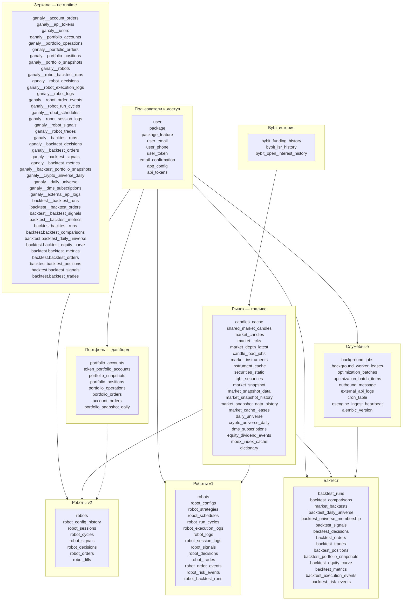
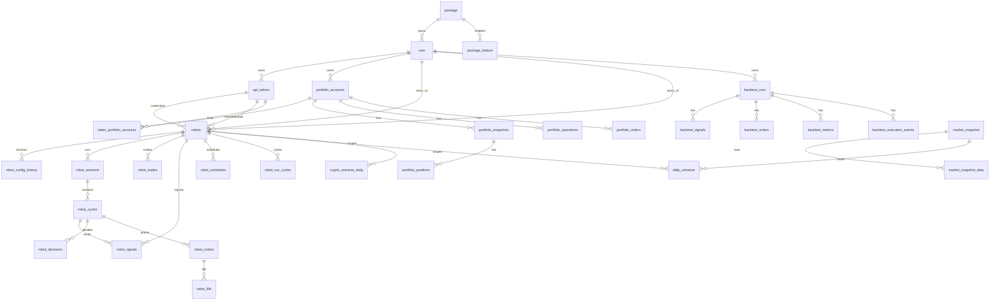

# Текущая база данных

Снимок **живой** локальной PostgreSQL `gin` на 2026-11-24. Это структура, а не выгрузка строк.

- Ревизия Alembic: `0088_user_contact_status`
- Таблиц: **128** (`public` 119, `backtest` 9)
- Колонок: **1668**
- Представлений: **1**
- Суммарный размер таблиц: **27 GB**

Число строк — оценка планировщика (`pg_class.reltuples`), не `COUNT(*)`. Размер — `pg_total_relation_size` (таблица и индексы).

Канон приложения — таблицы `public` без префикса `ganaly__` / `backtest__`. Зеркала и схема `backtest` остались после переноса облачной БД, см. [[manuals/db-cloud-to-local-migration]]. Audit роботов v2 подробнее в [[func/trades_tables]].

## Общая карта базы

Ниже — **карта доменов**, не полный ER на 128 таблиц. В Reading Mode Obsidian отрисует Mermaid. Цель: понять, *где что лежит и зачем*, а детали колонок — в разделах ниже.

### Зачем нам эти контуры

| Контур                | Зачем нужен                                                            | Главные таблицы                                                        |
| --------------------- | ---------------------------------------------------------------------- | ---------------------------------------------------------------------- |
| Пользователи и доступ | Аккаунты, пакеты, сессии входа, подтверждение почты                    | `user`, `package`, `user_token`, `email_confirmation`                  |
| Брокерские токены     | Подключение T-Invest / Bybit без хранения ключей в коде                | `api_tokens`, `token_portfolio_accounts`                               |
| Портфель              | Что видит пользователь на дашборде: счета, позиции, операции, заявки   | `portfolio_*`, `account_orders`                                        |
| Роботы v2             | Актуальный торговый контур: paper/live, audit сессия→цикл→ордер        | `robots`, `robots_v2_*`, `robot_config_history`                     |
| Роботы v1             | Legacy; живые данные ещё есть, новый код v2 сюда не пишет              | `robots`, `robot_trades`, `robot_*`                                    |
| Бэктест               | Прогоны стратегий, метрики, glass-box события                          | `backtest_runs`, `backtest_*`                                          |
| Рынок и справочники   | Свечи, снимки MOEX, вселенные, кэши — топливо роботов и бэктеста       | `candles_cache`, `shared_market_candles`, `market_*`, `daily_universe` |
| Bybit-история         | Funding / OI / LSR для крипто-стратегий                                | `bybit_*_history`                                                      |
| Служебные             | Очередь воркеров, почта, cron, лизы кэша                               | `background_jobs`, `outbound_message`, `cron_table`                    |
| Зеркала облака        | Артефакт переноса `ganaly`/`backtest` → local; приложение их не читает | `ganaly__*`, `backtest__*`, схема `backtest`                           |

### Поток данных (с высоты)

Каждый контур ниже называет **все** свои таблицы. Стрелки — кто от кого зависит. Зеркала в поток не входят: приложение их не читает. Колонки — в карточках дальше по заметке.



### Ядро связей (канон)

Упрощённый ER: только сущности, через которые сшиты остальные таблицы. Полные FK — в разделе ниже и в карточках таблиц.



### Как читать «где что»

1. **Вход пользователя** — `user` + `package` + `user_token` / `email_confirmation`. Без этого нет мультитенантности.
2. **Доступ к брокеру** — `api_tokens` (секрет) и `token_portfolio_accounts` (какой счёт виден под токеном).
3. **Деньги на экране** — дерево `portfolio_accounts` → snapshots / positions / operations / orders. Это UI портфеля, не audit робота.
4. **Торговля сейчас** — `robots` и audit `sessions → cycles → orders/fills`. Это источник правды для монитора v2 ([[func/trades_tables]]).
5. **Торговля раньше** — `robots` / `robot_*`. Держим, пока не вычистим legacy и зеркала.
6. **Идеи до live** — `backtest_runs` и дети; тяжёлые прогоны идут через `background_jobs`.
7. **Данные рынка** — самые тяжёлые таблицы (`market_snapshot_data_history`, `candles_cache`). Без них робот и бэктест слепы.
8. **Не путать с каноном** — `ganaly__*`, `backtest__*`, схема `backtest`: копии с облака после миграции, для отката/сверки, не для runtime.

### Оглавление деталей

- [[#Пользователи, пакеты и токены]] — 9 табл.
- [[#Портфель и заявки]] — 7 табл.
- [[#Роботы v2]] — 8 табл.
- [[#Роботы v1]] — 14 табл.
- [[#Бэктест]] — 15 табл.
- [[#Рынок и справочники]] — 21 табл.
- [[#Bybit]] — 3 табл.
- [[#Служебные]] — 9 табл.
- [[#Зеркала облака (ganaly__)]] — 29 табл.
- [[#Зеркала облака (backtest__)]] — 4 табл.
- [[#Схема backtest (legacy)]] — 9 табл.
- [[#Представления]] — `public.portfolio_snapshot_daily`

## Крупнейшие таблицы

| Таблица | Оценка строк | Размер |
|---|---:|---:|
| `public.market_snapshot_data_history` | 7 967 183 | 15.7 GB |
| `public.external_api_logs` | 4 059 752 | 3.9 GB |
| `public.candles_cache` | 4 036 395 | 1.3 GB |
| `public.robot_decisions` | 3 045 920 | 1.1 GB |
| `public.robot_session_logs` | 4 348 573 | 925.5 MB |
| `public.robot_cycles` | 2 988 870 | 841.5 MB |
| `public.ganaly__external_api_logs` | 1 573 975 | 770.9 MB |
| `public.ganaly__robot_session_logs` | 4 336 954 | 593.5 MB |
| `public.market_candles` | 1 171 571 | 408.7 MB |
| `public.backtest_signals` | 1 401 386 | 406.9 MB |
| `public.ganaly__backtest_signals` | 1 395 015 | 340.6 MB |
| `public.market_snapshot_data` | 2 046 | 326.5 MB |

## Внешние ключи (канон)

| Таблица | Ограничение |
|---|---|
| `account_orders` | `FOREIGN KEY (portfolio_account_id) REFERENCES portfolio_accounts(id) ON DELETE CASCADE` |
| `account_orders` | `FOREIGN KEY (robot_id) REFERENCES robots(id) ON DELETE SET NULL` |
| `api_tokens` | `FOREIGN KEY (user_id) REFERENCES "user"(id) ON DELETE CASCADE` |
| `backtest_decisions` | `FOREIGN KEY (run_id) REFERENCES backtest_runs(id) ON DELETE CASCADE` |
| `backtest_execution_events` | `FOREIGN KEY (run_id) REFERENCES backtest_runs(id) ON DELETE CASCADE` |
| `backtest_metrics` | `FOREIGN KEY (run_id) REFERENCES backtest_runs(id) ON DELETE CASCADE` |
| `backtest_orders` | `FOREIGN KEY (run_id) REFERENCES backtest_runs(id) ON DELETE CASCADE` |
| `backtest_portfolio_snapshots` | `FOREIGN KEY (run_id) REFERENCES backtest_runs(id) ON DELETE CASCADE` |
| `backtest_risk_events` | `FOREIGN KEY (run_id) REFERENCES backtest_runs(id) ON DELETE CASCADE` |
| `backtest_runs` | `FOREIGN KEY (user_id) REFERENCES "user"(id) ON DELETE SET NULL` |
| `backtest_signals` | `FOREIGN KEY (run_id) REFERENCES backtest_runs(id) ON DELETE CASCADE` |
| `backtest_universe_membership` | `FOREIGN KEY (run_id) REFERENCES backtest_runs(id) ON DELETE CASCADE` |
| `crypto_universe_daily` | `FOREIGN KEY (robot_id) REFERENCES robots(id) ON DELETE CASCADE` |
| `daily_universe` | `FOREIGN KEY (robot_id) REFERENCES robots(id) ON DELETE CASCADE` |
| `daily_universe` | `FOREIGN KEY (snapshot_id) REFERENCES market_snapshot(id) ON DELETE SET NULL` |
| `dms_subscriptions` | `FOREIGN KEY (robot_id) REFERENCES robots(id) ON DELETE CASCADE` |
| `dms_subscriptions` | `FOREIGN KEY (snapshot_id) REFERENCES market_snapshot(id) ON DELETE SET NULL` |
| `external_api_logs` | `FOREIGN KEY (user_id) REFERENCES "user"(id) ON DELETE SET NULL` |
| `market_snapshot_data` | `FOREIGN KEY (snapshot_id) REFERENCES market_snapshot(id) ON DELETE CASCADE` |
| `optimization_batch_items` | `FOREIGN KEY (batch_id) REFERENCES optimization_batches(id) ON DELETE CASCADE` |
| `outbound_message` | `FOREIGN KEY (user_id) REFERENCES "user"(id) ON DELETE SET NULL` |
| `outbound_message` | `FOREIGN KEY (email_id) REFERENCES user_email(id) ON DELETE SET NULL` |
| `outbound_message` | `FOREIGN KEY (phone_id) REFERENCES user_phone(id) ON DELETE SET NULL` |
| `package_feature` | `FOREIGN KEY (package_id) REFERENCES package(id) ON DELETE CASCADE` |
| `portfolio_accounts` | `FOREIGN KEY (user_id) REFERENCES "user"(id) ON DELETE CASCADE` |
| `portfolio_operations` | `FOREIGN KEY (account_id) REFERENCES portfolio_accounts(id) ON DELETE CASCADE` |
| `portfolio_orders` | `FOREIGN KEY (account_id) REFERENCES portfolio_accounts(id) ON DELETE CASCADE` |
| `portfolio_positions` | `FOREIGN KEY (snapshot_id) REFERENCES portfolio_snapshots(id) ON DELETE CASCADE` |
| `portfolio_snapshots` | `FOREIGN KEY (account_id) REFERENCES portfolio_accounts(id) ON DELETE CASCADE` |
| `robot_backtest_runs` | `FOREIGN KEY (robot_id) REFERENCES robots(id) ON DELETE CASCADE` |
| `robot_config_history` | `FOREIGN KEY (robot_id) REFERENCES robots(id) ON DELETE CASCADE` |
| `robot_decisions` | `FOREIGN KEY (cycle_id) REFERENCES robot_run_cycles(id) ON DELETE SET NULL` |
| `robot_decisions` | `FOREIGN KEY (execution_log_id) REFERENCES robot_execution_logs(id) ON DELETE SET NULL` |
| `robot_decisions` | `FOREIGN KEY (robot_id) REFERENCES robots(id) ON DELETE CASCADE` |
| `robot_execution_logs` | `FOREIGN KEY (robot_id) REFERENCES robots(id) ON DELETE CASCADE` |
| `robot_execution_logs` | `FOREIGN KEY (strategy_id) REFERENCES robot_strategies(id) ON DELETE SET NULL` |
| `robot_logs` | `FOREIGN KEY (execution_log_id) REFERENCES robot_execution_logs(id) ON DELETE SET NULL` |
| `robot_logs` | `FOREIGN KEY (robot_id) REFERENCES robots(id) ON DELETE CASCADE` |
| `robot_logs` | `FOREIGN KEY (token_id) REFERENCES api_tokens(id) ON DELETE SET NULL` |
| `robot_logs` | `FOREIGN KEY (user_id) REFERENCES "user"(id) ON DELETE SET NULL` |
| `robot_order_events` | `FOREIGN KEY (robot_id) REFERENCES robots(id) ON DELETE CASCADE` |
| `robot_order_events` | `FOREIGN KEY (trade_id) REFERENCES robot_trades(id) ON DELETE SET NULL` |
| `robot_run_cycles` | `FOREIGN KEY (execution_log_id) REFERENCES robot_execution_logs(id) ON DELETE SET NULL` |
| `robot_run_cycles` | `FOREIGN KEY (robot_id) REFERENCES robots(id) ON DELETE CASCADE` |
| `robot_schedules` | `FOREIGN KEY (robot_id) REFERENCES robots(id) ON DELETE CASCADE` |
| `robot_session_logs` | `FOREIGN KEY (robot_id) REFERENCES robots(id) ON DELETE CASCADE` |
| `robot_signals` | `FOREIGN KEY (executed_trade_id) REFERENCES robot_trades(id) ON DELETE SET NULL` |
| `robot_signals` | `FOREIGN KEY (robot_id) REFERENCES robots(id) ON DELETE CASCADE` |
| `robot_strategies` | `FOREIGN KEY (robot_id) REFERENCES robots(id) ON DELETE CASCADE` |
| `robot_trades` | `FOREIGN KEY (robot_id) REFERENCES robots(id) ON DELETE CASCADE` |
| `robots` | `FOREIGN KEY (token_id) REFERENCES api_tokens(id) ON DELETE SET NULL` |
| `robots` | `FOREIGN KEY (user_id) REFERENCES "user"(id) ON DELETE CASCADE` |
| `robots` | `FOREIGN KEY (token_id) REFERENCES api_tokens(id) ON DELETE SET NULL` |
| `robots` | `FOREIGN KEY (user_id) REFERENCES "user"(id) ON DELETE CASCADE` |
| `robot_cycles` | `FOREIGN KEY (robot_id) REFERENCES robots(id) ON DELETE CASCADE` |
| `robot_cycles` | `FOREIGN KEY (session_id) REFERENCES robot_sessions(id) ON DELETE CASCADE` |
| `robot_decisions` | `FOREIGN KEY (cycle_id) REFERENCES robot_cycles(id) ON DELETE CASCADE` |
| `robot_decisions` | `FOREIGN KEY (robot_id) REFERENCES robots(id) ON DELETE CASCADE` |
| `robot_fills` | `FOREIGN KEY (order_id) REFERENCES robot_orders(id) ON DELETE CASCADE` |
| `robot_fills` | `FOREIGN KEY (robot_id) REFERENCES robots(id) ON DELETE CASCADE` |
| `robot_orders` | `FOREIGN KEY (cycle_id) REFERENCES robot_cycles(id) ON DELETE CASCADE` |
| `robot_orders` | `FOREIGN KEY (robot_id) REFERENCES robots(id) ON DELETE CASCADE` |
| `robot_sessions` | `FOREIGN KEY (robot_id) REFERENCES robots(id) ON DELETE CASCADE` |
| `robot_signals` | `FOREIGN KEY (cycle_id) REFERENCES robot_cycles(id) ON DELETE CASCADE` |
| `robot_signals` | `FOREIGN KEY (robot_id) REFERENCES robots(id) ON DELETE CASCADE` |
| `token_portfolio_accounts` | `FOREIGN KEY (portfolio_account_id) REFERENCES portfolio_accounts(id) ON DELETE CASCADE` |
| `token_portfolio_accounts` | `FOREIGN KEY (token_id) REFERENCES api_tokens(id) ON DELETE CASCADE` |
| `user` | `FOREIGN KEY (package_code) REFERENCES package(id)` |
| `user_email` | `FOREIGN KEY (user_id) REFERENCES "user"(id) ON DELETE CASCADE` |
| `user_phone` | `FOREIGN KEY (user_id) REFERENCES "user"(id) ON DELETE CASCADE` |
| `user_token` | `FOREIGN KEY (user_id) REFERENCES "user"(id) ON DELETE CASCADE` |

Всего FK в каноническом `public`: **71**.

## Пользователи, пакеты и токены

| Таблица | Колонок | Оценка строк | Размер |
|---|---:|---:|---:|
| `public.api_tokens` | 15 | 11 | 192.0 KB |
| `public.app_config` | 3 | 0 | 32.0 KB |
| `public.email_confirmation` | 10 | 3 | 80.0 KB |
| `public.package` | 7 | 0 | 40.0 KB |
| `public.package_feature` | 8 | 0 | 88.0 KB |
| `public.user` | 5 | 3 | 56.0 KB |
| `public.user_email` | 6 | 0 | 40.0 KB |
| `public.user_phone` | 6 | 0 | 40.0 KB |
| `public.user_token` | 12 | 793 | 704.0 KB |

### public.api_tokens

Токены брокеров (T-Invest, Bybit) пользователя. Оценка строк 11, размер 192.0 KB.

| Колонка | Тип | NULL | По умолчанию |
|---|---|---|---|
| `id` | `bigint` | нет | `nextval('api_tokens_id_seq'::regclass)` |
| `user_id` | `bigint` | нет |  |
| `token` | `text` | нет |  |
| `token_type` | `integer` | нет |  |
| `name` | `character varying(100)` | да |  |
| `created_at` | `timestamp with time zone` | нет | `CURRENT_TIMESTAMP` |
| `modification_date` | `timestamp with time zone` | да |  |
| `expires_at` | `timestamp with time zone` | да |  |
| `last_used_at` | `timestamp with time zone` | да |  |
| `extra_data` | `jsonb` | да |  |
| `status` | `integer` | нет | `1` |
| `last_error` | `text` | да |  |
| `last_error_at` | `timestamp with time zone` | да |  |
| `token_secret` | `text` | да |  |
| `usercre` | `character varying(128)` | да |  |
| `usermod` | `character varying(128)` | да |  |

**Первичный ключ:** `PRIMARY KEY (id)`

**Внешние ключи:**

- `FOREIGN KEY (user_id) REFERENCES "user"(id) ON DELETE CASCADE`

**Индексы:**

- `ix_api_tokens_token_type` — `btree (token_type)`
- `ix_api_tokens_user_id` — `btree (user_id)`

### public.app_config

Ключ-значение настроек приложения. Оценка строк 0, размер 32.0 KB.

| Колонка | Тип | NULL | По умолчанию |
|---|---|---|---|
| `key` | `character varying(128)` | нет |  |
| `value` | `character varying(512)` | нет |  |
| `description` | `character varying(1024)` | да |  |

**Первичный ключ:** `PRIMARY KEY (key)`

### public.email_confirmation

Коды подтверждения почты и сброса доступа. Оценка строк 3, размер 80.0 KB.

| Колонка | Тип | NULL | По умолчанию |
|---|---|---|---|
| `id` | `bigint` | нет | `nextval('email_confirmation_id_seq'::regclass)` |
| `email` | `character varying(128)` | нет |  |
| `purpose` | `character varying(32)` | нет | `'register'::character varying` |
| `code_hash` | `character varying(64)` | нет |  |
| `password_hash` | `character varying(255)` | нет |  |
| `attempts` | `integer` | нет | `0` |
| `expires_at` | `timestamp with time zone` | нет |  |
| `created_at` | `timestamp with time zone` | нет |  |
| `last_sent_at` | `timestamp with time zone` | нет |  |
| `login` | `character varying(128)` | да |  |

**Первичный ключ:** `PRIMARY KEY (id)`

**Уникальность:** `UNIQUE (email, purpose)`

**Индексы:**

- `email_confirmation_email_purpose` — UNIQUE `btree (email, purpose)`

### public.package

Тарифный пакет. Оценка строк 0, размер 40.0 KB.

| Колонка | Тип | NULL | По умолчанию |
|---|---|---|---|
| `id` | `bigint` | нет | `nextval('package_id_seq'::regclass)` |
| `name` | `character varying(128)` | нет |  |
| `status` | `integer` | нет | `1` |
| `usercre` | `character varying(128)` | да |  |
| `date_creation` | `timestamp with time zone` | нет | `CURRENT_TIMESTAMP` |
| `usermod` | `character varying(128)` | да |  |
| `date_modification` | `timestamp with time zone` | да |  |

**Первичный ключ:** `PRIMARY KEY (id)`

**Индексы:**

- `ix_package_status` — `btree (status)`

### public.package_feature

Флаги возможностей пакета. Оценка строк 0, размер 88.0 KB.

| Колонка | Тип | NULL | По умолчанию |
|---|---|---|---|
| `id` | `bigint` | нет | `nextval('package_feature_id_seq'::regclass)` |
| `package_id` | `bigint` | нет |  |
| `feature` | `character varying(64)` | нет |  |
| `status` | `integer` | нет | `0` |
| `usercre` | `character varying(128)` | да |  |
| `date_creation` | `timestamp with time zone` | нет | `CURRENT_TIMESTAMP` |
| `usermod` | `character varying(128)` | да |  |
| `date_modification` | `timestamp with time zone` | да |  |

**Первичный ключ:** `PRIMARY KEY (id)`

**Уникальность:** `UNIQUE (package_id, feature)`

**Внешние ключи:**

- `FOREIGN KEY (package_id) REFERENCES package(id) ON DELETE CASCADE`

**Индексы:**

- `ix_package_feature_feature` — `btree (feature)`
- `ix_package_feature_package_id` — `btree (package_id)`
- `ix_package_feature_status` — `btree (status)`
- `uq_package_feature_package_feature` — UNIQUE `btree (package_id, feature)`

### public.user

Учётная запись приложения. Оценка строк 3, размер 56.0 KB.

| Колонка | Тип | NULL | По умолчанию |
|---|---|---|---|
| `id` | `bigint` | нет | `nextval('user_id_seq'::regclass)` |
| `login` | `character varying(128)` | нет |  |
| `password_hash` | `character varying(255)` | нет |  |
| `status` | `integer` | нет | `1` |
| `date_creation` | `timestamp with time zone` | нет | `CURRENT_TIMESTAMP` |
| `package_code` | `bigint` | нет | `1` |
| `usercre` | `character varying(128)` | да |  |
| `usermod` | `character varying(128)` | да |  |
| `date_modification` | `date` | да |  |

**Первичный ключ:** `PRIMARY KEY (id)`

**Уникальность:** `UNIQUE (login)`

**Внешние ключи:**

- `FOREIGN KEY (package_code) REFERENCES package(id)`

**Индексы:**

- `ix_user_package_code` — `btree (package_code)`
- `ix_user_status` — `btree (status)`
- `user_login_key` — UNIQUE `btree (login)`

Словарь: `USER.STATUS` — `0=off`, `1=on`.

### public.user_email

Почта пользователя. Оценка строк 0, размер 40.0 KB.

| Колонка | Тип | NULL | По умолчанию |
|---|---|---|---|
| `id` | `bigint` | нет | `nextval('user_email_id_seq'::regclass)` |
| `user_id` | `bigint` | нет |  |
| `email` | `character varying(255)` | нет |  |
| `is_primary` | `boolean` | нет | `true` |
| `creation_date` | `timestamp with time zone` | нет | `CURRENT_TIMESTAMP` |
| `usercre` | `character varying(128)` | да |  |
| `usermod` | `character varying(128)` | да |  |
| `modification_date` | `timestamp with time zone` | да |  |

**Первичный ключ:** `PRIMARY KEY (id)`

**Уникальность:** `UNIQUE (user_id, email)`

**Внешние ключи:**

- `FOREIGN KEY (user_id) REFERENCES "user"(id) ON DELETE CASCADE`

**Индексы:**

- `uq_user_email_user_email` — UNIQUE `btree (user_id, email)`

### public.user_phone

Телефон пользователя. Оценка строк 0, размер 40.0 KB.

| Колонка | Тип | NULL | По умолчанию |
|---|---|---|---|
| `id` | `bigint` | нет | `nextval('user_phone_id_seq'::regclass)` |
| `user_id` | `bigint` | нет |  |
| `phone` | `character varying(32)` | нет |  |
| `is_primary` | `boolean` | нет | `true` |
| `creation_date` | `timestamp with time zone` | нет | `CURRENT_TIMESTAMP` |
| `usercre` | `character varying(128)` | да |  |
| `usermod` | `character varying(128)` | да |  |
| `modification_date` | `timestamp with time zone` | да |  |

**Первичный ключ:** `PRIMARY KEY (id)`

**Уникальность:** `UNIQUE (user_id, phone)`

**Внешние ключи:**

- `FOREIGN KEY (user_id) REFERENCES "user"(id) ON DELETE CASCADE`

**Индексы:**

- `uq_user_phone_user_phone` — UNIQUE `btree (user_id, phone)`

### public.user_token

Сессии входа (refresh / метаданные клиента). Оценка строк 793, размер 704.0 KB.

| Колонка | Тип | NULL | По умолчанию |
|---|---|---|---|
| `id` | `bigint` | нет | `nextval('user_token_id_seq'::regclass)` |
| `user_id` | `bigint` | нет |  |
| `token` | `text` | нет |  |
| `status` | `integer` | нет | `1` |
| `created_at` | `timestamp with time zone` | нет | `CURRENT_TIMESTAMP` |
| `expires_at` | `timestamp with time zone` | нет |  |
| `invalidated_at` | `timestamp with time zone` | да |  |
| `ip` | `character varying(45)` | да |  |
| `user_agent` | `text` | да |  |
| `device_label` | `character varying(128)` | да |  |
| `geo_label` | `character varying(255)` | да |  |
| `last_seen_at` | `timestamp with time zone` | да |  |

**Первичный ключ:** `PRIMARY KEY (id)`

**Уникальность:** `UNIQUE (token)`

**Внешние ключи:**

- `FOREIGN KEY (user_id) REFERENCES "user"(id) ON DELETE CASCADE`

**Индексы:**

- `ix_user_token_user_status` — `btree (user_id, status)`
- `user_token_token_key` — UNIQUE `btree (token)`

## Портфель и заявки

| Таблица | Колонок | Оценка строк | Размер |
|---|---:|---:|---:|
| `public.account_orders` | 15 | 0 | 88.0 KB |
| `public.portfolio_accounts` | 15 | 10 | 104.0 KB |
| `public.portfolio_operations` | 22 | 16 992 | 14.2 MB |
| `public.portfolio_orders` | 18 | 103 | 144.0 KB |
| `public.portfolio_positions` | 23 | 75 658 | 19.2 MB |
| `public.portfolio_snapshots` | 16 | 66 026 | 12.6 MB |
| `public.token_portfolio_accounts` | 7 | 15 | 104.0 KB |

### public.account_orders

Журнал заявок счёта. Оценка строк 0, размер 88.0 KB.

| Колонка | Тип | NULL | По умолчанию |
|---|---|---|---|
| `id` | `bigint` | нет | `nextval('account_orders_id_seq'::regclass)` |
| `portfolio_account_id` | `bigint` | нет |  |
| `robot_id` | `bigint` | да |  |
| `order_id` | `character varying(120)` | да |  |
| `client_order_id` | `character varying(120)` | да |  |
| `figi` | `character varying(32)` | нет |  |
| `side` | `character varying(10)` | нет |  |
| `quantity` | `numeric(20,4)` | нет |  |
| `price` | `numeric(20,4)` | да |  |
| `filled_quantity` | `numeric(20,4)` | да |  |
| `avg_fill_price` | `numeric(20,4)` | да |  |
| `status` | `character varying(32)` | нет | `'pending'::character varying` |
| `order_type` | `character varying(16)` | нет |  |
| `created_at` | `timestamp with time zone` | нет | `CURRENT_TIMESTAMP` |
| `updated_at` | `timestamp with time zone` | да |  |

**Первичный ключ:** `PRIMARY KEY (id)`

**Внешние ключи:**

- `FOREIGN KEY (portfolio_account_id) REFERENCES portfolio_accounts(id) ON DELETE CASCADE`
- `FOREIGN KEY (robot_id) REFERENCES robots(id) ON DELETE SET NULL`

**Индексы:**

- `ix_account_orders_account_created` — `btree (portfolio_account_id, created_at DESC)`
- `ix_account_orders_account_status` — `btree (portfolio_account_id, status)`
- `ix_account_orders_robot_created` — `btree (robot_id, created_at DESC)`
- `uq_account_orders_account_order_id` — UNIQUE `btree (portfolio_account_id, order_id) WHERE (order_id IS NOT NULL)`

### public.portfolio_accounts

Брокерские счета, подключённые к портфелю. Оценка строк 10, размер 104.0 KB.

| Колонка | Тип | NULL | По умолчанию |
|---|---|---|---|
| `id` | `bigint` | нет | `nextval('portfolio_accounts_id_seq'::regclass)` |
| `user_id` | `bigint` | нет |  |
| `account_id` | `character varying(50)` | нет |  |
| `account_type` | `character varying(50)` | нет |  |
| `account_name` | `character varying(255)` | да |  |
| `account_status` | `character varying(50)` | нет |  |
| `opened_date` | `timestamp with time zone` | да |  |
| `closed_date` | `timestamp with time zone` | да |  |
| `access_level` | `character varying(50)` | да |  |
| `is_active` | `integer` | нет | `1` |
| `last_sync_at` | `timestamp with time zone` | да |  |
| `created_at` | `timestamp with time zone` | нет | `CURRENT_TIMESTAMP` |
| `updated_at` | `timestamp with time zone` | да |  |
| `last_token_id` | `bigint` | да |  |
| `dashboard_hidden` | `integer` | нет | `0` |

**Первичный ключ:** `PRIMARY KEY (id)`

**Уникальность:** `UNIQUE (user_id, account_id)`

**Внешние ключи:**

- `FOREIGN KEY (user_id) REFERENCES "user"(id) ON DELETE CASCADE`

**Индексы:**

- `ix_portfolio_accounts_last_token_id` — `btree (last_token_id)`
- `ix_portfolio_accounts_user_account` — `btree (user_id, account_id)`
- `uq_user_account` — UNIQUE `btree (user_id, account_id)`

### public.portfolio_operations

Брокерские операции (сделки, комиссии, вводы). Оценка строк 16 992, размер 14.2 MB.

| Колонка | Тип | NULL | По умолчанию |
|---|---|---|---|
| `id` | `bigint` | нет | `nextval('portfolio_operations_id_seq'::regclass)` |
| `account_id` | `bigint` | нет |  |
| `operation_id` | `character varying(120)` | нет |  |
| `parent_operation_id` | `character varying(50)` | да |  |
| `figi` | `character varying(20)` | да |  |
| `instrument_type` | `character varying(30)` | да |  |
| `instrument_uid` | `character varying(50)` | да |  |
| `position_uid` | `character varying(50)` | да |  |
| `operation_type` | `character varying(50)` | нет |  |
| `operation_date` | `timestamp with time zone` | нет |  |
| `quantity` | `numeric(20,4)` | нет |  |
| `quantity_rest` | `numeric(20,4)` | да |  |
| `price` | `numeric(20,4)` | нет |  |
| `price_currency` | `character varying(10)` | нет |  |
| `payment` | `numeric(20,4)` | нет |  |
| `payment_currency` | `character varying(10)` | нет |  |
| `commission` | `numeric(20,4)` | да |  |
| `commission_currency` | `character varying(10)` | да |  |
| `status` | `character varying(128)` | нет |  |
| `trades` | `json` | да |  |
| `extra_data` | `json` | да |  |
| `created_at` | `timestamp with time zone` | нет | `CURRENT_TIMESTAMP` |

**Первичный ключ:** `PRIMARY KEY (id)`

**Уникальность:** `UNIQUE (operation_id)`

**Внешние ключи:**

- `FOREIGN KEY (account_id) REFERENCES portfolio_accounts(id) ON DELETE CASCADE`

**Индексы:**

- `ix_portfolio_operations_account_date` — `btree (account_id, operation_date)`
- `ix_portfolio_operations_figi` — `btree (figi)`
- `ix_portfolio_operations_operation_id` — `btree (operation_id)`
- `portfolio_operations_operation_id_key` — UNIQUE `btree (operation_id)`

### public.portfolio_orders

Заявки, увиденные со стороны портфеля. Оценка строк 103, размер 144.0 KB.

| Колонка | Тип | NULL | По умолчанию |
|---|---|---|---|
| `id` | `bigint` | нет | `nextval('portfolio_orders_id_seq'::regclass)` |
| `account_id` | `bigint` | нет |  |
| `order_id` | `character varying(120)` | нет |  |
| `figi` | `character varying(32)` | да |  |
| `instrument_uid` | `character varying(50)` | да |  |
| `order_type` | `character varying(30)` | нет |  |
| `order_direction` | `character varying(20)` | нет |  |
| `order_date` | `timestamp with time zone` | нет |  |
| `lots_requested` | `numeric(20,4)` | нет |  |
| `lots_executed` | `numeric(20,4)` | да |  |
| `price` | `numeric(20,4)` | да |  |
| `execution_price` | `numeric(20,4)` | да |  |
| `status` | `character varying(30)` | нет |  |
| `commission` | `numeric(20,4)` | да |  |
| `commission_currency` | `character varying(10)` | да |  |
| `extra_data` | `json` | да |  |
| `created_at` | `timestamp with time zone` | нет | `CURRENT_TIMESTAMP` |
| `reason` | `character varying(64)` | да |  |

**Первичный ключ:** `PRIMARY KEY (id)`

**Внешние ключи:**

- `FOREIGN KEY (account_id) REFERENCES portfolio_accounts(id) ON DELETE CASCADE`

**Индексы:**

- `ix_portfolio_orders_account_date` — `btree (account_id, order_date)`
- `ix_portfolio_orders_account_status` — `btree (account_id, status)`
- `uq_portfolio_orders_account_order_id` — UNIQUE `btree (account_id, order_id)`

### public.portfolio_positions

Позиции счёта на момент снимка. Оценка строк 75 658, размер 19.2 MB.

| Колонка | Тип | NULL | По умолчанию |
|---|---|---|---|
| `id` | `bigint` | нет | `nextval('portfolio_positions_id_seq'::regclass)` |
| `snapshot_id` | `bigint` | нет |  |
| `figi` | `character varying(20)` | да |  |
| `instrument_uid` | `character varying(50)` | да |  |
| `position_uid` | `character varying(50)` | да |  |
| `ticker` | `character varying(50)` | да |  |
| `class_code` | `character varying(20)` | да |  |
| `instrument_type` | `character varying(30)` | нет |  |
| `quantity` | `numeric(20,4)` | нет |  |
| `quantity_lots` | `numeric(20,4)` | да |  |
| `average_position_price` | `numeric(20,4)` | да |  |
| `average_position_price_fifo` | `numeric(20,4)` | да |  |
| `current_price` | `numeric(20,4)` | да |  |
| `average_position_price_pt` | `numeric(20,4)` | да |  |
| `expected_yield` | `numeric(10,4)` | да |  |
| `expected_yield_fifo` | `numeric(10,4)` | да |  |
| `daily_yield` | `numeric(20,4)` | да |  |
| `var_margin` | `numeric(20,4)` | да |  |
| `current_nkd` | `numeric(20,4)` | да |  |
| `blocked` | `integer` | нет | `0` |
| `blocked_lots` | `numeric(20,4)` | да |  |
| `extra_data` | `json` | да |  |
| `created_at` | `timestamp with time zone` | нет | `CURRENT_TIMESTAMP` |

**Первичный ключ:** `PRIMARY KEY (id)`

**Внешние ключи:**

- `FOREIGN KEY (snapshot_id) REFERENCES portfolio_snapshots(id) ON DELETE CASCADE`

**Индексы:**

- `ix_portfolio_positions_figi` — `btree (figi)`
- `ix_portfolio_positions_snapshot` — `btree (snapshot_id)`
- `ix_portfolio_positions_ticker` — `btree (ticker)`

### public.portfolio_snapshots

Снимки капитала счёта. Оценка строк 66 026, размер 12.6 MB.

| Колонка | Тип | NULL | По умолчанию |
|---|---|---|---|
| `id` | `bigint` | нет | `nextval('portfolio_snapshots_id_seq'::regclass)` |
| `account_id` | `bigint` | нет |  |
| `snapshot_date` | `timestamp with time zone` | нет | `CURRENT_TIMESTAMP` |
| `total_amount_portfolio` | `numeric(20,4)` | нет |  |
| `total_amount_shares` | `numeric(20,4)` | да |  |
| `total_amount_bonds` | `numeric(20,4)` | да |  |
| `total_amount_etf` | `numeric(20,4)` | да |  |
| `total_amount_currencies` | `numeric(20,4)` | да |  |
| `total_amount_futures` | `numeric(20,4)` | да |  |
| `total_amount_options` | `numeric(20,4)` | да |  |
| `total_amount_sp` | `numeric(20,4)` | да |  |
| `expected_yield` | `numeric(10,4)` | да |  |
| `daily_yield` | `numeric(20,4)` | да |  |
| `daily_yield_relative` | `numeric(10,4)` | да |  |
| `currency` | `character varying(10)` | нет | `'RUB'::character varying` |
| `created_at` | `timestamp with time zone` | нет | `CURRENT_TIMESTAMP` |

**Первичный ключ:** `PRIMARY KEY (id)`

**Внешние ключи:**

- `FOREIGN KEY (account_id) REFERENCES portfolio_accounts(id) ON DELETE CASCADE`

**Индексы:**

- `ix_portfolio_snapshots_account_date` — `btree (account_id, snapshot_date)`

### public.token_portfolio_accounts

Привязка брокерского счёта к API-токену и аудит. Оценка строк 15, размер 104.0 KB.

| Колонка | Тип | NULL | По умолчанию |
|---|---|---|---|
| `token_id` | `bigint` | нет |  |
| `portfolio_account_id` | `bigint` | нет |  |
| `date_creation` | `timestamp with time zone` | нет | `CURRENT_TIMESTAMP` |
| `id` | `bigint` | нет | `nextval('token_portfolio_accounts_id_seq'::regclass)` |
| `status` | `integer` | нет | `1` |
| `usercre` | `character varying(128)` | да |  |
| `usermod` | `character varying(128)` | да |  |
| `date_modification` | `timestamp with time zone` | да |  |

**Первичный ключ:** `PRIMARY KEY (id)`

**Уникальность:** `UNIQUE (token_id, portfolio_account_id)`.

**Внешние ключи:**

- `FOREIGN KEY (portfolio_account_id) REFERENCES portfolio_accounts(id) ON DELETE CASCADE`
- `FOREIGN KEY (token_id) REFERENCES api_tokens(id) ON DELETE CASCADE`

**Индексы:**

- `ix_token_portfolio_accounts_account` — `btree (portfolio_account_id)`
- `ix_token_portfolio_accounts_status` — `btree (status)`
- `uq_token_portfolio_accounts_token_account` — UNIQUE `btree (token_id, portfolio_account_id)`

## Роботы v2

| Таблица | Колонок | Оценка строк | Размер |
|---|---:|---:|---:|
| `public.robot_config_history` | 6 | 31 | 120.0 KB |
| `public.robots` | 16 | 10 | 152.0 KB |
| `public.robot_cycles` | 11 | 2 988 870 | 841.5 MB |
| `public.robot_decisions` | 10 | 3 045 920 | 1.1 GB |
| `public.robot_fills` | 11 | 2 492 | 808.0 KB |
| `public.robot_orders` | 14 | 6 120 | 2.8 MB |
| `public.robot_sessions` | 8 | 124 | 80.0 KB |
| `public.robot_signals` | 11 | 38 690 | 10.2 MB |

### public.robot_config_history

История версий конфига robots v2. Оценка строк 31, размер 120.0 KB.

| Колонка | Тип | NULL | По умолчанию |
|---|---|---|---|
| `id` | `uuid` | нет |  |
| `robot_id` | `bigint` | нет |  |
| `version` | `integer` | нет |  |
| `config` | `json` | нет |  |
| `created_by` | `bigint` | да |  |
| `created_at` | `timestamp with time zone` | нет | `CURRENT_TIMESTAMP` |

**Первичный ключ:** `PRIMARY KEY (id)`

**Внешние ключи:**

- `FOREIGN KEY (robot_id) REFERENCES robots(id) ON DELETE CASCADE`

**Индексы:**

- `ix_robot_config_history_robot_id` — `btree (robot_id)`
- `ix_robot_config_history_robot_version` — UNIQUE `btree (robot_id, version)`

### public.robots

Greenfield-робот: конфиг, статус, режим paper/live. Оценка строк 10, размер 152.0 KB.

| Колонка | Тип | NULL | По умолчанию |
|---|---|---|---|
| `id` | `bigint` | нет | `nextval('robots_v2_id_seq'::regclass)` |
| `name` | `character varying(50)` | нет |  |
| `user_id` | `bigint` | нет |  |
| `token_id` | `bigint` | да |  |
| `type` | `integer` | нет |  |
| `status` | `integer` | нет | `0` |
| `config_version` | `integer` | нет | `4` |
| `config` | `json` | нет | `'{}'::json` |
| `metadata` | `json` | нет | `'{}'::json` |
| `last_started` | `timestamp with time zone` | да |  |
| `last_error` | `text` | да |  |
| `last_error_at` | `timestamp with time zone` | да |  |
| `usercre` | `bigint` | да |  |
| `date_creation` | `timestamp with time zone` | нет | `CURRENT_TIMESTAMP` |
| `usermod` | `bigint` | да |  |
| `date_modification` | `timestamp with time zone` | да |  |

**Первичный ключ:** `PRIMARY KEY (id)`

**Внешние ключи:**

- `FOREIGN KEY (token_id) REFERENCES api_tokens(id) ON DELETE SET NULL`
- `FOREIGN KEY (user_id) REFERENCES "user"(id) ON DELETE CASCADE`

**Индексы:**

- `ix_robots_v2_status` — `btree (status)`
- `ix_robots_v2_token_id` — `btree (token_id)`
- `ix_robots_v2_type` — `btree (type)`
- `ix_robots_v2_user_id` — `btree (user_id)`

### public.robot_cycles

Торговый цикл внутри сессии v2. Оценка строк 2 988 870, размер 841.5 MB.

| Колонка | Тип | NULL | По умолчанию |
|---|---|---|---|
| `id` | `uuid` | нет |  |
| `session_id` | `uuid` | нет |  |
| `robot_id` | `bigint` | нет |  |
| `cycle_number` | `integer` | нет |  |
| `triggered_by` | `character varying(32)` | нет | `'poll'::character varying` |
| `started_at` | `timestamp with time zone` | нет |  |
| `finished_at` | `timestamp with time zone` | да |  |
| `status` | `character varying(16)` | нет | `'ok'::character varying` |
| `skip_reason` | `character varying(64)` | да |  |
| `equity` | `numeric(20,4)` | да |  |
| `stats` | `jsonb` | нет | `'{}'::jsonb` |

**Первичный ключ:** `PRIMARY KEY (id)`

**Внешние ключи:**

- `FOREIGN KEY (robot_id) REFERENCES robots(id) ON DELETE CASCADE`
- `FOREIGN KEY (session_id) REFERENCES robot_sessions(id) ON DELETE CASCADE`

**Индексы:**

- `ix_robot_cycles_robot_started` — `btree (robot_id, started_at)`
- `ix_robot_cycles_session_id` — `btree (session_id)`

### public.robot_decisions

Решения цикла v2 (вход, пропуск, риск). Оценка строк 3 045 920, размер 1.1 GB.

| Колонка | Тип | NULL | По умолчанию |
|---|---|---|---|
| `id` | `uuid` | нет |  |
| `cycle_id` | `uuid` | нет |  |
| `robot_id` | `bigint` | нет |  |
| `stage` | `character varying(32)` | нет |  |
| `outcome` | `character varying(16)` | нет |  |
| `code` | `character varying(64)` | нет |  |
| `message` | `text` | да |  |
| `ticker` | `character varying(32)` | да |  |
| `context` | `jsonb` | нет | `'{}'::jsonb` |
| `created_at` | `timestamp with time zone` | нет |  |

**Первичный ключ:** `PRIMARY KEY (id)`

**Внешние ключи:**

- `FOREIGN KEY (cycle_id) REFERENCES robot_cycles(id) ON DELETE CASCADE`
- `FOREIGN KEY (robot_id) REFERENCES robots(id) ON DELETE CASCADE`

**Индексы:**

- `ix_robot_decisions_cycle_id` — `btree (cycle_id)`
- `ix_robot_decisions_robot_created` — `btree (robot_id, created_at)`

### public.robot_fills

Исполнения заявок v2. Оценка строк 2 492, размер 808.0 KB.

| Колонка | Тип | NULL | По умолчанию |
|---|---|---|---|
| `id` | `uuid` | нет |  |
| `order_id` | `uuid` | нет |  |
| `robot_id` | `bigint` | нет |  |
| `ticker` | `character varying(32)` | нет |  |
| `side` | `character varying(8)` | нет |  |
| `quantity` | `numeric(20,4)` | нет |  |
| `price` | `numeric(20,6)` | нет |  |
| `pnl` | `numeric(20,6)` | да |  |
| `commission` | `numeric(20,6)` | да |  |
| `kind` | `character varying(32)` | нет |  |
| `filled_at` | `timestamp with time zone` | нет |  |

**Первичный ключ:** `PRIMARY KEY (id)`

**Внешние ключи:**

- `FOREIGN KEY (order_id) REFERENCES robot_orders(id) ON DELETE CASCADE`
- `FOREIGN KEY (robot_id) REFERENCES robots(id) ON DELETE CASCADE`

**Индексы:**

- `ix_robot_fills_order_id` — `btree (order_id)`
- `ix_robot_fills_robot_filled` — `btree (robot_id, filled_at)`

### public.robot_orders

Заявки, порождённые циклом v2. Оценка строк 6 120, размер 2.8 MB.

| Колонка | Тип | NULL | По умолчанию |
|---|---|---|---|
| `id` | `uuid` | нет |  |
| `cycle_id` | `uuid` | нет |  |
| `robot_id` | `bigint` | нет |  |
| `ticker` | `character varying(32)` | нет |  |
| `side` | `character varying(8)` | нет |  |
| `kind` | `character varying(32)` | нет |  |
| `quantity` | `numeric(20,4)` | нет |  |
| `price` | `numeric(20,6)` | да |  |
| `status` | `character varying(32)` | нет |  |
| `mode` | `character varying(16)` | нет |  |
| `broker_order_id` | `character varying(128)` | да |  |
| `reject_reason` | `text` | да |  |
| `submitted_at` | `timestamp with time zone` | нет |  |
| `order_type` | `character varying(16)` | нет | `'MARKET'::character varying` |

**Первичный ключ:** `PRIMARY KEY (id)`

**Внешние ключи:**

- `FOREIGN KEY (cycle_id) REFERENCES robot_cycles(id) ON DELETE CASCADE`
- `FOREIGN KEY (robot_id) REFERENCES robots(id) ON DELETE CASCADE`

**Индексы:**

- `ix_robot_orders_broker_order_id` — `btree (broker_order_id)`
- `ix_robot_orders_cycle_id` — `btree (cycle_id)`
- `ix_robot_orders_robot_submitted` — `btree (robot_id, submitted_at)`

### public.robot_sessions

Один запуск робота v2 от Start до Stop. Оценка строк 124, размер 80.0 KB.

| Колонка | Тип | NULL | По умолчанию |
|---|---|---|---|
| `id` | `uuid` | нет |  |
| `robot_id` | `bigint` | нет |  |
| `mode` | `character varying(16)` | нет |  |
| `virtual_capital` | `numeric(20,4)` | да |  |
| `account_id` | `character varying(64)` | да |  |
| `started_at` | `timestamp with time zone` | нет |  |
| `ended_at` | `timestamp with time zone` | да |  |
| `stop_reason` | `character varying(64)` | да |  |

**Первичный ключ:** `PRIMARY KEY (id)`

**Внешние ключи:**

- `FOREIGN KEY (robot_id) REFERENCES robots(id) ON DELETE CASCADE`

**Индексы:**

- `ix_robot_sessions_robot_started` — `btree (robot_id, started_at)`

### public.robot_signals

Сигналы цикла v2. Оценка строк 38 690, размер 10.2 MB.

| Колонка | Тип | NULL | По умолчанию |
|---|---|---|---|
| `id` | `uuid` | нет |  |
| `cycle_id` | `uuid` | нет |  |
| `robot_id` | `bigint` | нет |  |
| `ticker` | `character varying(32)` | нет |  |
| `side` | `character varying(8)` | нет |  |
| `kind` | `character varying(32)` | нет |  |
| `reason` | `text` | да |  |
| `price` | `numeric(20,6)` | да |  |
| `created_at` | `timestamp with time zone` | нет |  |
| `entry_price` | `numeric(20,6)` | да |  |
| `delta_pct` | `numeric(12,4)` | да |  |

**Первичный ключ:** `PRIMARY KEY (id)`

**Внешние ключи:**

- `FOREIGN KEY (cycle_id) REFERENCES robot_cycles(id) ON DELETE CASCADE`
- `FOREIGN KEY (robot_id) REFERENCES robots(id) ON DELETE CASCADE`

**Индексы:**

- `ix_robot_signals_cycle_id` — `btree (cycle_id)`

## Роботы v1

| Таблица | Колонок | Оценка строк | Размер |
|---|---:|---:|---:|
| `public.robot_backtest_runs` | 10 | 0 | 272.0 KB |
| `public.robot_configs` | 13 | 0 | 32.0 KB |
| `public.robot_decisions` | 11 | 129 233 | 63.9 MB |
| `public.robot_execution_logs` | 10 | 84 687 | 20.5 MB |
| `public.robot_logs` | 17 | 78 626 | 43.4 MB |
| `public.robot_order_events` | 8 | 0 | 40.0 KB |
| `public.robot_risk_events` | 8 | 0 | 32.0 KB |
| `public.robot_run_cycles` | 7 | 74 715 | 15.2 MB |
| `public.robot_schedules` | 14 | 68 | 112.0 KB |
| `public.robot_session_logs` | 6 | 4 348 573 | 925.5 MB |
| `public.robot_signals` | 11 | 0 | 56.0 KB |
| `public.robot_strategies` | 12 | 0 | 40.0 KB |
| `public.robot_trades` | 26 | 63 239 | 13.1 MB |
| `public.robots` | 15 | 18 | 152.0 KB |

### public.robot_backtest_runs

Прогоны бэктеста, привязанные к роботу v1. Оценка строк 0, размер 272.0 KB.

| Колонка | Тип | NULL | По умолчанию |
|---|---|---|---|
| `id` | `bigint` | нет | `nextval('robot_backtest_runs_id_seq'::regclass)` |
| `robot_id` | `bigint` | нет |  |
| `requested_from` | `timestamp with time zone` | нет |  |
| `requested_to` | `timestamp with time zone` | нет |  |
| `initial_capital` | `numeric(20,4)` | нет |  |
| `final_equity` | `numeric(20,4)` | нет |  |
| `total_return_percent` | `numeric(10,4)` | нет |  |
| `max_drawdown_percent` | `numeric(10,4)` | да |  |
| `result_payload` | `jsonb` | нет |  |
| `created_at` | `timestamp with time zone` | нет |  |

**Первичный ключ:** `PRIMARY KEY (id)`

**Внешние ключи:**

- `FOREIGN KEY (robot_id) REFERENCES robots(id) ON DELETE CASCADE`

**Индексы:**

- `ix_robot_backtest_runs_created_at` — `btree (created_at)`
- `ix_robot_backtest_runs_robot_id` — `btree (robot_id)`

### public.robot_configs

Конфиг робота v1. Оценка строк 0, размер 32.0 KB.

| Колонка | Тип | NULL | По умолчанию |
|---|---|---|---|
| `id` | `bigint` | нет | `nextval('robot_configs_id_seq'::regclass)` |
| `robot_type` | `integer` | нет |  |
| `config_key` | `character varying(100)` | нет |  |
| `config_value` | `json` | нет |  |
| `description` | `character varying(500)` | да |  |
| `is_required` | `integer` | нет | `0` |
| `usercre` | `bigint` | да |  |
| `date_creation` | `timestamp with time zone` | нет | `CURRENT_TIMESTAMP` |
| `usermod` | `bigint` | да |  |
| `date_modification` | `timestamp with time zone` | да |  |
| `validation_schema` | `json` | да |  |
| `display_order` | `integer` | нет | `0` |
| `config_group` | `character varying(50)` | да |  |

**Первичный ключ:** `PRIMARY KEY (id)`

**Индексы:**

- `ix_robot_configs_key` — `btree (config_key)`
- `ix_robot_configs_type` — `btree (robot_type)`

### public.robot_decisions

Решения v1. Оценка строк 129 233, размер 63.9 MB.

| Колонка | Тип | NULL | По умолчанию |
|---|---|---|---|
| `id` | `bigint` | нет | `nextval('robot_decisions_id_seq'::regclass)` |
| `robot_id` | `bigint` | нет |  |
| `execution_log_id` | `bigint` | да |  |
| `cycle_id` | `bigint` | да |  |
| `figi` | `character varying(20)` | да |  |
| `stage` | `character varying(50)` | нет |  |
| `decision_type` | `character varying(50)` | нет |  |
| `decision` | `character varying(50)` | нет |  |
| `reason_code` | `character varying(120)` | да |  |
| `payload` | `jsonb` | да |  |
| `created_at` | `timestamp with time zone` | нет |  |

**Первичный ключ:** `PRIMARY KEY (id)`

**Внешние ключи:**

- `FOREIGN KEY (cycle_id) REFERENCES robot_run_cycles(id) ON DELETE SET NULL`
- `FOREIGN KEY (execution_log_id) REFERENCES robot_execution_logs(id) ON DELETE SET NULL`
- `FOREIGN KEY (robot_id) REFERENCES robots(id) ON DELETE CASCADE`

**Индексы:**

- `ix_robot_decisions_created_at` — `btree (created_at)`
- `ix_robot_decisions_cycle_id` — `btree (cycle_id)`
- `ix_robot_decisions_robot_id` — `btree (robot_id)`

### public.robot_execution_logs

Журнал исполнения v1. Оценка строк 84 687, размер 20.5 MB.

| Колонка | Тип | NULL | По умолчанию |
|---|---|---|---|
| `id` | `bigint` | нет | `nextval('robot_execution_logs_id_seq'::regclass)` |
| `robot_id` | `bigint` | нет |  |
| `strategy_id` | `bigint` | да |  |
| `action_type` | `integer` | нет |  |
| `status` | `integer` | нет |  |
| `message` | `text` | да |  |
| `details` | `json` | да |  |
| `execution_time_ms` | `integer` | да |  |
| `error_stack` | `text` | да |  |
| `created_at` | `timestamp with time zone` | нет | `CURRENT_TIMESTAMP` |

**Первичный ключ:** `PRIMARY KEY (id)`

**Внешние ключи:**

- `FOREIGN KEY (robot_id) REFERENCES robots(id) ON DELETE CASCADE`
- `FOREIGN KEY (strategy_id) REFERENCES robot_strategies(id) ON DELETE SET NULL`

**Индексы:**

- `ix_robot_logs_action_type_1` — `btree (action_type)`
- `ix_robot_logs_created_at_1` — `btree (created_at)`
- `ix_robot_logs_robot_id_1` — `btree (robot_id)`
- `ix_robot_logs_status_1` — `btree (status)`

### public.robot_logs

Текстовые логи v1. Оценка строк 78 626, размер 43.4 MB.

| Колонка | Тип | NULL | По умолчанию |
|---|---|---|---|
| `id` | `bigint` | нет | `nextval('robot_logs_id_seq'::regclass)` |
| `robot_name` | `character varying(100)` | нет |  |
| `robot_version` | `character varying(20)` | да |  |
| `token_id` | `bigint` | да |  |
| `user_id` | `bigint` | да |  |
| `endpoint` | `character varying(500)` | нет |  |
| `request_data` | `json` | да |  |
| `response_status` | `integer` | да |  |
| `response_data` | `json` | да |  |
| `started_at` | `timestamp with time zone` | нет |  |
| `finished_at` | `timestamp with time zone` | да |  |
| `duration_ms` | `integer` | да |  |
| `success` | `integer` | нет | `1` |
| `error_message` | `text` | да |  |
| `created_at` | `timestamp with time zone` | нет | `CURRENT_TIMESTAMP` |
| `robot_id` | `bigint` | да |  |
| `execution_log_id` | `bigint` | да |  |

**Первичный ключ:** `PRIMARY KEY (id)`

**Внешние ключи:**

- `FOREIGN KEY (execution_log_id) REFERENCES robot_execution_logs(id) ON DELETE SET NULL`
- `FOREIGN KEY (robot_id) REFERENCES robots(id) ON DELETE CASCADE`
- `FOREIGN KEY (token_id) REFERENCES api_tokens(id) ON DELETE SET NULL`
- `FOREIGN KEY (user_id) REFERENCES "user"(id) ON DELETE SET NULL`

**Индексы:**

- `ix_robot_logs_created_at` — `btree (created_at)`
- `ix_robot_logs_execution_log_id` — `btree (execution_log_id)`
- `ix_robot_logs_robot_id` — `btree (robot_id)`
- `ix_robot_logs_robot_name` — `btree (robot_name)`
- `ix_robot_logs_started_at` — `btree (started_at)`
- `ix_robot_logs_success` — `btree (success)`
- `ix_robot_logs_token_id` — `btree (token_id)`
- `ix_robot_logs_user_id` — `btree (user_id)`

### public.robot_order_events

События заявок v1. Оценка строк 0, размер 40.0 KB.

| Колонка | Тип | NULL | По умолчанию |
|---|---|---|---|
| `id` | `bigint` | нет | `nextval('robot_order_events_id_seq'::regclass)` |
| `robot_id` | `bigint` | нет |  |
| `trade_id` | `bigint` | да |  |
| `order_id` | `character varying(120)` | да |  |
| `status` | `character varying(50)` | нет |  |
| `event_type` | `character varying(50)` | нет | `'status_update'::character varying` |
| `payload` | `jsonb` | да |  |
| `created_at` | `timestamp with time zone` | нет |  |

**Первичный ключ:** `PRIMARY KEY (id)`

**Внешние ключи:**

- `FOREIGN KEY (robot_id) REFERENCES robots(id) ON DELETE CASCADE`
- `FOREIGN KEY (trade_id) REFERENCES robot_trades(id) ON DELETE SET NULL`

**Индексы:**

- `ix_robot_order_events_created_at` — `btree (created_at)`
- `ix_robot_order_events_order_id` — `btree (order_id)`
- `ix_robot_order_events_robot_id` — `btree (robot_id)`

### public.robot_risk_events

События риска v1. Оценка строк 0, размер 32.0 KB.

| Колонка | Тип | NULL | По умолчанию |
|---|---|---|---|
| `id` | `bigint` | нет | `nextval('robot_risk_events_id_seq'::regclass)` |
| `robot_id` | `bigint` | нет |  |
| `ts` | `timestamp with time zone` | нет | `now()` |
| `secid` | `character varying(24)` | да |  |
| `figi` | `character varying(64)` | да |  |
| `signal_id` | `character varying(64)` | да |  |
| `reason_code` | `character varying(64)` | нет |  |
| `payload` | `jsonb` | нет | `'{}'::jsonb` |

**Первичный ключ:** `PRIMARY KEY (id)`

**Индексы:**

- `idx_robot_risk_events_reason` — `btree (robot_id, reason_code)`
- `idx_robot_risk_events_robot_ts` — `btree (robot_id, ts)`

### public.robot_run_cycles

Циклы прогона v1. Оценка строк 74 715, размер 15.2 MB.

| Колонка | Тип | NULL | По умолчанию |
|---|---|---|---|
| `id` | `bigint` | нет | `nextval('robot_run_cycles_id_seq'::regclass)` |
| `robot_id` | `bigint` | нет |  |
| `execution_log_id` | `bigint` | да |  |
| `status` | `character varying(20)` | нет | `'pending'::character varying` |
| `started_at` | `timestamp with time zone` | нет |  |
| `finished_at` | `timestamp with time zone` | да |  |
| `context` | `jsonb` | да |  |

**Первичный ключ:** `PRIMARY KEY (id)`

**Внешние ключи:**

- `FOREIGN KEY (execution_log_id) REFERENCES robot_execution_logs(id) ON DELETE SET NULL`
- `FOREIGN KEY (robot_id) REFERENCES robots(id) ON DELETE CASCADE`

**Индексы:**

- `ix_robot_run_cycles_exec_log_id` — `btree (execution_log_id)`
- `ix_robot_run_cycles_robot_id` — `btree (robot_id)`
- `ix_robot_run_cycles_started_at` — `btree (started_at)`

### public.robot_schedules

Расписание запусков v1. Оценка строк 68, размер 112.0 KB.

| Колонка | Тип | NULL | По умолчанию |
|---|---|---|---|
| `id` | `bigint` | нет | `nextval('robot_schedules_id_seq'::regclass)` |
| `robot_id` | `bigint` | нет |  |
| `schedule_type` | `integer` | нет |  |
| `interval_seconds` | `integer` | да |  |
| `start_time` | `time with time zone` | да |  |
| `end_time` | `time with time zone` | да |  |
| `weekdays` | `integer` | да |  |
| `is_active` | `integer` | нет | `1` |
| `priority` | `integer` | нет | `0` |
| `description` | `character varying(500)` | да |  |
| `usercre` | `bigint` | да |  |
| `date_creation` | `timestamp with time zone` | нет | `CURRENT_TIMESTAMP` |
| `usermod` | `bigint` | да |  |
| `date_modification` | `timestamp with time zone` | да |  |

**Первичный ключ:** `PRIMARY KEY (id)`

**Внешние ключи:**

- `FOREIGN KEY (robot_id) REFERENCES robots(id) ON DELETE CASCADE`

**Индексы:**

- `ix_robot_schedules_active` — `btree (is_active)`
- `ix_robot_schedules_robot_id` — `btree (robot_id)`
- `ix_robot_schedules_type` — `btree (schedule_type)`

### public.robot_session_logs

Построчный лог сессии v1. Оценка строк 4 348 573, размер 925.5 MB.

| Колонка | Тип | NULL | По умолчанию |
|---|---|---|---|
| `id` | `bigint` | нет | `nextval('robot_session_logs_id_seq'::regclass)` |
| `robot_id` | `bigint` | нет |  |
| `execution_log_id` | `bigint` | да |  |
| `level` | `character varying(16)` | нет | `'INFO'::character varying` |
| `message` | `text` | нет |  |
| `created_at` | `timestamp with time zone` | нет | `CURRENT_TIMESTAMP` |

**Первичный ключ:** `PRIMARY KEY (id)`

**Внешние ключи:**

- `FOREIGN KEY (robot_id) REFERENCES robots(id) ON DELETE CASCADE`

**Индексы:**

- `ix_robot_session_logs_robot_id` — `btree (robot_id, id)`

### public.robot_signals

Сигналы v1. Оценка строк 0, размер 56.0 KB.

| Колонка | Тип | NULL | По умолчанию |
|---|---|---|---|
| `id` | `bigint` | нет | `nextval('robot_signals_id_seq'::regclass)` |
| `robot_id` | `bigint` | нет |  |
| `figi` | `character varying(20)` | нет |  |
| `ticker` | `character varying(50)` | да |  |
| `signal_type` | `character varying(30)` | нет |  |
| `signal_strength` | `integer` | да |  |
| `price_at_signal` | `numeric(20,4)` | да |  |
| `indicators` | `json` | да |  |
| `was_executed` | `integer` | нет | `0` |
| `executed_trade_id` | `bigint` | да |  |
| `created_at` | `timestamp with time zone` | нет | `CURRENT_TIMESTAMP` |

**Первичный ключ:** `PRIMARY KEY (id)`

**Внешние ключи:**

- `FOREIGN KEY (executed_trade_id) REFERENCES robot_trades(id) ON DELETE SET NULL`
- `FOREIGN KEY (robot_id) REFERENCES robots(id) ON DELETE CASCADE`

**Индексы:**

- `ix_robot_signals_created_at` — `btree (created_at)`
- `ix_robot_signals_executed` — `btree (was_executed)`
- `ix_robot_signals_figi` — `btree (figi)`
- `ix_robot_signals_robot_id` — `btree (robot_id)`
- `ix_robot_signals_type` — `btree (signal_type)`

### public.robot_strategies

Стратегии, привязанные к роботу v1. Оценка строк 0, размер 40.0 KB.

| Колонка | Тип | NULL | По умолчанию |
|---|---|---|---|
| `id` | `bigint` | нет | `nextval('robot_strategies_id_seq'::regclass)` |
| `robot_id` | `bigint` | нет |  |
| `type` | `integer` | нет |  |
| `parameters` | `json` | нет | `'{}'::json` |
| `validation_schema` | `json` | да |  |
| `version` | `integer` | нет | `1` |
| `is_active` | `integer` | нет | `1` |
| `is_default` | `integer` | нет | `0` |
| `usercre` | `bigint` | да |  |
| `date_creation` | `timestamp with time zone` | нет | `CURRENT_TIMESTAMP` |
| `usermod` | `bigint` | да |  |
| `date_modification` | `timestamp with time zone` | да |  |

**Первичный ключ:** `PRIMARY KEY (id)`

**Внешние ключи:**

- `FOREIGN KEY (robot_id) REFERENCES robots(id) ON DELETE CASCADE`

**Индексы:**

- `ix_robot_strategies_active` — `btree (is_active)`
- `ix_robot_strategies_robot_id` — `btree (robot_id)`
- `ix_robot_strategies_type` — `btree (type)`

### public.robot_trades

Сделки робота v1. Оценка строк 63 239, размер 13.1 MB.

| Колонка | Тип | NULL | По умолчанию |
|---|---|---|---|
| `id` | `bigint` | нет | `nextval('robot_trades_id_seq'::regclass)` |
| `robot_id` | `bigint` | нет |  |
| `figi` | `character varying(20)` | нет |  |
| `ticker` | `character varying(50)` | да |  |
| `instrument_type` | `character varying(30)` | да |  |
| `side` | `character varying(10)` | нет |  |
| `quantity` | `numeric(20,4)` | нет |  |
| `price` | `numeric(20,4)` | нет |  |
| `total_amount` | `numeric(20,4)` | нет |  |
| `commission` | `numeric(20,4)` | да |  |
| `commission_currency` | `character varying(10)` | да |  |
| `order_id` | `character varying(50)` | да |  |
| `entry_price` | `numeric(20,4)` | да |  |
| `exit_price` | `numeric(20,4)` | да |  |
| `max_price_during_hold` | `numeric(20,4)` | да |  |
| `min_price_during_hold` | `numeric(20,4)` | да |  |
| `filled_quantity` | `numeric(20,4)` | да |  |
| `avg_fill_price` | `numeric(20,4)` | да |  |
| `profit` | `numeric(20,4)` | да |  |
| `profit_percent` | `numeric(10,4)` | да |  |
| `status` | `character varying(20)` | нет | `'open'::character varying` |
| `created_at` | `timestamp with time zone` | нет | `CURRENT_TIMESTAMP` |
| `closed_at` | `timestamp with time zone` | да |  |
| `usercre` | `bigint` | да |  |
| `date_creation` | `timestamp with time zone` | нет | `CURRENT_TIMESTAMP` |
| `updated_at` | `timestamp with time zone` | да |  |

**Первичный ключ:** `PRIMARY KEY (id)`

**Уникальность:** `UNIQUE (order_id)`

**Внешние ключи:**

- `FOREIGN KEY (robot_id) REFERENCES robots(id) ON DELETE CASCADE`

**Индексы:**

- `ix_robot_trades_created_at` — `btree (created_at)`
- `ix_robot_trades_figi` — `btree (figi)`
- `ix_robot_trades_robot_id` — `btree (robot_id)`
- `ix_robot_trades_status` — `btree (status)`
- `robot_trades_order_id_key` — UNIQUE `btree (order_id)`

### public.robots

Legacy-робот v1. Оценка строк 18, размер 152.0 KB.

| Колонка | Тип | NULL | По умолчанию |
|---|---|---|---|
| `id` | `bigint` | нет | `nextval('robots_id_seq'::regclass)` |
| `name` | `character varying(255)` | да |  |
| `user_id` | `bigint` | нет |  |
| `token_id` | `bigint` | да |  |
| `type` | `integer` | нет |  |
| `status` | `integer` | нет | `0` |
| `config` | `json` | нет | `'{}'::json` |
| `last_started` | `timestamp with time zone` | да |  |
| `last_stopped` | `timestamp with time zone` | да |  |
| `last_error` | `text` | да |  |
| `last_error_at` | `timestamp with time zone` | да |  |
| `usercre` | `bigint` | да |  |
| `date_creation` | `timestamp with time zone` | нет | `CURRENT_TIMESTAMP` |
| `usermod` | `bigint` | да |  |
| `date_modification` | `timestamp with time zone` | да |  |

**Первичный ключ:** `PRIMARY KEY (id)`

**Внешние ключи:**

- `FOREIGN KEY (token_id) REFERENCES api_tokens(id) ON DELETE SET NULL`
- `FOREIGN KEY (user_id) REFERENCES "user"(id) ON DELETE CASCADE`

**Индексы:**

- `ix_robots_status` — `btree (status)`
- `ix_robots_token_id` — `btree (token_id)`
- `ix_robots_type` — `btree (type)`
- `ix_robots_user_id` — `btree (user_id)`

## Бэктест

| Таблица | Колонок | Оценка строк | Размер |
|---|---:|---:|---:|
| `public.backtest_comparisons` | 6 | 0 | 8.0 KB |
| `public.backtest_daily_universe` | 14 | 228 242 | 70.1 MB |
| `public.backtest_decisions` | 9 | 228 242 | 76.4 MB |
| `public.backtest_equity_curve` | 13 | 1 266 | 160.0 KB |
| `public.backtest_execution_events` | 15 | 238 | 216.0 KB |
| `public.backtest_metrics` | 10 | 40 | 1.1 MB |
| `public.backtest_orders` | 14 | 2 492 | 904.0 KB |
| `public.backtest_portfolio_snapshots` | 6 | 30 652 | 3.4 MB |
| `public.backtest_positions` | 10 | 0 | 0 B |
| `public.backtest_risk_events` | 8 | 0 | 32.0 KB |
| `public.backtest_runs` | 25 | 171 | 1.1 MB |
| `public.backtest_signals` | 8 | 1 401 386 | 406.9 MB |
| `public.backtest_trades` | 10 | 6 519 | 680.0 KB |
| `public.backtest_universe_membership` | 6 | 1 742 | 264.0 KB |
| `public.market_backtests` | 12 | 0 | 40.0 KB |

### public.backtest_comparisons

Сравнение прогонов. Оценка строк 0, размер 8.0 KB.

| Колонка | Тип | NULL | По умолчанию |
|---|---|---|---|
| `id` | `bigint` | да |  |
| `name` | `character varying(200)` | да |  |
| `base_run_id` | `bigint` | да |  |
| `compare_run_id` | `bigint` | да |  |
| `config_diff` | `jsonb` | да |  |
| `created_at` | `timestamp with time zone` | да |  |

### public.backtest_daily_universe

Дневной состав вселенной бэктеста. Оценка строк 228 242, размер 70.1 MB.

| Колонка | Тип | NULL | По умолчанию |
|---|---|---|---|
| `id` | `bigint` | да |  |
| `backtest_run_id` | `bigint` | да |  |
| `trade_date` | `date` | да |  |
| `ticker` | `character varying(20)` | да |  |
| `source` | `character varying(30)` | да |  |
| `filter_result` | `character varying(20)` | да |  |
| `reject_reason` | `text` | да |  |
| `snapshot_id` | `bigint` | да |  |
| `price_at_filter` | `numeric(12,4)` | да |  |
| `volume_at_filter` | `bigint` | да |  |
| `atr_value` | `numeric(12,4)` | да |  |
| `gap_percent` | `numeric(6,3)` | да |  |
| `applied_filters` | `jsonb` | да |  |
| `created_at` | `timestamp with time zone` | да |  |

### public.backtest_decisions

Решения внутри прогона. Оценка строк 228 242, размер 76.4 MB.

| Колонка | Тип | NULL | По умолчанию |
|---|---|---|---|
| `id` | `bigint` | нет | `nextval('backtest_decisions_id_seq'::regclass)` |
| `run_id` | `bigint` | нет |  |
| `trade_date` | `date` | нет |  |
| `ticker` | `character varying(20)` | нет |  |
| `source` | `character varying(20)` | нет | `'PIPELINE'::character varying` |
| `result` | `character varying(20)` | нет |  |
| `reason` | `text` | да |  |
| `payload` | `jsonb` | нет | `'{}'::jsonb` |
| `created_at` | `timestamp with time zone` | нет | `now()` |

**Первичный ключ:** `PRIMARY KEY (id)`

**Внешние ключи:**

- `FOREIGN KEY (run_id) REFERENCES backtest_runs(id) ON DELETE CASCADE`

**Индексы:**

- `idx_backtest_decisions_run_day` — `btree (run_id, trade_date)`
- `idx_backtest_decisions_run_ticker` — `btree (run_id, ticker)`

### public.backtest_equity_curve

Кривая капитала прогона. Оценка строк 1 266, размер 160.0 KB.

| Колонка | Тип | NULL | По умолчанию |
|---|---|---|---|
| `id` | `bigint` | да |  |
| `backtest_run_id` | `bigint` | да |  |
| `trade_date` | `date` | да |  |
| `cash` | `numeric(14,2)` | да |  |
| `positions_value` | `numeric(14,2)` | да |  |
| `total_equity` | `numeric(14,2)` | да |  |
| `daily_pnl` | `numeric(12,4)` | да |  |
| `daily_return_percent` | `numeric(8,4)` | да |  |
| `commission_paid` | `numeric(12,4)` | да |  |
| `slippage_paid` | `numeric(12,4)` | да |  |
| `trades_count` | `integer` | да |  |
| `drawdown` | `numeric(8,4)` | да |  |
| `drawdown_percent` | `numeric(6,2)` | да |  |

### public.backtest_execution_events

События исполнения прогона. Оценка строк 238, размер 216.0 KB.

| Колонка | Тип | NULL | По умолчанию |
|---|---|---|---|
| `id` | `bigint` | нет | `nextval('backtest_execution_events_id_seq'::regclass)` |
| `run_id` | `bigint` | нет |  |
| `event_time` | `timestamp with time zone` | нет |  |
| `intent_id` | `character varying(64)` | нет |  |
| `cycle_id` | `character varying(64)` | да |  |
| `ticker` | `character varying(32)` | нет |  |
| `side` | `character varying(10)` | да |  |
| `kind` | `character varying(32)` | да |  |
| `status` | `character varying(20)` | нет |  |
| `reason` | `character varying(64)` | да |  |
| `reject_reason` | `character varying(64)` | да |  |
| `quantity` | `numeric(20,4)` | да |  |
| `price` | `numeric(20,8)` | да |  |
| `trade_id` | `bigint` | да |  |
| `payload` | `jsonb` | нет | `'{}'::jsonb` |

**Первичный ключ:** `PRIMARY KEY (id)`

**Внешние ключи:**

- `FOREIGN KEY (run_id) REFERENCES backtest_runs(id) ON DELETE CASCADE`

**Индексы:**

- `ix_backtest_execution_events_run_cycle` — `btree (run_id, cycle_id)`
- `ix_backtest_execution_events_run_id` — `btree (run_id)`
- `ix_backtest_execution_events_run_intent` — `btree (run_id, intent_id)`

### public.backtest_metrics

Сводные метрики прогона. Оценка строк 40, размер 1.1 MB.

| Колонка | Тип | NULL | По умолчанию |
|---|---|---|---|
| `id` | `bigint` | нет | `nextval('backtest_metrics_id_seq'::regclass)` |
| `run_id` | `bigint` | нет |  |
| `total_return_percent` | `numeric(12,6)` | да |  |
| `max_drawdown_percent` | `numeric(12,6)` | да |  |
| `sharpe_ratio` | `numeric(12,6)` | да |  |
| `trades_total` | `bigint` | нет | `0` |
| `win_rate_percent` | `numeric(12,6)` | да |  |
| `avg_pnl_per_trade` | `numeric(20,6)` | да |  |
| `final_equity` | `numeric(20,6)` | да |  |
| `payload` | `jsonb` | нет | `'{}'::jsonb` |

**Первичный ключ:** `PRIMARY KEY (id)`

**Внешние ключи:**

- `FOREIGN KEY (run_id) REFERENCES backtest_runs(id) ON DELETE CASCADE`

**Индексы:**

- `uq_backtest_metrics_run_id` — UNIQUE `btree (run_id)`

### public.backtest_orders

Заявки прогона. Оценка строк 2 492, размер 904.0 KB.

| Колонка | Тип | NULL | По умолчанию |
|---|---|---|---|
| `id` | `bigint` | нет | `nextval('backtest_orders_id_seq'::regclass)` |
| `run_id` | `bigint` | нет |  |
| `signal_time` | `timestamp with time zone` | да |  |
| `figi` | `character varying(20)` | нет |  |
| `side` | `character varying(10)` | нет |  |
| `status` | `character varying(20)` | нет |  |
| `quantity` | `numeric(20,4)` | нет |  |
| `requested_price` | `numeric(20,6)` | да |  |
| `executed_price` | `numeric(20,6)` | да |  |
| `slippage_pct` | `numeric(10,6)` | нет | `0` |
| `commission` | `numeric(20,6)` | да |  |
| `tax` | `numeric(20,6)` | да |  |
| `pnl_net` | `numeric(20,6)` | да |  |
| `payload` | `jsonb` | нет | `'{}'::jsonb` |

**Первичный ключ:** `PRIMARY KEY (id)`

**Внешние ключи:**

- `FOREIGN KEY (run_id) REFERENCES backtest_runs(id) ON DELETE CASCADE`

**Индексы:**

- `ix_backtest_orders_run_id` — `btree (run_id)`

### public.backtest_portfolio_snapshots

Снимки капитала внутри прогона. Оценка строк 30 652, размер 3.4 MB.

| Колонка | Тип | NULL | По умолчанию |
|---|---|---|---|
| `id` | `bigint` | нет | `nextval('backtest_portfolio_snapshots_id_seq'::regclass)` |
| `run_id` | `bigint` | нет |  |
| `snapshot_time` | `timestamp with time zone` | нет |  |
| `cash_balance` | `numeric(20,4)` | нет |  |
| `equity` | `numeric(20,4)` | нет |  |
| `positions_payload` | `jsonb` | нет | `'[]'::jsonb` |

**Первичный ключ:** `PRIMARY KEY (id)`

**Внешние ключи:**

- `FOREIGN KEY (run_id) REFERENCES backtest_runs(id) ON DELETE CASCADE`

**Индексы:**

- `ix_backtest_portfolio_run_id` — `btree (run_id)`

### public.backtest_positions

Позиции прогона. Оценка строк 0, размер 0 B.

| Колонка | Тип | NULL | По умолчанию |
|---|---|---|---|
| `id` | `bigint` | да |  |
| `backtest_run_id` | `bigint` | да |  |
| `trade_date` | `date` | да |  |
| `ticker` | `character varying(20)` | да |  |
| `quantity` | `integer` | да |  |
| `avg_entry_price` | `numeric(12,4)` | да |  |
| `current_price` | `numeric(12,4)` | да |  |
| `unrealized_pnl` | `numeric(12,4)` | да |  |
| `realized_pnl` | `numeric(12,4)` | да |  |
| `updated_at` | `timestamp with time zone` | да |  |

### public.backtest_risk_events

События риска прогона. Оценка строк 0, размер 32.0 KB.

| Колонка | Тип | NULL | По умолчанию |
|---|---|---|---|
| `id` | `bigint` | нет | `nextval('backtest_risk_events_id_seq'::regclass)` |
| `run_id` | `bigint` | нет |  |
| `ts` | `timestamp with time zone` | нет | `now()` |
| `secid` | `character varying(24)` | да |  |
| `figi` | `character varying(64)` | да |  |
| `signal_id` | `character varying(64)` | да |  |
| `reason_code` | `character varying(64)` | нет |  |
| `payload` | `jsonb` | нет | `'{}'::jsonb` |

**Первичный ключ:** `PRIMARY KEY (id)`

**Внешние ключи:**

- `FOREIGN KEY (run_id) REFERENCES backtest_runs(id) ON DELETE CASCADE`

**Индексы:**

- `idx_backtest_risk_events_reason` — `btree (run_id, reason_code)`
- `idx_backtest_risk_events_run_ts` — `btree (run_id, ts)`

### public.backtest_runs

Прогон бэктеста (в том числе robots v2). Оценка строк 171, размер 1.1 MB.

| Колонка | Тип | NULL | По умолчанию |
|---|---|---|---|
| `id` | `bigint` | нет | `nextval('backtest_runs_id_seq'::regclass)` |
| `robot_id` | `bigint` | да |  |
| `requested_from` | `timestamp with time zone` | нет |  |
| `requested_to` | `timestamp with time zone` | нет |  |
| `started_at` | `timestamp with time zone` | нет |  |
| `finished_at` | `timestamp with time zone` | да |  |
| `status` | `character varying(20)` | нет |  |
| `board` | `character varying(20)` | нет | `'TQBR'::character varying` |
| `initial_capital` | `numeric(20,4)` | нет |  |
| `config_snapshot` | `jsonb` | нет | `'{}'::jsonb` |
| `execution_model` | `jsonb` | нет | `'{}'::jsonb` |
| `metrics_summary` | `jsonb` | да |  |
| `error_message` | `text` | да |  |
| `user_id` | `bigint` | да |  |
| `cancel_requested` | `boolean` | нет | `false` |
| `run_phase` | `character varying(40)` | да |  |
| `current_trade_date` | `date` | да |  |
| `trade_dates_total` | `integer` | да |  |
| `trade_dates_remaining` | `integer` | да |  |
| `partial_result` | `boolean` | нет | `false` |
| `progress_percent` | `numeric(5,2)` | да |  |
| `eta_seconds` | `integer` | да |  |
| `eta_confidence` | `character varying(10)` | да |  |
| `phase_units_done` | `integer` | да |  |
| `phase_units_total` | `integer` | да |  |

**Первичный ключ:** `PRIMARY KEY (id)`

**Внешние ключи:**

- `FOREIGN KEY (user_id) REFERENCES "user"(id) ON DELETE SET NULL`

**Индексы:**

- `ix_backtest_runs_robot_created` — `btree (robot_id, started_at DESC)`
- `ix_backtest_runs_robot_id_started` — `btree (robot_id, started_at DESC)`
- `ix_backtest_runs_user_started` — `btree (user_id, started_at)`
- `ix_backtest_runs_user_started_desc` — `btree (user_id, started_at DESC)`

### public.backtest_signals

Сигналы прогона. Оценка строк 1 401 386, размер 406.9 MB.

| Колонка | Тип | NULL | По умолчанию |
|---|---|---|---|
| `id` | `bigint` | нет | `nextval('backtest_signals_id_seq'::regclass)` |
| `run_id` | `bigint` | нет |  |
| `signal_time` | `timestamp with time zone` | да |  |
| `figi` | `character varying(20)` | нет |  |
| `signal_type` | `character varying(20)` | нет |  |
| `price` | `numeric(20,6)` | да |  |
| `was_executed` | `integer` | нет | `0` |
| `payload` | `jsonb` | нет | `'{}'::jsonb` |

**Первичный ключ:** `PRIMARY KEY (id)`

**Внешние ключи:**

- `FOREIGN KEY (run_id) REFERENCES backtest_runs(id) ON DELETE CASCADE`

**Индексы:**

- `ix_backtest_signals_run_id` — `btree (run_id)`

### public.backtest_trades

Сделки прогона. Оценка строк 6 519, размер 680.0 KB.

| Колонка | Тип | NULL | По умолчанию |
|---|---|---|---|
| `id` | `bigint` | да |  |
| `backtest_run_id` | `bigint` | да |  |
| `order_id` | `bigint` | да |  |
| `ticker` | `character varying(20)` | да |  |
| `direction` | `character varying(10)` | да |  |
| `quantity` | `integer` | да |  |
| `price` | `numeric(12,4)` | да |  |
| `commission` | `numeric(12,4)` | да |  |
| `trade_time` | `timestamp with time zone` | да |  |
| `created_at` | `timestamp with time zone` | да |  |

### public.backtest_universe_membership

Состав вселенной на дату прогона. Оценка строк 1 742, размер 264.0 KB.

| Колонка | Тип | NULL | По умолчанию |
|---|---|---|---|
| `run_id` | `bigint` | нет |  |
| `trade_date` | `date` | нет |  |
| `ticker` | `character varying(32)` | нет |  |
| `source` | `character varying(64)` | да |  |
| `filter_result` | `character varying(32)` | да |  |
| `reject_reason` | `text` | да |  |

**Первичный ключ:** `PRIMARY KEY (run_id, trade_date, ticker)`

**Внешние ключи:**

- `FOREIGN KEY (run_id) REFERENCES backtest_runs(id) ON DELETE CASCADE`

**Индексы:**

- `ix_backtest_universe_membership_run_date` — `btree (run_id, trade_date)`

### public.market_backtests

Ранние записи рыночных бэктестов. Оценка строк 0, размер 40.0 KB.

| Колонка | Тип | NULL | По умолчанию |
|---|---|---|---|
| `id` | `bigint` | нет | `nextval('market_backtests_id_seq'::regclass)` |
| `user_id` | `integer` | нет |  |
| `name` | `character varying(255)` | да |  |
| `figi` | `character varying(32)` | нет |  |
| `candle_interval` | `character varying(64)` | нет |  |
| `strategy` | `character varying(64)` | нет |  |
| `from_date` | `timestamp with time zone` | нет |  |
| `to_date` | `timestamp with time zone` | нет |  |
| `initial_capital` | `numeric(20,4)` | нет |  |
| `request_payload` | `json` | нет |  |
| `result_payload` | `json` | нет |  |
| `created_at` | `timestamp with time zone` | нет | `CURRENT_TIMESTAMP` |

**Первичный ключ:** `PRIMARY KEY (id)`

**Индексы:**

- `ix_market_backtests_figi` — `btree (figi)`
- `ix_market_backtests_strategy` — `btree (strategy)`
- `ix_market_backtests_user_created` — `btree (user_id, created_at)`

## Рынок и справочники

| Таблица | Колонок | Оценка строк | Размер |
|---|---:|---:|---:|
| `public.candle_load_jobs` | 20 | 0 | 64.0 KB |
| `public.candles_cache` | 13 | 4 036 395 | 1.3 GB |
| `public.crypto_universe_daily` | 12 | 5 840 | 2.6 MB |
| `public.daily_universe` | 14 | 1 701 | 720.0 KB |
| `public.dictionary` | 12 | 36 | 96.0 KB |
| `public.dms_subscriptions` | 13 | 0 | 40.0 KB |
| `public.equity_dividend_events` | 11 | 1 436 | 1.4 MB |
| `public.instrument_cache` | 18 | 0 | 40.0 KB |
| `public.market_cache_leases` | 11 | 24 874 | 4.1 MB |
| `public.market_candles` | 10 | 1 171 571 | 408.7 MB |
| `public.market_depth_latest` | 7 | 0 | 16.0 KB |
| `public.market_instruments` | 7 | 195 | 72.0 KB |
| `public.market_snapshot` | 9 | 5 | 368.0 KB |
| `public.market_snapshot_data` | 59 | 2 046 | 326.5 MB |
| `public.market_snapshot_data_history` | 59 | 7 967 183 | 15.7 GB |
| `public.market_snapshot_history` | 9 | 18 292 | 2.2 MB |
| `public.market_ticks` | 10 | 0 | 24.0 KB |
| `public.moex_index_cache` | 5 | 0 | 32.0 KB |
| `public.securities_static` | 7 | 0 | 8.0 KB |
| `public.shared_market_candles` | 11 | 7 456 | 1.8 MB |
| `public.tqbr_securities` | 20 | 3 981 | 3.5 MB |

### public.candle_load_jobs

Задания догрузки свечей. Оценка строк 0, размер 64.0 KB.

| Колонка | Тип | NULL | По умолчанию |
|---|---|---|---|
| `id` | `uuid` | нет | `gen_random_uuid()` |
| `user_id` | `bigint` | да |  |
| `status` | `character varying(20)` | нет | `'queued'::character varying` |
| `board` | `character varying(16)` | нет | `'TQBR'::character varying` |
| `interval` | `character varying(32)` | нет |  |
| `from_ts` | `timestamp with time zone` | нет |  |
| `to_ts` | `timestamp with time zone` | нет |  |
| `tickers` | `text[]` | нет |  |
| `tickers_total` | `integer` | нет | `0` |
| `tickers_done` | `integer` | нет | `0` |
| `bars_written` | `bigint` | нет | `'0'::bigint` |
| `progress_percent` | `numeric(6,2)` | нет | `'0'::numeric` |
| `message` | `text` | да |  |
| `eta_seconds` | `integer` | да |  |
| `error` | `text` | да |  |
| `idempotency_key` | `character varying(128)` | да |  |
| `created_at` | `timestamp with time zone` | нет | `CURRENT_TIMESTAMP` |
| `updated_at` | `timestamp with time zone` | нет | `CURRENT_TIMESTAMP` |
| `started_at` | `timestamp with time zone` | да |  |
| `finished_at` | `timestamp with time zone` | да |  |

**Первичный ключ:** `PRIMARY KEY (id)`

**Уникальность:** `UNIQUE (idempotency_key)`

**Индексы:**

- `ix_candle_load_jobs_status_created` — `btree (status, created_at)`
- `uq_candle_load_jobs_idempotency` — UNIQUE `btree (idempotency_key)`

### public.candles_cache

Кэш свечей. Оценка строк 4 036 395, размер 1.3 GB.

| Колонка | Тип | NULL | По умолчанию |
|---|---|---|---|
| `id` | `bigint` | нет | `nextval('candles_cache_id_seq'::regclass)` |
| `ticker` | `character varying(20)` | нет |  |
| `interval` | `character varying(10)` | нет |  |
| `candle_time` | `timestamp with time zone` | нет |  |
| `open` | `numeric(12,4)` | да |  |
| `high` | `numeric(12,4)` | да |  |
| `low` | `numeric(12,4)` | да |  |
| `close` | `numeric(12,4)` | да |  |
| `volume` | `bigint` | да |  |
| `updated_at` | `timestamp with time zone` | да | `now()` |
| `market` | `character varying(16)` | нет |  |
| `instrument_id` | `character varying(64)` | нет |  |
| `source` | `character varying(32)` | нет |  |

**Первичный ключ:** `PRIMARY KEY (id)`

**Индексы:**

- `idx_candles_market_instrument_interval_time` — `btree (market, instrument_id, "interval", candle_time)`
- `uq_candles_cache_market_instrument_interval_time` — UNIQUE `btree (market, instrument_id, "interval", candle_time)`

### public.crypto_universe_daily

Дневная вселенная крипто-инструментов. Оценка строк 5 840, размер 2.6 MB.

| Колонка | Тип | NULL | По умолчанию |
|---|---|---|---|
| `id` | `bigint` | нет | `nextval('crypto_universe_daily_id_seq'::regclass)` |
| `robot_id` | `bigint` | нет |  |
| `trade_date` | `date` | нет |  |
| `symbol` | `character varying(32)` | нет |  |
| `source` | `character varying(30)` | нет | `'crypto_screening'::character varying` |
| `filter_result` | `character varying(20)` | да |  |
| `reject_reason` | `text` | да |  |
| `turnover_24h` | `numeric(20,4)` | да |  |
| `last_price` | `numeric(20,8)` | да |  |
| `spread_percent` | `numeric(10,6)` | да |  |
| `meta_payload` | `jsonb` | да |  |
| `created_at` | `timestamp with time zone` | да | `now()` |

**Первичный ключ:** `PRIMARY KEY (id)`

**Внешние ключи:**

- `FOREIGN KEY (robot_id) REFERENCES robots(id) ON DELETE CASCADE`

**Индексы:**

- `idx_crypto_universe_daily_result` — `btree (filter_result)`
- `idx_crypto_universe_daily_robot_date` — `btree (robot_id, trade_date)`
- `uq_crypto_universe_daily_robot_date_symbol` — UNIQUE `btree (robot_id, trade_date, symbol)`

### public.daily_universe

Дневная вселенная MOEX. Оценка строк 1 701, размер 720.0 KB.

| Колонка | Тип | NULL | По умолчанию |
|---|---|---|---|
| `id` | `bigint` | нет | `nextval('daily_universe_id_seq'::regclass)` |
| `robot_id` | `bigint` | нет |  |
| `trade_date` | `date` | нет |  |
| `ticker` | `character varying(20)` | нет |  |
| `source` | `character varying(30)` | нет |  |
| `filter_result` | `character varying(20)` | да |  |
| `reject_reason` | `text` | да |  |
| `snapshot_id` | `bigint` | да |  |
| `price_at_filter` | `numeric(12,4)` | да |  |
| `volume_at_filter` | `bigint` | да |  |
| `atr_value` | `numeric(12,4)` | да |  |
| `gap_percent` | `numeric(6,3)` | да |  |
| `applied_filters` | `text` | да |  |
| `created_at` | `timestamp with time zone` | да | `now()` |

**Первичный ключ:** `PRIMARY KEY (id)`

**Внешние ключи:**

- `FOREIGN KEY (robot_id) REFERENCES robots(id) ON DELETE CASCADE`
- `FOREIGN KEY (snapshot_id) REFERENCES market_snapshot(id) ON DELETE SET NULL`

**Индексы:**

- `idx_daily_universe_result` — `btree (filter_result)`
- `idx_daily_universe_robot_date` — `btree (robot_id, trade_date)`
- `idx_daily_universe_snapshot` — `btree (snapshot_id)`
- `uq_daily_universe_robot_date_ticker` — UNIQUE `btree (robot_id, trade_date, ticker)`

### public.dictionary

Справочник кодов UI и домена. Оценка строк 36, размер 96.0 KB.

| Колонка | Тип | NULL | По умолчанию |
|---|---|---|---|
| `id` | `bigint` | нет | `nextval('dictionary_id_seq'::regclass)` |
| `table_name` | `character varying(100)` | нет |  |
| `column_name` | `character varying(100)` | нет |  |
| `name` | `character varying(255)` | нет |  |
| `description` | `character varying(500)` | да |  |
| `num_value` | `integer` | да |  |
| `string_value` | `character varying(255)` | да |  |
| `hide_from_ui` | `integer` | нет | `0` |
| `usercre` | `bigint` | да |  |
| `date_creation` | `timestamp with time zone` | нет | `CURRENT_TIMESTAMP` |
| `usermod` | `bigint` | да |  |
| `date_modification` | `timestamp with time zone` | да |  |

**Первичный ключ:** `PRIMARY KEY (id)`

**Индексы:**

- `ix_dictionary_num_value` — `btree (num_value)`
- `ix_dictionary_table_column` — `btree (table_name, column_name)`

### public.dms_subscriptions

Подписки на рыночные данные. Оценка строк 0, размер 40.0 KB.

| Колонка | Тип | NULL | По умолчанию |
|---|---|---|---|
| `id` | `bigint` | нет | `nextval('dms_subscriptions_id_seq'::regclass)` |
| `robot_id` | `bigint` | нет |  |
| `subscription_key` | `character varying(100)` | нет |  |
| `board` | `character varying(20)` | нет |  |
| `include_candles` | `boolean` | да | `false` |
| `candle_interval` | `character varying(10)` | да |  |
| `candle_depth` | `integer` | да | `14` |
| `requested_at` | `timestamp with time zone` | да |  |
| `request_date` | `date` | нет | `CURRENT_DATE` |
| `snapshot_hour` | `integer` | да |  |
| `status` | `character varying(20)` | да |  |
| `snapshot_id` | `bigint` | да |  |
| `created_at` | `timestamp with time zone` | да | `now()` |

**Первичный ключ:** `PRIMARY KEY (id)`

**Внешние ключи:**

- `FOREIGN KEY (robot_id) REFERENCES robots(id) ON DELETE CASCADE`
- `FOREIGN KEY (snapshot_id) REFERENCES market_snapshot(id) ON DELETE SET NULL`

**Индексы:**

- `uq_dms_subscriptions_robot_key_date_hour` — UNIQUE `btree (robot_id, subscription_key, request_date, snapshot_hour)`

### public.equity_dividend_events

Дивидендные события для бэктеста. Оценка строк 1 436, размер 1.4 MB.

| Колонка | Тип | NULL | По умолчанию |
|---|---|---|---|
| `id` | `bigint` | нет | `nextval('equity_dividend_events_id_seq'::regclass)` |
| `source` | `character varying(32)` | нет |  |
| `external_corp_action_id` | `character varying(160)` | нет |  |
| `secid` | `character varying(24)` | нет |  |
| `ticker` | `character varying(24)` | нет |  |
| `ex_date` | `date` | нет |  |
| `amount_per_share` | `numeric(20,9)` | да |  |
| `currency` | `character varying(12)` | да |  |
| `source_updated_at` | `timestamp with time zone` | да |  |
| `raw_payload` | `jsonb` | нет | `'{}'::jsonb` |
| `created_at` | `timestamp with time zone` | нет | `CURRENT_TIMESTAMP` |

**Первичный ключ:** `PRIMARY KEY (id)`

**Уникальность:** `UNIQUE (source, external_corp_action_id)`

**Индексы:**

- `ix_equity_dividend_ex_date` — `btree (ex_date)`
- `ix_equity_dividend_secid` — `btree (secid)`
- `ix_equity_dividend_ticker_ex` — `btree (ticker, ex_date)`
- `uq_equity_dividend_events_source_ext` — UNIQUE `btree (source, external_corp_action_id)`

### public.instrument_cache

Кэш инструментов брокера. Оценка строк 0, размер 40.0 KB.

| Колонка | Тип | NULL | По умолчанию |
|---|---|---|---|
| `id` | `bigint` | нет | `nextval('instrument_cache_id_seq'::regclass)` |
| `figi` | `character varying(20)` | нет |  |
| `ticker` | `character varying(50)` | да |  |
| `isin` | `character varying(20)` | да |  |
| `instrument_uid` | `character varying(50)` | да |  |
| `position_uid` | `character varying(50)` | да |  |
| `name` | `character varying(255)` | да |  |
| `instrument_type` | `character varying(30)` | нет |  |
| `currency` | `character varying(10)` | да |  |
| `lot` | `integer` | да |  |
| `nominal` | `numeric(20,4)` | да |  |
| `nominal_currency` | `character varying(10)` | да |  |
| `maturity_date` | `timestamp with time zone` | да |  |
| `sector` | `character varying(100)` | да |  |
| `extra_data` | `json` | да |  |
| `created_at` | `timestamp with time zone` | нет | `CURRENT_TIMESTAMP` |
| `updated_at` | `timestamp with time zone` | да |  |
| `last_used_at` | `timestamp with time zone` | да |  |

**Первичный ключ:** `PRIMARY KEY (id)`

**Уникальность:** `UNIQUE (figi)`

**Индексы:**

- `instrument_cache_figi_key` — UNIQUE `btree (figi)`
- `ix_instrument_cache_figi` — `btree (figi)`
- `ix_instrument_cache_ticker` — `btree (ticker)`

### public.market_cache_leases

Аренда загрузки рыночного кэша. Оценка строк 24 874, размер 4.1 MB.

| Колонка | Тип | NULL | По умолчанию |
|---|---|---|---|
| `id` | `bigint` | нет | `nextval('market_cache_leases_id_seq'::regclass)` |
| `run_id` | `bigint` | нет |  |
| `market` | `character varying(16)` | нет |  |
| `instrument_id` | `character varying(64)` | нет |  |
| `interval` | `character varying(16)` | нет |  |
| `from_date` | `date` | нет |  |
| `to_date` | `date` | нет |  |
| `status` | `character varying(16)` | нет | `'active'::character varying` |
| `expires_at` | `timestamp with time zone` | да |  |
| `created_at` | `timestamp with time zone` | нет | `CURRENT_TIMESTAMP` |
| `updated_at` | `timestamp with time zone` | нет | `CURRENT_TIMESTAMP` |

**Первичный ключ:** `PRIMARY KEY (id)`

**Индексы:**

- `ix_market_cache_leases_gc` — `btree (market, status, expires_at)`
- `ix_market_cache_leases_live` — `btree (market, instrument_id, "interval", status)`
- `ix_market_cache_leases_run_id` — `btree (run_id)`

### public.market_candles

Свечи рыночного контура. Оценка строк 1 171 571, размер 408.7 MB.

| Колонка | Тип | NULL | По умолчанию |
|---|---|---|---|
| `id` | `bigint` | нет | `nextval('market_candles_id_seq'::regclass)` |
| `figi` | `character varying(32)` | нет |  |
| `candle_interval` | `character varying(64)` | нет |  |
| `candle_time` | `timestamp with time zone` | нет |  |
| `open` | `numeric(20,9)` | нет |  |
| `high` | `numeric(20,9)` | нет |  |
| `low` | `numeric(20,9)` | нет |  |
| `close` | `numeric(20,9)` | нет |  |
| `volume` | `bigint` | да |  |
| `created_at` | `timestamp with time zone` | нет | `CURRENT_TIMESTAMP` |

**Первичный ключ:** `PRIMARY KEY (id)`

**Уникальность:** `UNIQUE (figi, candle_interval, candle_time)`

**Индексы:**

- `ix_market_candles_figi_interval_time` — `btree (figi, candle_interval, candle_time)`
- `uq_market_candles_figi_int_time` — UNIQUE `btree (figi, candle_interval, candle_time)`

### public.market_depth_latest

Последний стакан. Оценка строк 0, размер 16.0 KB.

| Колонка | Тип | NULL | По умолчанию |
|---|---|---|---|
| `market` | `character varying(16)` | нет |  |
| `instrument_id` | `character varying(64)` | нет |  |
| `ticker` | `character varying(32)` | нет |  |
| `bids` | `jsonb` | нет | `'[]'::jsonb` |
| `asks` | `jsonb` | нет | `'[]'::jsonb` |
| `exchange_time` | `timestamp with time zone` | да |  |
| `updated_at` | `timestamp with time zone` | нет | `CURRENT_TIMESTAMP` |

**Первичный ключ:** `PRIMARY KEY (market, instrument_id)`

### public.market_instruments

Инструменты рынка. Оценка строк 195, размер 72.0 KB.

| Колонка | Тип | NULL | По умолчанию |
|---|---|---|---|
| `id` | `bigint` | нет | `nextval('market_instruments_id_seq'::regclass)` |
| `figi` | `character varying(32)` | нет |  |
| `ticker` | `character varying(64)` | да |  |
| `name` | `text` | да |  |
| `instrument_type` | `character varying(32)` | да |  |
| `created_at` | `timestamp with time zone` | нет | `CURRENT_TIMESTAMP` |
| `updated_at` | `timestamp with time zone` | да |  |

**Первичный ключ:** `PRIMARY KEY (id)`

**Уникальность:** `UNIQUE (figi)`

**Индексы:**

- `ix_market_instruments_ticker` — `btree (ticker)`
- `uq_market_instruments_figi` — UNIQUE `btree (figi)`

### public.market_snapshot

Снимок рынка. Оценка строк 5, размер 368.0 KB.

| Колонка | Тип | NULL | По умолчанию |
|---|---|---|---|
| `id` | `bigint` | нет | `nextval('market_snapshot_id_seq'::regclass)` |
| `snapshot_time` | `timestamp with time zone` | нет |  |
| `board` | `character varying(20)` | нет |  |
| `status` | `character varying(20)` | да |  |
| `error_message` | `text` | да |  |
| `is_manual` | `boolean` | да | `false` |
| `ttl_minutes` | `integer` | да | `5` |
| `moex_timestamp` | `timestamp with time zone` | да |  |
| `created_at` | `timestamp with time zone` | да | `now()` |

**Первичный ключ:** `PRIMARY KEY (id)`

### public.market_snapshot_data

Строки снимка рынка. Оценка строк 2 046, размер 326.5 MB.

| Колонка | Тип | NULL | По умолчанию |
|---|---|---|---|
| `id` | `bigint` | нет | `nextval('market_snapshot_data_id_seq'::regclass)` |
| `snapshot_id` | `bigint` | нет |  |
| `ticker` | `character varying(20)` | нет |  |
| `last_price` | `numeric(12,4)` | да |  |
| `open_price` | `numeric(12,4)` | да |  |
| `prev_price` | `numeric(12,4)` | да |  |
| `volume_today` | `bigint` | да |  |
| `value_today` | `bigint` | да |  |
| `volume_lots` | `bigint` | да |  |
| `bid` | `numeric(12,4)` | да |  |
| `ask` | `numeric(12,4)` | да |  |
| `spread` | `numeric(12,4)` | да |  |
| `security_status` | `character varying(10)` | да |  |
| `trading_status` | `character varying(20)` | да |  |
| `num_trades` | `bigint` | да |  |
| `min_step` | `numeric(12,6)` | да |  |
| `issue_size` | `numeric(20,4)` | да |  |
| `board_id` | `character varying(12)` | да |  |
| `short_name` | `character varying(255)` | да |  |
| `sec_name` | `character varying(255)` | да |  |
| `isin` | `character varying(20)` | да |  |
| `sec_type` | `character varying(3)` | да |  |
| `list_level` | `integer` | да |  |
| `face_value` | `numeric(20,6)` | да |  |
| `board_name` | `character varying(381)` | да |  |
| `decimals` | `integer` | да |  |
| `remarks` | `character varying(255)` | да |  |
| `market_code` | `character varying(12)` | да |  |
| `instr_id` | `character varying(12)` | да |  |
| `sector_id` | `character varying(12)` | да |  |
| `face_unit` | `character varying(12)` | да |  |
| `prev_date` | `date` | да |  |
| `lat_name` | `character varying(255)` | да |  |
| `reg_number` | `character varying(90)` | да |  |
| `currency_id` | `character varying(12)` | да |  |
| `settle_date` | `date` | да |  |
| `lot_size` | `integer` | да |  |
| `low_price` | `numeric(12,4)` | да |  |
| `high_price` | `numeric(12,4)` | да |  |
| `close_price` | `numeric(12,4)` | да |  |
| `prev_wa_price` | `numeric(12,4)` | да |  |
| `prev_legal_close_price` | `numeric(12,4)` | да |  |
| `value` | `numeric(20,4)` | да |  |
| `value_usd` | `numeric(20,4)` | да |  |
| `wa_price` | `numeric(12,4)` | да |  |
| `last_change` | `numeric(12,4)` | да |  |
| `last_change_prcnt` | `numeric(12,4)` | да |  |
| `market_price_today` | `numeric(12,4)` | да |  |
| `market_price` | `numeric(12,4)` | да |  |
| `last_to_prev_price` | `numeric(12,4)` | да |  |
| `market_update_time` | `character varying(20)` | да |  |
| `val_today_rur` | `bigint` | да |  |
| `trading_session` | `character varying(3)` | да |  |
| `seq_num` | `bigint` | да |  |
| `sys_time` | `timestamp with time zone` | да |  |
| `issue_capitalization` | `numeric(20,4)` | да |  |
| `trend_issue_capitalization` | `numeric(20,4)` | да |  |
| `securities_payload` | `jsonb` | да |  |
| `marketdata_payload` | `jsonb` | да |  |

**Первичный ключ:** `PRIMARY KEY (id)`

**Внешние ключи:**

- `FOREIGN KEY (snapshot_id) REFERENCES market_snapshot(id) ON DELETE CASCADE`

**Индексы:**

- `idx_snapshot_data_ticker_time` — `btree (ticker, snapshot_id)`
- `uq_market_snapshot_data_snapshot_ticker` — UNIQUE `btree (snapshot_id, ticker)`

### public.market_snapshot_data_history

История строк снимка (самая тяжёлая таблица). Оценка строк 7 967 183, размер 15.7 GB.

| Колонка | Тип | NULL | По умолчанию |
|---|---|---|---|
| `id` | `bigint` | нет |  |
| `snapshot_id` | `bigint` | нет |  |
| `ticker` | `character varying(20)` | нет |  |
| `last_price` | `numeric(12,4)` | да |  |
| `open_price` | `numeric(12,4)` | да |  |
| `prev_price` | `numeric(12,4)` | да |  |
| `volume_today` | `bigint` | да |  |
| `value_today` | `bigint` | да |  |
| `volume_lots` | `bigint` | да |  |
| `bid` | `numeric(12,4)` | да |  |
| `ask` | `numeric(12,4)` | да |  |
| `spread` | `numeric(12,4)` | да |  |
| `security_status` | `character varying(10)` | да |  |
| `trading_status` | `character varying(20)` | да |  |
| `num_trades` | `bigint` | да |  |
| `min_step` | `numeric(12,6)` | да |  |
| `issue_size` | `numeric(20,4)` | да |  |
| `board_id` | `character varying(12)` | да |  |
| `short_name` | `character varying(255)` | да |  |
| `sec_name` | `character varying(255)` | да |  |
| `isin` | `character varying(20)` | да |  |
| `sec_type` | `character varying(3)` | да |  |
| `list_level` | `integer` | да |  |
| `face_value` | `numeric(20,6)` | да |  |
| `board_name` | `character varying(381)` | да |  |
| `decimals` | `integer` | да |  |
| `remarks` | `character varying(255)` | да |  |
| `market_code` | `character varying(12)` | да |  |
| `instr_id` | `character varying(12)` | да |  |
| `sector_id` | `character varying(12)` | да |  |
| `face_unit` | `character varying(12)` | да |  |
| `prev_date` | `date` | да |  |
| `lat_name` | `character varying(255)` | да |  |
| `reg_number` | `character varying(90)` | да |  |
| `currency_id` | `character varying(12)` | да |  |
| `settle_date` | `date` | да |  |
| `lot_size` | `integer` | да |  |
| `low_price` | `numeric(12,4)` | да |  |
| `high_price` | `numeric(12,4)` | да |  |
| `close_price` | `numeric(12,4)` | да |  |
| `prev_wa_price` | `numeric(12,4)` | да |  |
| `prev_legal_close_price` | `numeric(12,4)` | да |  |
| `value` | `numeric(20,4)` | да |  |
| `value_usd` | `numeric(20,4)` | да |  |
| `wa_price` | `numeric(12,4)` | да |  |
| `last_change` | `numeric(12,4)` | да |  |
| `last_change_prcnt` | `numeric(12,4)` | да |  |
| `market_price_today` | `numeric(12,4)` | да |  |
| `market_price` | `numeric(12,4)` | да |  |
| `last_to_prev_price` | `numeric(12,4)` | да |  |
| `market_update_time` | `character varying(20)` | да |  |
| `val_today_rur` | `bigint` | да |  |
| `trading_session` | `character varying(3)` | да |  |
| `seq_num` | `bigint` | да |  |
| `sys_time` | `timestamp with time zone` | да |  |
| `issue_capitalization` | `numeric(20,4)` | да |  |
| `trend_issue_capitalization` | `numeric(20,4)` | да |  |
| `securities_payload` | `jsonb` | да |  |
| `marketdata_payload` | `jsonb` | да |  |

**Первичный ключ:** `PRIMARY KEY (id)`

**Индексы:**

- `idx_market_snapshot_data_history_snapshot_ticker` — `btree (snapshot_id, ticker)`

### public.market_snapshot_history

История снимков. Оценка строк 18 292, размер 2.2 MB.

| Колонка | Тип | NULL | По умолчанию |
|---|---|---|---|
| `id` | `bigint` | нет |  |
| `snapshot_time` | `timestamp with time zone` | нет |  |
| `board` | `character varying(20)` | нет |  |
| `status` | `character varying(20)` | да |  |
| `error_message` | `text` | да |  |
| `is_manual` | `boolean` | да | `false` |
| `ttl_minutes` | `integer` | да | `5` |
| `moex_timestamp` | `timestamp with time zone` | да |  |
| `created_at` | `timestamp with time zone` | да | `now()` |

**Первичный ключ:** `PRIMARY KEY (id)`

### public.market_ticks

Тики. Оценка строк 0, размер 24.0 KB.

| Колонка | Тип | NULL | По умолчанию |
|---|---|---|---|
| `id` | `bigint` | нет | `nextval('market_ticks_id_seq'::regclass)` |
| `market` | `character varying(16)` | нет |  |
| `instrument_id` | `character varying(64)` | нет |  |
| `ticker` | `character varying(32)` | нет |  |
| `exchange_time` | `timestamp with time zone` | нет |  |
| `price` | `numeric(20,8)` | нет |  |
| `quantity` | `numeric(20,8)` | нет |  |
| `side` | `character varying(8)` | да |  |
| `trade_id` | `character varying(64)` | нет | `''::character varying` |
| `ingested_at` | `timestamp with time zone` | нет | `CURRENT_TIMESTAMP` |

**Первичный ключ:** `PRIMARY KEY (id)`

**Индексы:**

- `ix_market_ticks_lookup` — `btree (market, instrument_id, exchange_time)`
- `uq_market_ticks_dedup` — UNIQUE `btree (market, instrument_id, exchange_time, trade_id, price, quantity)`

### public.moex_index_cache

Кэш индексов MOEX. Оценка строк 0, размер 32.0 KB.

| Колонка | Тип | NULL | По умолчанию |
|---|---|---|---|
| `id` | `bigint` | нет | `nextval('moex_index_cache_id_seq'::regclass)` |
| `index_code` | `character varying(32)` | нет |  |
| `as_of_date` | `date` | нет |  |
| `tickers` | `json` | нет |  |
| `fetched_at` | `timestamp with time zone` | нет | `CURRENT_TIMESTAMP` |

**Первичный ключ:** `PRIMARY KEY (id)`

**Уникальность:** `UNIQUE (index_code, as_of_date)`

**Индексы:**

- `ix_moex_index_cache_code_date` — `btree (index_code, as_of_date)`
- `uq_moex_index_cache_code_date` — UNIQUE `btree (index_code, as_of_date)`

### public.securities_static

Статические атрибуты бумаг MOEX. Оценка строк 0, размер 8.0 KB.

| Колонка | Тип | NULL | По умолчанию |
|---|---|---|---|
| `ticker` | `character varying(20)` | нет |  |
| `shortname` | `character varying(100)` | да |  |
| `lot_size` | `integer` | да |  |
| `min_step` | `numeric(10,6)` | да |  |
| `isin` | `character varying(20)` | да |  |
| `status` | `character varying(10)` | да |  |
| `updated_at` | `timestamp with time zone` | да |  |

**Первичный ключ:** `PRIMARY KEY (ticker)`

### public.shared_market_candles

Общие свечи MOEX для бэктеста и роботов. Оценка строк 7 456, размер 1.8 MB.

| Колонка | Тип | NULL | По умолчанию |
|---|---|---|---|
| `ticker` | `character varying(20)` | нет |  |
| `board` | `character varying(16)` | нет | `'TQBR'::character varying` |
| `interval` | `character varying(32)` | нет |  |
| `bucket_start` | `timestamp with time zone` | нет |  |
| `open` | `numeric(20,9)` | нет |  |
| `high` | `numeric(20,9)` | нет |  |
| `low` | `numeric(20,9)` | нет |  |
| `close` | `numeric(20,9)` | нет |  |
| `volume` | `bigint` | да |  |
| `source` | `character varying(32)` | нет | `'MOEX_ISS'::character varying` |
| `updated_at` | `timestamp with time zone` | нет | `CURRENT_TIMESTAMP` |

**Первичный ключ:** `PRIMARY KEY (ticker, board, "interval", bucket_start)`

**Индексы:**

- `ix_shared_market_candles_range` — `btree (ticker, board, "interval", bucket_start)`

### public.tqbr_securities

Бумаги режима TQBR. Оценка строк 3 981, размер 3.5 MB.

| Колонка | Тип | NULL | По умолчанию |
|---|---|---|---|
| `secid` | `character varying(32)` | нет |  |
| `shortname` | `text` | да |  |
| `isin` | `character varying(32)` | да |  |
| `updated_at` | `timestamp with time zone` | нет | `CURRENT_TIMESTAMP` |
| `name` | `text` | да |  |
| `regnumber` | `character varying(64)` | да |  |
| `instrument_type` | `character varying(32)` | да |  |
| `instrument_group` | `character varying(32)` | да |  |
| `engine` | `character varying(16)` | да |  |
| `market` | `character varying(16)` | да |  |
| `primary_board` | `character varying(16)` | да |  |
| `is_traded` | `boolean` | нет | `true` |
| `currency` | `character varying(12)` | да |  |
| `face_value` | `numeric(20,6)` | да |  |
| `maturity_date` | `date` | да |  |
| `lot_size` | `integer` | да |  |
| `issuer` | `text` | да |  |
| `list_level` | `integer` | да |  |
| `is_active` | `boolean` | нет | `true` |
| `extra_data` | `jsonb` | нет | `'{}'::jsonb` |

**Первичный ключ:** `PRIMARY KEY (secid)`

**Индексы:**

- `ix_tqbr_securities_instrument_group` — `btree (instrument_group)`
- `ix_tqbr_securities_is_active` — `btree (is_active)`
- `ix_tqbr_securities_isin` — `btree (isin)`
- `ix_tqbr_securities_market` — `btree (market)`
- `ix_tqbr_securities_primary_board` — `btree (primary_board)`
- `ix_tqbr_securities_secid` — `btree (secid)`

## Bybit

| Таблица | Колонок | Оценка строк | Размер |
|---|---:|---:|---:|
| `public.bybit_funding_history` | 6 | 213 943 | 43.3 MB |
| `public.bybit_lsr_history` | 7 | 11 725 | 2.5 MB |
| `public.bybit_open_interest_history` | 6 | 11 725 | 2.4 MB |

### public.bybit_funding_history

История funding rate Bybit. Оценка строк 213 943, размер 43.3 MB.

| Колонка | Тип | NULL | По умолчанию |
|---|---|---|---|
| `id` | `bigint` | нет | `nextval('bybit_funding_history_id_seq'::regclass)` |
| `symbol` | `character varying(32)` | нет |  |
| `funding_time` | `timestamp with time zone` | нет |  |
| `funding_rate` | `numeric(12,8)` | нет |  |
| `instrument_category` | `character varying(16)` | нет | `'linear'::character varying` |
| `created_at` | `timestamp with time zone` | да | `now()` |

**Первичный ключ:** `PRIMARY KEY (id)`

**Индексы:**

- `idx_bybit_funding_history_symbol_time` — `btree (symbol, funding_time)`
- `uq_bybit_funding_history_symbol_time_category` — UNIQUE `btree (symbol, funding_time, instrument_category)`

### public.bybit_lsr_history

История long/short ratio Bybit. Оценка строк 11 725, размер 2.5 MB.

| Колонка | Тип | NULL | По умолчанию |
|---|---|---|---|
| `id` | `bigint` | нет | `nextval('bybit_lsr_history_id_seq'::regclass)` |
| `symbol` | `character varying(32)` | нет |  |
| `snapshot_time` | `timestamp with time zone` | нет |  |
| `long_ratio` | `numeric(12,8)` | нет |  |
| `short_ratio` | `numeric(12,8)` | нет |  |
| `instrument_category` | `character varying(16)` | нет | `'linear'::character varying` |
| `created_at` | `timestamp with time zone` | да | `now()` |

**Первичный ключ:** `PRIMARY KEY (id)`

**Индексы:**

- `idx_bybit_lsr_history_symbol_time` — `btree (symbol, snapshot_time)`
- `uq_bybit_lsr_history_symbol_time_category` — UNIQUE `btree (symbol, snapshot_time, instrument_category)`

### public.bybit_open_interest_history

История open interest Bybit. Оценка строк 11 725, размер 2.4 MB.

| Колонка | Тип | NULL | По умолчанию |
|---|---|---|---|
| `id` | `bigint` | нет | `nextval('bybit_open_interest_history_id_seq'::regclass)` |
| `symbol` | `character varying(32)` | нет |  |
| `snapshot_time` | `timestamp with time zone` | нет |  |
| `open_interest_usd` | `numeric(20,4)` | нет |  |
| `instrument_category` | `character varying(16)` | нет | `'linear'::character varying` |
| `created_at` | `timestamp with time zone` | да | `now()` |

**Первичный ключ:** `PRIMARY KEY (id)`

**Индексы:**

- `idx_bybit_oi_history_symbol_time` — `btree (symbol, snapshot_time)`
- `uq_bybit_oi_history_symbol_time_category` — UNIQUE `btree (symbol, snapshot_time, instrument_category)`

## Служебные

| Таблица | Колонок | Оценка строк | Размер |
|---|---:|---:|---:|
| `public.alembic_version` | 1 | 0 | 24.0 KB |
| `public.background_jobs` | 15 | 288 449 | 179.6 MB |
| `public.background_worker_leases` | 8 | 2 | 72.0 KB |
| `public.cron_table` | 8 | 1 | 104.0 KB |
| `public.external_api_logs` | 16 | 4 059 752 | 3.9 GB |
| `public.optimization_batch_items` | 8 | 0 | 32.0 KB |
| `public.optimization_batches` | 15 | 0 | 24.0 KB |
| `public.osengine_ingest_heartbeat` | 6 | 0 | 16.0 KB |
| `public.outbound_message` | 21 | 119 | 128.0 KB |

### public.alembic_version

Текущая ревизия миграций. Оценка строк 0, размер 24.0 KB.

| Колонка | Тип | NULL | По умолчанию |
|---|---|---|---|
| `version_num` | `character varying(32)` | нет |  |

**Первичный ключ:** `PRIMARY KEY (version_num)`

### public.background_jobs

Очередь фоновых задач (бэктест, оптимизации). Оценка строк 288 449, размер 179.6 MB.

| Колонка | Тип | NULL | По умолчанию |
|---|---|---|---|
| `id` | `uuid` | нет | `gen_random_uuid()` |
| `lane` | `character varying(32)` | нет |  |
| `job_type` | `character varying(64)` | нет |  |
| `status` | `character varying(20)` | нет | `'queued'::character varying` |
| `priority` | `integer` | нет | `0` |
| `payload` | `jsonb` | нет | `'{}'::jsonb` |
| `idempotency_key` | `character varying(160)` | да |  |
| `message` | `text` | да |  |
| `error` | `text` | да |  |
| `attempts` | `integer` | нет | `0` |
| `run_after` | `timestamp with time zone` | да |  |
| `created_at` | `timestamp with time zone` | нет | `CURRENT_TIMESTAMP` |
| `updated_at` | `timestamp with time zone` | нет | `CURRENT_TIMESTAMP` |
| `started_at` | `timestamp with time zone` | да |  |
| `finished_at` | `timestamp with time zone` | да |  |

**Первичный ключ:** `PRIMARY KEY (id)`

**Индексы:**

- `ix_background_jobs_idempotency_active` — `btree (idempotency_key) WHERE ((status)::text = ANY ((ARRAY['queued'::character varying, 'running'::character varying])::text[]))`
- `ix_background_jobs_lane_status_priority` — `btree (lane, status, priority, created_at)`

### public.background_worker_leases

Лизы воркеров очереди. Оценка строк 2, размер 72.0 KB.

| Колонка | Тип | NULL | По умолчанию |
|---|---|---|---|
| `lane` | `character varying(32)` | нет |  |
| `worker_id` | `uuid` | нет |  |
| `hostname` | `character varying(255)` | да |  |
| `pid` | `integer` | да |  |
| `status` | `character varying(20)` | нет | `'running'::character varying` |
| `started_at` | `timestamp with time zone` | нет | `CURRENT_TIMESTAMP` |
| `heartbeat_at` | `timestamp with time zone` | нет | `CURRENT_TIMESTAMP` |
| `updated_at` | `timestamp with time zone` | нет | `CURRENT_TIMESTAMP` |

**Первичный ключ:** `PRIMARY KEY (lane)`

**Индексы:**

- `ix_bg_worker_leases_status_hb` — `btree (status, heartbeat_at)`

### public.cron_table

Реестр cron-задач. Оценка строк 1, размер 104.0 KB.

| Колонка | Тип | NULL | По умолчанию |
|---|---|---|---|
| `id` | `bigint` | нет | `nextval('cron_table_id_seq'::regclass)` |
| `robot_name` | `character varying(64)` | нет |  |
| `fixed_delay` | `integer` | нет |  |
| `last_run` | `timestamp with time zone` | да |  |
| `next_run` | `timestamp with time zone` | да |  |
| `is_active` | `boolean` | нет | `true` |
| `created_at` | `timestamp with time zone` | нет | `CURRENT_TIMESTAMP` |
| `updated_at` | `timestamp with time zone` | нет | `CURRENT_TIMESTAMP` |

**Первичный ключ:** `PRIMARY KEY (id)`

**Уникальность:** `UNIQUE (robot_name)`

**Индексы:**

- `ix_cron_table_is_active` — `btree (is_active)`
- `ix_cron_table_next_run` — `btree (next_run)`
- `uq_cron_table_robot_name` — UNIQUE `btree (robot_name)`

### public.external_api_logs

Журнал вызовов внешних API. Оценка строк 4 059 752, размер 3.9 GB.

| Колонка | Тип | NULL | По умолчанию |
|---|---|---|---|
| `id` | `bigint` | нет | `nextval('external_api_logs_id_seq'::regclass)` |
| `user_id` | `bigint` | да |  |
| `token_id` | `bigint` | да |  |
| `broker` | `character varying(32)` | нет | `'tinvest'::character varying` |
| `context_type` | `character varying(64)` | да |  |
| `context_ref` | `character varying(128)` | да |  |
| `endpoint` | `character varying(500)` | нет |  |
| `request_data` | `jsonb` | да |  |
| `response_status` | `integer` | да |  |
| `response_data` | `jsonb` | да |  |
| `started_at` | `timestamp with time zone` | нет |  |
| `finished_at` | `timestamp with time zone` | да |  |
| `duration_ms` | `integer` | да |  |
| `success` | `integer` | нет | `1` |
| `error_message` | `text` | да |  |
| `created_at` | `timestamp with time zone` | нет | `CURRENT_TIMESTAMP` |

**Первичный ключ:** `PRIMARY KEY (id)`

**Внешние ключи:**

- `FOREIGN KEY (user_id) REFERENCES "user"(id) ON DELETE SET NULL`

**Индексы:**

- `ix_external_api_logs_broker` — `btree (broker)`
- `ix_external_api_logs_endpoint` — `btree (endpoint)`
- `ix_external_api_logs_success` — `btree (success)`
- `ix_external_api_logs_user_created` — `btree (user_id, created_at)`

### public.optimization_batch_items

Варианты внутри пакета оптимизации. Оценка строк 0, размер 32.0 KB.

| Колонка | Тип | NULL | По умолчанию |
|---|---|---|---|
| `id` | `integer` | нет | `nextval('optimization_batch_items_id_seq'::regclass)` |
| `batch_id` | `integer` | нет |  |
| `candidate_index` | `integer` | нет |  |
| `run_id` | `integer` | да |  |
| `param_summary` | `jsonb` | нет | `'{}'::jsonb` |
| `status` | `character varying(20)` | нет | `'queued'::character varying` |
| `score` | `double precision` | да |  |
| `created_at` | `timestamp with time zone` | нет | `CURRENT_TIMESTAMP` |

**Первичный ключ:** `PRIMARY KEY (id)`

**Внешние ключи:**

- `FOREIGN KEY (batch_id) REFERENCES optimization_batches(id) ON DELETE CASCADE`

**Индексы:**

- `ix_optimization_batch_items_batch` — `btree (batch_id, candidate_index)`
- `ix_optimization_batch_items_run` — `btree (run_id)`

### public.optimization_batches

Пакет оптимизации параметров. Оценка строк 0, размер 24.0 KB.

| Колонка | Тип | NULL | По умолчанию |
|---|---|---|---|
| `id` | `integer` | нет | `nextval('optimization_batches_id_seq'::regclass)` |
| `robot_id` | `integer` | нет |  |
| `user_id` | `integer` | нет |  |
| `goal` | `character varying(32)` | нет |  |
| `mode` | `character varying(16)` | нет |  |
| `status` | `character varying(20)` | нет | `'queued'::character varying` |
| `total_candidates` | `integer` | нет | `0` |
| `requested_from` | `timestamp with time zone` | нет |  |
| `requested_to` | `timestamp with time zone` | нет |  |
| `initial_capital` | `double precision` | нет |  |
| `overfitting_warnings` | `jsonb` | нет | `'[]'::jsonb` |
| `error_message` | `text` | да |  |
| `created_at` | `timestamp with time zone` | нет | `CURRENT_TIMESTAMP` |
| `started_at` | `timestamp with time zone` | да |  |
| `finished_at` | `timestamp with time zone` | да |  |

**Первичный ключ:** `PRIMARY KEY (id)`

**Индексы:**

- `ix_optimization_batches_robot_status` — `btree (robot_id, status)`

### public.osengine_ingest_heartbeat

Пульс приёма данных OsEngine. Оценка строк 0, размер 16.0 KB.

| Колонка | Тип | NULL | По умолчанию |
|---|---|---|---|
| `stream` | `character varying(32)` | нет |  |
| `last_at` | `timestamp with time zone` | да |  |
| `subscribed_instruments` | `integer` | нет | `0` |
| `rows_total` | `bigint` | нет | `'0'::bigint` |
| `detail` | `text` | да |  |
| `updated_at` | `timestamp with time zone` | нет | `CURRENT_TIMESTAMP` |

**Первичный ключ:** `PRIMARY KEY (stream)`

### public.outbound_message

Исходящие письма и сообщения. Оценка строк 119, размер 128.0 KB.

| Колонка | Тип | NULL | По умолчанию |
|---|---|---|---|
| `id` | `bigint` | нет | `nextval('outbound_mail_id_seq'::regclass)` |
| `user_id` | `bigint` | да |  |
| `subject` | `character varying(255)` | да |  |
| `body` | `text` | нет |  |
| `purpose` | `character varying(32)` | нет |  |
| `status` | `character varying(16)` | нет | `'pending'::character varying` |
| `attempts` | `integer` | нет | `0` |
| `error_code` | `character varying(64)` | да |  |
| `error_message` | `text` | да |  |
| `created_at` | `timestamp with time zone` | нет |  |
| `updated_at` | `timestamp with time zone` | нет |  |
| `sent_at` | `timestamp with time zone` | да |  |
| `next_attempt_at` | `timestamp with time zone` | да |  |
| `channel` | `character varying(16)` | нет |  |
| `email_id` | `bigint` | да |  |
| `phone_id` | `bigint` | да |  |
| `created_source` | `character varying(16)` | нет |  |
| `created_by` | `character varying(255)` | нет |  |
| `updated_source` | `character varying(16)` | нет |  |
| `updated_by` | `character varying(255)` | нет |  |
| `to_email` | `character varying(255)` | да |  |

**Первичный ключ:** `PRIMARY KEY (id)`

**Внешние ключи:**

- `FOREIGN KEY (user_id) REFERENCES "user"(id) ON DELETE SET NULL`
- `FOREIGN KEY (email_id) REFERENCES user_email(id) ON DELETE SET NULL`
- `FOREIGN KEY (phone_id) REFERENCES user_phone(id) ON DELETE SET NULL`

**Проверки:**

- `CHECK (((channel)::text = ANY ((ARRAY['mail'::character varying, 'sms'::character varying])::text[])))`
- `CHECK (((((channel)::text = 'mail'::text) AND (phone_id IS NULL) AND (((email_id IS NOT NULL) AND (to_email IS NULL)) OR ((email_id IS NULL) AND (to_email IS NOT NULL)))) OR (((channel)::text = 'sms'::text) AND (phone_id IS NOT NULL) AND (email_id IS NULL) AND (to_email IS NULL))))`
- `CHECK (((created_source)::text = ANY ((ARRAY['robot'::character varying, 'rest'::character varying])::text[])))`
- `CHECK (((status)::text = ANY ((ARRAY['pending'::character varying, 'sending'::character varying, 'sent'::character varying, 'failed'::character varying])::text[])))`
- `CHECK (((updated_source)::text = ANY ((ARRAY['robot'::character varying, 'rest'::character varying])::text[])))`

**Индексы:**

- `outbound_message_pending_idx` — `btree (next_attempt_at NULLS FIRST, id) WHERE ((status)::text = 'pending'::text)`

## Зеркала облака (ganaly__)

Копии таблиц облачных схем `ganaly` / `backtest`, сложенные в `public` при переносе. Приложение читает канонические таблицы без префикса.

| Таблица | Колонок | Оценка строк | Размер |
|---|---:|---:|---:|
| `public.ganaly__account_orders` | 15 | 0 | 8.0 KB |
| `public.ganaly__api_tokens` | 13 | 0 | 16.0 KB |
| `public.ganaly__backtest_decisions` | 9 | 228 242 | 67.6 MB |
| `public.ganaly__backtest_metrics` | 10 | 0 | 1008.0 KB |
| `public.ganaly__backtest_orders` | 14 | 2 492 | 736.0 KB |
| `public.ganaly__backtest_portfolio_snapshots` | 6 | 30 652 | 2.2 MB |
| `public.ganaly__backtest_runs` | 25 | 139 | 520.0 KB |
| `public.ganaly__backtest_signals` | 8 | 1 395 015 | 340.6 MB |
| `public.ganaly__crypto_universe_daily` | 12 | 5 840 | 2.0 MB |
| `public.ganaly__daily_universe` | 14 | 1 701 | 440.0 KB |
| `public.ganaly__dms_subscriptions` | 13 | 0 | 8.0 KB |
| `public.ganaly__external_api_logs` | 16 | 1 573 975 | 770.9 MB |
| `public.ganaly__portfolio_accounts` | 15 | 0 | 8.0 KB |
| `public.ganaly__portfolio_operations` | 22 | 9 782 | 6.0 MB |
| `public.ganaly__portfolio_orders` | 18 | 52 | 24.0 KB |
| `public.ganaly__portfolio_positions` | 23 | 35 739 | 7.1 MB |
| `public.ganaly__portfolio_snapshots` | 16 | 8 514 | 1.1 MB |
| `public.ganaly__robot_backtest_runs` | 10 | 0 | 208.0 KB |
| `public.ganaly__robot_decisions` | 11 | 129 233 | 51.1 MB |
| `public.ganaly__robot_execution_logs` | 10 | 59 823 | 8.7 MB |
| `public.ganaly__robot_logs` | 17 | 78 626 | 31.3 MB |
| `public.ganaly__robot_order_events` | 8 | 77 602 | 33.6 MB |
| `public.ganaly__robot_run_cycles` | 7 | 74 715 | 9.1 MB |
| `public.ganaly__robot_schedules` | 14 | 68 | 24.0 KB |
| `public.ganaly__robot_session_logs` | 6 | 4 336 954 | 593.5 MB |
| `public.ganaly__robot_signals` | 11 | 63 985 | 6.4 MB |
| `public.ganaly__robot_trades` | 26 | 63 239 | 7.0 MB |
| `public.ganaly__robots` | 15 | 0 | 40.0 KB |
| `public.ganaly__users` | 7 | 0 | 16.0 KB |

### public.ganaly__account_orders

Зеркало облачной таблицы `account_orders`. Оценка строк 0, размер 8.0 KB.

| Колонка | Тип | NULL | По умолчанию |
|---|---|---|---|
| `id` | `bigint` | да |  |
| `portfolio_account_id` | `bigint` | да |  |
| `robot_id` | `bigint` | да |  |
| `order_id` | `character varying(120)` | да |  |
| `client_order_id` | `character varying(120)` | да |  |
| `figi` | `character varying(32)` | да |  |
| `side` | `character varying(10)` | да |  |
| `quantity` | `numeric(20,4)` | да |  |
| `price` | `numeric(20,4)` | да |  |
| `filled_quantity` | `numeric(20,4)` | да |  |
| `avg_fill_price` | `numeric(20,4)` | да |  |
| `status` | `character varying(32)` | да |  |
| `order_type` | `character varying(16)` | да |  |
| `created_at` | `timestamp with time zone` | да |  |
| `updated_at` | `timestamp with time zone` | да |  |

### public.ganaly__api_tokens

Зеркало облачной таблицы `api_tokens`. Оценка строк 0, размер 16.0 KB.

| Колонка | Тип | NULL | По умолчанию |
|---|---|---|---|
| `id` | `bigint` | да |  |
| `user_id` | `bigint` | да |  |
| `token` | `text` | да |  |
| `token_type` | `integer` | да |  |
| `name` | `character varying(100)` | да |  |
| `created_at` | `timestamp with time zone` | да |  |
| `updated_at` | `timestamp with time zone` | да |  |
| `expires_at` | `timestamp with time zone` | да |  |
| `last_used_at` | `timestamp with time zone` | да |  |
| `refresh_interval_minutes` | `integer` | да |  |
| `account_id` | `character varying(50)` | да |  |
| `extra_data` | `jsonb` | да |  |
| `status` | `integer` | да |  |

### public.ganaly__backtest_decisions

Зеркало облачной таблицы `backtest_decisions`. Оценка строк 228 242, размер 67.6 MB.

| Колонка | Тип | NULL | По умолчанию |
|---|---|---|---|
| `id` | `bigint` | да |  |
| `run_id` | `bigint` | да |  |
| `trade_date` | `date` | да |  |
| `ticker` | `character varying(20)` | да |  |
| `source` | `character varying(20)` | да |  |
| `result` | `character varying(20)` | да |  |
| `reason` | `text` | да |  |
| `payload` | `jsonb` | да |  |
| `created_at` | `timestamp with time zone` | да |  |

### public.ganaly__backtest_metrics

Зеркало облачной таблицы `backtest_metrics`. Оценка строк 0, размер 1008.0 KB.

| Колонка | Тип | NULL | По умолчанию |
|---|---|---|---|
| `id` | `bigint` | да |  |
| `run_id` | `bigint` | да |  |
| `total_return_percent` | `numeric(12,6)` | да |  |
| `max_drawdown_percent` | `numeric(12,6)` | да |  |
| `sharpe_ratio` | `numeric(12,6)` | да |  |
| `trades_total` | `bigint` | да |  |
| `win_rate_percent` | `numeric(12,6)` | да |  |
| `avg_pnl_per_trade` | `numeric(20,6)` | да |  |
| `final_equity` | `numeric(20,6)` | да |  |
| `payload` | `jsonb` | да |  |

### public.ganaly__backtest_orders

Зеркало облачной таблицы `backtest_orders`. Оценка строк 2 492, размер 736.0 KB.

| Колонка | Тип | NULL | По умолчанию |
|---|---|---|---|
| `id` | `bigint` | да |  |
| `run_id` | `bigint` | да |  |
| `signal_time` | `timestamp with time zone` | да |  |
| `figi` | `character varying(20)` | да |  |
| `side` | `character varying(10)` | да |  |
| `status` | `character varying(20)` | да |  |
| `quantity` | `numeric(20,4)` | да |  |
| `requested_price` | `numeric(20,6)` | да |  |
| `executed_price` | `numeric(20,6)` | да |  |
| `slippage_pct` | `numeric(10,6)` | да |  |
| `commission` | `numeric(20,6)` | да |  |
| `tax` | `numeric(20,6)` | да |  |
| `pnl_net` | `numeric(20,6)` | да |  |
| `payload` | `jsonb` | да |  |

### public.ganaly__backtest_portfolio_snapshots

Зеркало облачной таблицы `backtest_portfolio_snapshots`. Оценка строк 30 652, размер 2.2 MB.

| Колонка | Тип | NULL | По умолчанию |
|---|---|---|---|
| `id` | `bigint` | да |  |
| `run_id` | `bigint` | да |  |
| `snapshot_time` | `timestamp with time zone` | да |  |
| `cash_balance` | `numeric(20,4)` | да |  |
| `equity` | `numeric(20,4)` | да |  |
| `positions_payload` | `jsonb` | да |  |

### public.ganaly__backtest_runs

Зеркало облачной таблицы `backtest_runs`. Оценка строк 139, размер 520.0 KB.

| Колонка | Тип | NULL | По умолчанию |
|---|---|---|---|
| `id` | `bigint` | да |  |
| `robot_id` | `bigint` | да |  |
| `requested_from` | `timestamp with time zone` | да |  |
| `requested_to` | `timestamp with time zone` | да |  |
| `started_at` | `timestamp with time zone` | да |  |
| `finished_at` | `timestamp with time zone` | да |  |
| `status` | `character varying(20)` | да |  |
| `board` | `character varying(20)` | да |  |
| `initial_capital` | `numeric(20,4)` | да |  |
| `config_snapshot` | `jsonb` | да |  |
| `execution_model` | `jsonb` | да |  |
| `metrics_summary` | `jsonb` | да |  |
| `error_message` | `text` | да |  |
| `user_id` | `bigint` | да |  |
| `cancel_requested` | `boolean` | да |  |
| `run_phase` | `character varying(40)` | да |  |
| `current_trade_date` | `date` | да |  |
| `trade_dates_total` | `integer` | да |  |
| `trade_dates_remaining` | `integer` | да |  |
| `partial_result` | `boolean` | да |  |
| `progress_percent` | `numeric(5,2)` | да |  |
| `eta_seconds` | `integer` | да |  |
| `eta_confidence` | `character varying(10)` | да |  |
| `phase_units_done` | `integer` | да |  |
| `phase_units_total` | `integer` | да |  |

### public.ganaly__backtest_signals

Зеркало облачной таблицы `backtest_signals`. Оценка строк 1 395 015, размер 340.6 MB.

| Колонка | Тип | NULL | По умолчанию |
|---|---|---|---|
| `id` | `bigint` | да |  |
| `run_id` | `bigint` | да |  |
| `signal_time` | `timestamp with time zone` | да |  |
| `figi` | `character varying(20)` | да |  |
| `signal_type` | `character varying(20)` | да |  |
| `price` | `numeric(20,6)` | да |  |
| `was_executed` | `integer` | да |  |
| `payload` | `jsonb` | да |  |

### public.ganaly__crypto_universe_daily

Зеркало облачной таблицы `crypto_universe_daily`. Оценка строк 5 840, размер 2.0 MB.

| Колонка | Тип | NULL | По умолчанию |
|---|---|---|---|
| `id` | `bigint` | да |  |
| `robot_id` | `bigint` | да |  |
| `trade_date` | `date` | да |  |
| `symbol` | `character varying(32)` | да |  |
| `source` | `character varying(30)` | да |  |
| `filter_result` | `character varying(20)` | да |  |
| `reject_reason` | `text` | да |  |
| `turnover_24h` | `numeric(20,4)` | да |  |
| `last_price` | `numeric(20,8)` | да |  |
| `spread_percent` | `numeric(10,6)` | да |  |
| `meta_payload` | `jsonb` | да |  |
| `created_at` | `timestamp with time zone` | да |  |

### public.ganaly__daily_universe

Зеркало облачной таблицы `daily_universe`. Оценка строк 1 701, размер 440.0 KB.

| Колонка | Тип | NULL | По умолчанию |
|---|---|---|---|
| `id` | `bigint` | да |  |
| `robot_id` | `bigint` | да |  |
| `trade_date` | `date` | да |  |
| `ticker` | `character varying(20)` | да |  |
| `source` | `character varying(30)` | да |  |
| `filter_result` | `character varying(20)` | да |  |
| `reject_reason` | `text` | да |  |
| `snapshot_id` | `bigint` | да |  |
| `price_at_filter` | `numeric(12,4)` | да |  |
| `volume_at_filter` | `bigint` | да |  |
| `atr_value` | `numeric(12,4)` | да |  |
| `gap_percent` | `numeric(6,3)` | да |  |
| `applied_filters` | `text` | да |  |
| `created_at` | `timestamp with time zone` | да |  |

### public.ganaly__dms_subscriptions

Зеркало облачной таблицы `dms_subscriptions`. Оценка строк 0, размер 8.0 KB.

| Колонка | Тип | NULL | По умолчанию |
|---|---|---|---|
| `id` | `bigint` | да |  |
| `robot_id` | `bigint` | да |  |
| `subscription_key` | `character varying(100)` | да |  |
| `board` | `character varying(20)` | да |  |
| `include_candles` | `boolean` | да |  |
| `candle_interval` | `character varying(10)` | да |  |
| `candle_depth` | `integer` | да |  |
| `requested_at` | `timestamp with time zone` | да |  |
| `request_date` | `date` | да |  |
| `snapshot_hour` | `integer` | да |  |
| `status` | `character varying(20)` | да |  |
| `snapshot_id` | `bigint` | да |  |
| `created_at` | `timestamp with time zone` | да |  |

### public.ganaly__external_api_logs

Зеркало облачной таблицы `external_api_logs`. Оценка строк 1 573 975, размер 770.9 MB.

| Колонка | Тип | NULL | По умолчанию |
|---|---|---|---|
| `id` | `bigint` | да |  |
| `user_id` | `bigint` | да |  |
| `token_id` | `bigint` | да |  |
| `broker` | `character varying(32)` | да |  |
| `context_type` | `character varying(64)` | да |  |
| `context_ref` | `character varying(128)` | да |  |
| `endpoint` | `character varying(500)` | да |  |
| `request_data` | `jsonb` | да |  |
| `response_status` | `integer` | да |  |
| `response_data` | `jsonb` | да |  |
| `started_at` | `timestamp with time zone` | да |  |
| `finished_at` | `timestamp with time zone` | да |  |
| `duration_ms` | `integer` | да |  |
| `success` | `integer` | да |  |
| `error_message` | `text` | да |  |
| `created_at` | `timestamp with time zone` | да |  |

### public.ganaly__portfolio_accounts

Зеркало облачной таблицы `portfolio_accounts`. Оценка строк 0, размер 8.0 KB.

| Колонка | Тип | NULL | По умолчанию |
|---|---|---|---|
| `id` | `bigint` | да |  |
| `user_id` | `bigint` | да |  |
| `account_id` | `character varying(50)` | да |  |
| `account_type` | `character varying(50)` | да |  |
| `account_name` | `character varying(255)` | да |  |
| `account_status` | `character varying(50)` | да |  |
| `opened_date` | `timestamp with time zone` | да |  |
| `closed_date` | `timestamp with time zone` | да |  |
| `is_active` | `integer` | да |  |
| `created_at` | `timestamp with time zone` | да |  |
| `updated_at` | `timestamp with time zone` | да |  |
| `access_level` | `character varying(50)` | да |  |
| `last_sync_at` | `timestamp with time zone` | да |  |
| `last_token_id` | `bigint` | да |  |
| `dashboard_hidden` | `integer` | да |  |

### public.ganaly__portfolio_operations

Зеркало облачной таблицы `portfolio_operations`. Оценка строк 9 782, размер 6.0 MB.

| Колонка | Тип | NULL | По умолчанию |
|---|---|---|---|
| `id` | `bigint` | да |  |
| `account_id` | `bigint` | да |  |
| `operation_id` | `character varying(120)` | да |  |
| `figi` | `character varying(20)` | да |  |
| `instrument_type` | `character varying(30)` | да |  |
| `operation_type` | `character varying(50)` | да |  |
| `operation_date` | `timestamp with time zone` | да |  |
| `quantity` | `numeric(20,4)` | да |  |
| `price` | `numeric(20,4)` | да |  |
| `price_currency` | `character varying(10)` | да |  |
| `payment` | `numeric(20,4)` | да |  |
| `payment_currency` | `character varying(10)` | да |  |
| `status` | `character varying(64)` | да |  |
| `commission` | `numeric(20,4)` | да |  |
| `commission_currency` | `character varying(10)` | да |  |
| `extra_data` | `json` | да |  |
| `created_at` | `timestamp with time zone` | да |  |
| `parent_operation_id` | `character varying(50)` | да |  |
| `instrument_uid` | `character varying(50)` | да |  |
| `position_uid` | `character varying(50)` | да |  |
| `quantity_rest` | `numeric(20,4)` | да |  |
| `trades` | `json` | да |  |

### public.ganaly__portfolio_orders

Зеркало облачной таблицы `portfolio_orders`. Оценка строк 52, размер 24.0 KB.

| Колонка | Тип | NULL | По умолчанию |
|---|---|---|---|
| `id` | `bigint` | да |  |
| `account_id` | `bigint` | да |  |
| `order_id` | `character varying(120)` | да |  |
| `figi` | `character varying(32)` | да |  |
| `instrument_uid` | `character varying(50)` | да |  |
| `order_type` | `character varying(30)` | да |  |
| `order_direction` | `character varying(20)` | да |  |
| `order_date` | `timestamp with time zone` | да |  |
| `lots_requested` | `numeric(20,4)` | да |  |
| `lots_executed` | `numeric(20,4)` | да |  |
| `price` | `numeric(20,4)` | да |  |
| `execution_price` | `numeric(20,4)` | да |  |
| `status` | `character varying(30)` | да |  |
| `commission` | `numeric(20,4)` | да |  |
| `commission_currency` | `character varying(10)` | да |  |
| `extra_data` | `json` | да |  |
| `created_at` | `timestamp with time zone` | да |  |
| `reason` | `character varying(64)` | да |  |

### public.ganaly__portfolio_positions

Зеркало облачной таблицы `portfolio_positions`. Оценка строк 35 739, размер 7.1 MB.

| Колонка | Тип | NULL | По умолчанию |
|---|---|---|---|
| `id` | `bigint` | да |  |
| `snapshot_id` | `bigint` | да |  |
| `figi` | `character varying(20)` | да |  |
| `instrument_uid` | `character varying(50)` | да |  |
| `position_uid` | `character varying(50)` | да |  |
| `ticker` | `character varying(50)` | да |  |
| `class_code` | `character varying(20)` | да |  |
| `instrument_type` | `character varying(30)` | да |  |
| `quantity` | `numeric(20,4)` | да |  |
| `quantity_lots` | `numeric(20,4)` | да |  |
| `average_position_price` | `numeric(20,4)` | да |  |
| `current_price` | `numeric(20,4)` | да |  |
| `average_position_price_fifo` | `numeric(20,4)` | да |  |
| `expected_yield` | `numeric(10,4)` | да |  |
| `expected_yield_fifo` | `numeric(10,4)` | да |  |
| `daily_yield` | `numeric(20,4)` | да |  |
| `var_margin` | `numeric(20,4)` | да |  |
| `current_nkd` | `numeric(20,4)` | да |  |
| `blocked` | `integer` | да |  |
| `blocked_lots` | `numeric(20,4)` | да |  |
| `extra_data` | `json` | да |  |
| `created_at` | `timestamp with time zone` | да |  |
| `average_position_price_pt` | `numeric(20,4)` | да |  |

### public.ganaly__portfolio_snapshots

Зеркало облачной таблицы `portfolio_snapshots`. Оценка строк 8 514, размер 1.1 MB.

| Колонка | Тип | NULL | По умолчанию |
|---|---|---|---|
| `id` | `bigint` | да |  |
| `account_id` | `bigint` | да |  |
| `snapshot_date` | `timestamp with time zone` | да |  |
| `total_amount_portfolio` | `numeric(20,4)` | да |  |
| `total_amount_shares` | `numeric(20,4)` | да |  |
| `total_amount_bonds` | `numeric(20,4)` | да |  |
| `total_amount_etf` | `numeric(20,4)` | да |  |
| `total_amount_currencies` | `numeric(20,4)` | да |  |
| `total_amount_futures` | `numeric(20,4)` | да |  |
| `total_amount_options` | `numeric(20,4)` | да |  |
| `expected_yield` | `numeric(10,4)` | да |  |
| `daily_yield` | `numeric(20,4)` | да |  |
| `daily_yield_relative` | `numeric(10,4)` | да |  |
| `currency` | `character varying(10)` | да |  |
| `created_at` | `timestamp with time zone` | да |  |
| `total_amount_sp` | `numeric(20,4)` | да |  |

### public.ganaly__robot_backtest_runs

Зеркало облачной таблицы `robot_backtest_runs`. Оценка строк 0, размер 208.0 KB.

| Колонка | Тип | NULL | По умолчанию |
|---|---|---|---|
| `id` | `bigint` | да |  |
| `robot_id` | `bigint` | да |  |
| `requested_from` | `timestamp with time zone` | да |  |
| `requested_to` | `timestamp with time zone` | да |  |
| `initial_capital` | `numeric(20,4)` | да |  |
| `final_equity` | `numeric(20,4)` | да |  |
| `total_return_percent` | `numeric(10,4)` | да |  |
| `max_drawdown_percent` | `numeric(10,4)` | да |  |
| `result_payload` | `jsonb` | да |  |
| `created_at` | `timestamp with time zone` | да |  |

### public.ganaly__robot_decisions

Зеркало облачной таблицы `robot_decisions`. Оценка строк 129 233, размер 51.1 MB.

| Колонка | Тип | NULL | По умолчанию |
|---|---|---|---|
| `id` | `bigint` | да |  |
| `robot_id` | `bigint` | да |  |
| `execution_log_id` | `bigint` | да |  |
| `cycle_id` | `bigint` | да |  |
| `figi` | `character varying(20)` | да |  |
| `stage` | `character varying(50)` | да |  |
| `decision_type` | `character varying(50)` | да |  |
| `decision` | `character varying(50)` | да |  |
| `reason_code` | `character varying(120)` | да |  |
| `payload` | `jsonb` | да |  |
| `created_at` | `timestamp with time zone` | да |  |

### public.ganaly__robot_execution_logs

Зеркало облачной таблицы `robot_execution_logs`. Оценка строк 59 823, размер 8.7 MB.

| Колонка | Тип | NULL | По умолчанию |
|---|---|---|---|
| `id` | `bigint` | да |  |
| `robot_id` | `bigint` | да |  |
| `strategy_id` | `bigint` | да |  |
| `action_type` | `integer` | да |  |
| `status` | `integer` | да |  |
| `message` | `text` | да |  |
| `details` | `json` | да |  |
| `execution_time_ms` | `integer` | да |  |
| `error_stack` | `text` | да |  |
| `created_at` | `timestamp with time zone` | да |  |

### public.ganaly__robot_logs

Зеркало облачной таблицы `robot_logs`. Оценка строк 78 626, размер 31.3 MB.

| Колонка | Тип | NULL | По умолчанию |
|---|---|---|---|
| `id` | `bigint` | да |  |
| `robot_name` | `character varying(100)` | да |  |
| `robot_version` | `character varying(20)` | да |  |
| `token_id` | `bigint` | да |  |
| `user_id` | `bigint` | да |  |
| `endpoint` | `character varying(500)` | да |  |
| `request_data` | `json` | да |  |
| `response_status` | `integer` | да |  |
| `response_data` | `json` | да |  |
| `started_at` | `timestamp with time zone` | да |  |
| `finished_at` | `timestamp with time zone` | да |  |
| `duration_ms` | `integer` | да |  |
| `success` | `integer` | да |  |
| `error_message` | `text` | да |  |
| `created_at` | `timestamp with time zone` | да |  |
| `robot_id` | `bigint` | да |  |
| `execution_log_id` | `bigint` | да |  |

### public.ganaly__robot_order_events

Зеркало облачной таблицы `robot_order_events`. Оценка строк 77 602, размер 33.6 MB.

| Колонка | Тип | NULL | По умолчанию |
|---|---|---|---|
| `id` | `bigint` | да |  |
| `robot_id` | `bigint` | да |  |
| `trade_id` | `bigint` | да |  |
| `order_id` | `character varying(120)` | да |  |
| `status` | `character varying(50)` | да |  |
| `event_type` | `character varying(50)` | да |  |
| `payload` | `jsonb` | да |  |
| `created_at` | `timestamp with time zone` | да |  |

### public.ganaly__robot_run_cycles

Зеркало облачной таблицы `robot_run_cycles`. Оценка строк 74 715, размер 9.1 MB.

| Колонка | Тип | NULL | По умолчанию |
|---|---|---|---|
| `id` | `bigint` | да |  |
| `robot_id` | `bigint` | да |  |
| `execution_log_id` | `bigint` | да |  |
| `status` | `character varying(20)` | да |  |
| `started_at` | `timestamp with time zone` | да |  |
| `finished_at` | `timestamp with time zone` | да |  |
| `context` | `jsonb` | да |  |

### public.ganaly__robot_schedules

Зеркало облачной таблицы `robot_schedules`. Оценка строк 68, размер 24.0 KB.

| Колонка | Тип | NULL | По умолчанию |
|---|---|---|---|
| `id` | `bigint` | да |  |
| `robot_id` | `bigint` | да |  |
| `schedule_type` | `integer` | да |  |
| `interval_seconds` | `integer` | да |  |
| `start_time` | `time with time zone` | да |  |
| `end_time` | `time with time zone` | да |  |
| `weekdays` | `integer` | да |  |
| `is_active` | `integer` | да |  |
| `priority` | `integer` | да |  |
| `description` | `character varying(500)` | да |  |
| `usercre` | `bigint` | да |  |
| `date_creation` | `timestamp with time zone` | да |  |
| `usermod` | `bigint` | да |  |
| `date_modification` | `timestamp with time zone` | да |  |

### public.ganaly__robot_session_logs

Зеркало облачной таблицы `robot_session_logs`. Оценка строк 4 336 954, размер 593.5 MB.

| Колонка | Тип | NULL | По умолчанию |
|---|---|---|---|
| `id` | `bigint` | да |  |
| `robot_id` | `bigint` | да |  |
| `execution_log_id` | `bigint` | да |  |
| `level` | `character varying(16)` | да |  |
| `message` | `text` | да |  |
| `created_at` | `timestamp with time zone` | да |  |

### public.ganaly__robot_signals

Зеркало облачной таблицы `robot_signals`. Оценка строк 63 985, размер 6.4 MB.

| Колонка | Тип | NULL | По умолчанию |
|---|---|---|---|
| `id` | `bigint` | да |  |
| `robot_id` | `bigint` | да |  |
| `figi` | `character varying(20)` | да |  |
| `ticker` | `character varying(50)` | да |  |
| `signal_type` | `character varying(30)` | да |  |
| `signal_strength` | `integer` | да |  |
| `price_at_signal` | `numeric(20,4)` | да |  |
| `indicators` | `json` | да |  |
| `was_executed` | `integer` | да |  |
| `executed_trade_id` | `bigint` | да |  |
| `created_at` | `timestamp with time zone` | да |  |

### public.ganaly__robot_trades

Зеркало облачной таблицы `robot_trades`. Оценка строк 63 239, размер 7.0 MB.

| Колонка | Тип | NULL | По умолчанию |
|---|---|---|---|
| `id` | `bigint` | да |  |
| `robot_id` | `bigint` | да |  |
| `figi` | `character varying(20)` | да |  |
| `ticker` | `character varying(50)` | да |  |
| `instrument_type` | `character varying(30)` | да |  |
| `side` | `character varying(10)` | да |  |
| `quantity` | `numeric(20,4)` | да |  |
| `price` | `numeric(20,4)` | да |  |
| `total_amount` | `numeric(20,4)` | да |  |
| `commission` | `numeric(20,4)` | да |  |
| `commission_currency` | `character varying(10)` | да |  |
| `order_id` | `character varying(50)` | да |  |
| `entry_price` | `numeric(20,4)` | да |  |
| `exit_price` | `numeric(20,4)` | да |  |
| `max_price_during_hold` | `numeric(20,4)` | да |  |
| `min_price_during_hold` | `numeric(20,4)` | да |  |
| `filled_quantity` | `numeric(20,4)` | да |  |
| `avg_fill_price` | `numeric(20,4)` | да |  |
| `profit` | `numeric(20,4)` | да |  |
| `profit_percent` | `numeric(10,4)` | да |  |
| `status` | `character varying(20)` | да |  |
| `created_at` | `timestamp with time zone` | да |  |
| `closed_at` | `timestamp with time zone` | да |  |
| `usercre` | `bigint` | да |  |
| `date_creation` | `timestamp with time zone` | да |  |
| `updated_at` | `timestamp with time zone` | да |  |

### public.ganaly__robots

Зеркало облачной таблицы `robots`. Оценка строк 0, размер 40.0 KB.

| Колонка | Тип | NULL | По умолчанию |
|---|---|---|---|
| `id` | `bigint` | да |  |
| `name` | `character varying(255)` | да |  |
| `user_id` | `bigint` | да |  |
| `token_id` | `bigint` | да |  |
| `type` | `integer` | да |  |
| `status` | `integer` | да |  |
| `config` | `json` | да |  |
| `last_started` | `timestamp with time zone` | да |  |
| `last_error` | `text` | да |  |
| `last_error_at` | `timestamp with time zone` | да |  |
| `usercre` | `bigint` | да |  |
| `date_creation` | `timestamp with time zone` | да |  |
| `usermod` | `bigint` | да |  |
| `date_modification` | `timestamp with time zone` | да |  |
| `last_stopped` | `timestamp with time zone` | да |  |

### public.ganaly__users

Зеркало облачной таблицы `users`. Оценка строк 0, размер 16.0 KB.

| Колонка | Тип | NULL | По умолчанию |
|---|---|---|---|
| `id` | `integer` | да |  |
| `email` | `character varying(255)` | да |  |
| `phone` | `character varying(20)` | да |  |
| `password_hash` | `character varying(255)` | да |  |
| `status` | `character varying(20)` | да |  |
| `created_at` | `timestamp with time zone` | да |  |
| `updated_at` | `timestamp with time zone` | да |  |

## Зеркала облака (backtest__)

Копии таблиц облачных схем `ganaly` / `backtest`, сложенные в `public` при переносе. Приложение читает канонические таблицы без префикса.

| Таблица | Колонок | Оценка строк | Размер |
|---|---:|---:|---:|
| `public.backtest__backtest_metrics` | 29 | 0 | 8.0 KB |
| `public.backtest__backtest_orders` | 16 | 6 519 | 896.0 KB |
| `public.backtest__backtest_runs` | 18 | 181 | 568.0 KB |
| `public.backtest__backtest_signals` | 12 | 1 602 549 | 179.1 MB |

### public.backtest__backtest_metrics

Зеркало облачной таблицы `backtest_metrics`. Оценка строк 0, размер 8.0 KB.

| Колонка | Тип | NULL | По умолчанию |
|---|---|---|---|
| `id` | `bigint` | да |  |
| `backtest_run_id` | `bigint` | да |  |
| `start_date` | `date` | да |  |
| `end_date` | `date` | да |  |
| `trading_days` | `integer` | да |  |
| `total_trades` | `integer` | да |  |
| `winning_trades` | `integer` | да |  |
| `losing_trades` | `integer` | да |  |
| `win_rate` | `numeric(5,2)` | да |  |
| `total_return_percent` | `numeric(8,2)` | да |  |
| `annualized_return_percent` | `numeric(8,2)` | да |  |
| `max_drawdown_percent` | `numeric(6,2)` | да |  |
| `max_drawdown_duration` | `integer` | да |  |
| `sharpe_ratio` | `numeric(6,2)` | да |  |
| `sortino_ratio` | `numeric(6,2)` | да |  |
| `calmar_ratio` | `numeric(6,2)` | да |  |
| `volatility_annual` | `numeric(6,2)` | да |  |
| `initial_capital` | `numeric(14,2)` | да |  |
| `final_equity` | `numeric(14,2)` | да |  |
| `gross_profit` | `numeric(14,2)` | да |  |
| `gross_loss` | `numeric(14,2)` | да |  |
| `total_commission` | `numeric(14,2)` | да |  |
| `total_slippage` | `numeric(14,2)` | да |  |
| `net_profit` | `numeric(14,2)` | да |  |
| `profit_factor` | `numeric(6,2)` | да |  |
| `profit_per_trade` | `numeric(12,4)` | да |  |
| `avg_win` | `numeric(12,4)` | да |  |
| `avg_loss` | `numeric(12,4)` | да |  |
| `created_at` | `timestamp with time zone` | да |  |

### public.backtest__backtest_orders

Зеркало облачной таблицы `backtest_orders`. Оценка строк 6 519, размер 896.0 KB.

| Колонка | Тип | NULL | По умолчанию |
|---|---|---|---|
| `id` | `bigint` | да |  |
| `backtest_run_id` | `bigint` | да |  |
| `signal_id` | `bigint` | да |  |
| `ticker` | `character varying(20)` | да |  |
| `direction` | `character varying(10)` | да |  |
| `order_type` | `character varying(20)` | да |  |
| `limit_price` | `numeric(12,4)` | да |  |
| `requested_quantity` | `integer` | да |  |
| `executed_quantity` | `integer` | да |  |
| `avg_execution_price` | `numeric(12,4)` | да |  |
| `slippage_cost` | `numeric(12,4)` | да |  |
| `commission_cost` | `numeric(12,4)` | да |  |
| `status` | `character varying(20)` | да |  |
| `placed_at` | `timestamp with time zone` | да |  |
| `filled_at` | `timestamp with time zone` | да |  |
| `created_at` | `timestamp with time zone` | да |  |

### public.backtest__backtest_runs

Зеркало облачной таблицы `backtest_runs`. Оценка строк 181, размер 568.0 KB.

| Колонка | Тип | NULL | По умолчанию |
|---|---|---|---|
| `id` | `bigint` | да |  |
| `name` | `character varying(200)` | да |  |
| `description` | `text` | да |  |
| `robot_config_id` | `bigint` | да |  |
| `robot_config_snapshot` | `jsonb` | да |  |
| `date_from` | `date` | да |  |
| `date_to` | `date` | да |  |
| `initial_capital` | `numeric(14,2)` | да |  |
| `commission_percent` | `numeric(5,4)` | да |  |
| `slippage_percent` | `numeric(5,4)` | да |  |
| `lot_fixed_fee` | `numeric(8,2)` | да |  |
| `execution_model` | `character varying(20)` | да |  |
| `status` | `character varying(20)` | да |  |
| `progress_percent` | `numeric(5,2)` | да |  |
| `started_at` | `timestamp with time zone` | да |  |
| `completed_at` | `timestamp with time zone` | да |  |
| `created_by` | `character varying(50)` | да |  |
| `created_at` | `timestamp with time zone` | да |  |

### public.backtest__backtest_signals

Зеркало облачной таблицы `backtest_signals`. Оценка строк 1 602 549, размер 179.1 MB.

| Колонка | Тип | NULL | По умолчанию |
|---|---|---|---|
| `id` | `bigint` | да |  |
| `backtest_run_id` | `bigint` | да |  |
| `trade_date` | `date` | да |  |
| `ticker` | `character varying(20)` | да |  |
| `direction` | `character varying(10)` | да |  |
| `signal_time` | `timestamp with time zone` | да |  |
| `price_at_signal` | `numeric(12,4)` | да |  |
| `quantity_lots` | `integer` | да |  |
| `stop_loss` | `numeric(12,4)` | да |  |
| `take_profit` | `numeric(12,4)` | да |  |
| `reason` | `character varying(50)` | да |  |
| `created_at` | `timestamp with time zone` | да |  |

## Схема backtest (legacy)

Отдельная схема Postgres. Рабочий контур бэктеста — таблицы `public.backtest_*`.

| Таблица | Колонок | Оценка строк | Размер |
|---|---:|---:|---:|
| `backtest.backtest_comparisons` | 6 | 0 | 16.0 KB |
| `backtest.backtest_daily_universe` | 14 | 0 | 24.0 KB |
| `backtest.backtest_equity_curve` | 13 | 0 | 16.0 KB |
| `backtest.backtest_metrics` | 29 | 0 | 16.0 KB |
| `backtest.backtest_orders` | 16 | 0 | 8.0 KB |
| `backtest.backtest_positions` | 10 | 0 | 16.0 KB |
| `backtest.backtest_runs` | 18 | 0 | 16.0 KB |
| `backtest.backtest_signals` | 12 | 0 | 8.0 KB |
| `backtest.backtest_trades` | 10 | 0 | 8.0 KB |

### backtest.backtest_comparisons

Сравнение прогонов. Оценка строк 0, размер 16.0 KB.

| Колонка | Тип | NULL | По умолчанию |
|---|---|---|---|
| `id` | `bigint` | нет | `nextval('backtest.backtest_comparisons_id_seq'::regclass)` |
| `name` | `character varying(200)` | да |  |
| `base_run_id` | `bigint` | нет |  |
| `compare_run_id` | `bigint` | нет |  |
| `config_diff` | `jsonb` | нет | `'{}'::jsonb` |
| `created_at` | `timestamp with time zone` | нет | `now()` |

**Первичный ключ:** `PRIMARY KEY (id)`

**Внешние ключи:**

- `FOREIGN KEY (base_run_id) REFERENCES backtest.backtest_runs(id) ON DELETE CASCADE`
- `FOREIGN KEY (compare_run_id) REFERENCES backtest.backtest_runs(id) ON DELETE CASCADE`

### backtest.backtest_daily_universe

Дневной состав вселенной бэктеста. Оценка строк 0, размер 24.0 KB.

| Колонка | Тип | NULL | По умолчанию |
|---|---|---|---|
| `id` | `bigint` | нет | `nextval('backtest.backtest_daily_universe_id_seq'::regclass)` |
| `backtest_run_id` | `bigint` | нет |  |
| `trade_date` | `date` | нет |  |
| `ticker` | `character varying(20)` | нет |  |
| `source` | `character varying(30)` | нет |  |
| `filter_result` | `character varying(20)` | да |  |
| `reject_reason` | `text` | да |  |
| `snapshot_id` | `bigint` | да |  |
| `price_at_filter` | `numeric(12,4)` | да |  |
| `volume_at_filter` | `bigint` | да |  |
| `atr_value` | `numeric(12,4)` | да |  |
| `gap_percent` | `numeric(6,3)` | да |  |
| `applied_filters` | `jsonb` | нет | `'{}'::jsonb` |
| `created_at` | `timestamp with time zone` | нет | `now()` |

**Первичный ключ:** `PRIMARY KEY (id)`

**Уникальность:** `UNIQUE (backtest_run_id, trade_date, ticker)`

**Внешние ключи:**

- `FOREIGN KEY (backtest_run_id) REFERENCES backtest.backtest_runs(id) ON DELETE CASCADE`

**Индексы:**

- `backtest_daily_universe_backtest_run_id_trade_date_ticker_key` — UNIQUE `btree (backtest_run_id, trade_date, ticker)`

### backtest.backtest_equity_curve

Кривая капитала прогона. Оценка строк 0, размер 16.0 KB.

| Колонка | Тип | NULL | По умолчанию |
|---|---|---|---|
| `id` | `bigint` | нет | `nextval('backtest.backtest_equity_curve_id_seq'::regclass)` |
| `backtest_run_id` | `bigint` | нет |  |
| `trade_date` | `date` | нет |  |
| `cash` | `numeric(14,2)` | да |  |
| `positions_value` | `numeric(14,2)` | да |  |
| `total_equity` | `numeric(14,2)` | да |  |
| `daily_pnl` | `numeric(12,4)` | да |  |
| `daily_return_percent` | `numeric(8,4)` | да |  |
| `commission_paid` | `numeric(12,4)` | нет | `0` |
| `slippage_paid` | `numeric(12,4)` | нет | `0` |
| `trades_count` | `integer` | нет | `0` |
| `drawdown` | `numeric(8,4)` | да |  |
| `drawdown_percent` | `numeric(6,2)` | да |  |

**Первичный ключ:** `PRIMARY KEY (id)`

**Уникальность:** `UNIQUE (backtest_run_id, trade_date)`

**Внешние ключи:**

- `FOREIGN KEY (backtest_run_id) REFERENCES backtest.backtest_runs(id) ON DELETE CASCADE`

**Индексы:**

- `backtest_equity_curve_backtest_run_id_trade_date_key` — UNIQUE `btree (backtest_run_id, trade_date)`

### backtest.backtest_metrics

Сводные метрики прогона. Оценка строк 0, размер 16.0 KB.

| Колонка | Тип | NULL | По умолчанию |
|---|---|---|---|
| `id` | `bigint` | нет | `nextval('backtest.backtest_metrics_id_seq'::regclass)` |
| `backtest_run_id` | `bigint` | нет |  |
| `start_date` | `date` | да |  |
| `end_date` | `date` | да |  |
| `trading_days` | `integer` | да |  |
| `total_trades` | `integer` | да |  |
| `winning_trades` | `integer` | да |  |
| `losing_trades` | `integer` | да |  |
| `win_rate` | `numeric(5,2)` | да |  |
| `total_return_percent` | `numeric(8,2)` | да |  |
| `annualized_return_percent` | `numeric(8,2)` | да |  |
| `max_drawdown_percent` | `numeric(6,2)` | да |  |
| `max_drawdown_duration` | `integer` | да |  |
| `sharpe_ratio` | `numeric(6,2)` | да |  |
| `sortino_ratio` | `numeric(6,2)` | да |  |
| `calmar_ratio` | `numeric(6,2)` | да |  |
| `volatility_annual` | `numeric(6,2)` | да |  |
| `initial_capital` | `numeric(14,2)` | да |  |
| `final_equity` | `numeric(14,2)` | да |  |
| `gross_profit` | `numeric(14,2)` | да |  |
| `gross_loss` | `numeric(14,2)` | да |  |
| `total_commission` | `numeric(14,2)` | да |  |
| `total_slippage` | `numeric(14,2)` | да |  |
| `net_profit` | `numeric(14,2)` | да |  |
| `profit_factor` | `numeric(6,2)` | да |  |
| `profit_per_trade` | `numeric(12,4)` | да |  |
| `avg_win` | `numeric(12,4)` | да |  |
| `avg_loss` | `numeric(12,4)` | да |  |
| `created_at` | `timestamp with time zone` | нет | `now()` |

**Первичный ключ:** `PRIMARY KEY (id)`

**Уникальность:** `UNIQUE (backtest_run_id)`

**Внешние ключи:**

- `FOREIGN KEY (backtest_run_id) REFERENCES backtest.backtest_runs(id) ON DELETE CASCADE`

**Индексы:**

- `backtest_metrics_backtest_run_id_key` — UNIQUE `btree (backtest_run_id)`

### backtest.backtest_orders

Заявки прогона. Оценка строк 0, размер 8.0 KB.

| Колонка | Тип | NULL | По умолчанию |
|---|---|---|---|
| `id` | `bigint` | нет | `nextval('backtest.backtest_orders_id_seq'::regclass)` |
| `backtest_run_id` | `bigint` | нет |  |
| `signal_id` | `bigint` | да |  |
| `ticker` | `character varying(20)` | нет |  |
| `direction` | `character varying(10)` | нет |  |
| `order_type` | `character varying(20)` | нет | `'LIMIT'::character varying` |
| `limit_price` | `numeric(12,4)` | да |  |
| `requested_quantity` | `integer` | да |  |
| `executed_quantity` | `integer` | нет | `0` |
| `avg_execution_price` | `numeric(12,4)` | да |  |
| `slippage_cost` | `numeric(12,4)` | нет | `0` |
| `commission_cost` | `numeric(12,4)` | нет | `0` |
| `status` | `character varying(20)` | нет | `'PENDING'::character varying` |
| `placed_at` | `timestamp with time zone` | да |  |
| `filled_at` | `timestamp with time zone` | да |  |
| `created_at` | `timestamp with time zone` | нет | `now()` |

**Первичный ключ:** `PRIMARY KEY (id)`

**Внешние ключи:**

- `FOREIGN KEY (backtest_run_id) REFERENCES backtest.backtest_runs(id) ON DELETE CASCADE`
- `FOREIGN KEY (signal_id) REFERENCES backtest.backtest_signals(id) ON DELETE SET NULL`

### backtest.backtest_positions

Позиции прогона. Оценка строк 0, размер 16.0 KB.

| Колонка | Тип | NULL | По умолчанию |
|---|---|---|---|
| `id` | `bigint` | нет | `nextval('backtest.backtest_positions_id_seq'::regclass)` |
| `backtest_run_id` | `bigint` | нет |  |
| `trade_date` | `date` | нет |  |
| `ticker` | `character varying(20)` | нет |  |
| `quantity` | `integer` | нет |  |
| `avg_entry_price` | `numeric(12,4)` | да |  |
| `current_price` | `numeric(12,4)` | да |  |
| `unrealized_pnl` | `numeric(12,4)` | да |  |
| `realized_pnl` | `numeric(12,4)` | да |  |
| `updated_at` | `timestamp with time zone` | нет | `now()` |

**Первичный ключ:** `PRIMARY KEY (id)`

**Уникальность:** `UNIQUE (backtest_run_id, trade_date, ticker)`

**Внешние ключи:**

- `FOREIGN KEY (backtest_run_id) REFERENCES backtest.backtest_runs(id) ON DELETE CASCADE`

**Индексы:**

- `backtest_positions_backtest_run_id_trade_date_ticker_key` — UNIQUE `btree (backtest_run_id, trade_date, ticker)`

### backtest.backtest_runs

Прогон бэктеста (в том числе robots v2). Оценка строк 0, размер 16.0 KB.

| Колонка | Тип | NULL | По умолчанию |
|---|---|---|---|
| `id` | `bigint` | нет | `nextval('backtest.backtest_runs_id_seq'::regclass)` |
| `name` | `character varying(200)` | нет | `'history-backtest'::character varying` |
| `description` | `text` | да |  |
| `robot_config_id` | `bigint` | нет |  |
| `robot_config_snapshot` | `jsonb` | нет | `'{}'::jsonb` |
| `date_from` | `date` | нет |  |
| `date_to` | `date` | нет |  |
| `initial_capital` | `numeric(14,2)` | нет | `100000.00` |
| `commission_percent` | `numeric(5,4)` | нет | `0.05` |
| `slippage_percent` | `numeric(5,4)` | нет | `0.1` |
| `lot_fixed_fee` | `numeric(8,2)` | нет | `0.0` |
| `execution_model` | `character varying(20)` | нет | `'NEXT_BAR_OPEN'::character varying` |
| `status` | `character varying(20)` | нет | `'PENDING'::character varying` |
| `progress_percent` | `numeric(5,2)` | нет | `0` |
| `started_at` | `timestamp with time zone` | да |  |
| `completed_at` | `timestamp with time zone` | да |  |
| `created_by` | `character varying(50)` | да |  |
| `created_at` | `timestamp with time zone` | нет | `now()` |

**Первичный ключ:** `PRIMARY KEY (id)`

### backtest.backtest_signals

Сигналы прогона. Оценка строк 0, размер 8.0 KB.

| Колонка | Тип | NULL | По умолчанию |
|---|---|---|---|
| `id` | `bigint` | нет | `nextval('backtest.backtest_signals_id_seq'::regclass)` |
| `backtest_run_id` | `bigint` | нет |  |
| `trade_date` | `date` | нет |  |
| `ticker` | `character varying(20)` | нет |  |
| `direction` | `character varying(10)` | нет |  |
| `signal_time` | `timestamp with time zone` | нет |  |
| `price_at_signal` | `numeric(12,4)` | да |  |
| `quantity_lots` | `integer` | да |  |
| `stop_loss` | `numeric(12,4)` | да |  |
| `take_profit` | `numeric(12,4)` | да |  |
| `reason` | `character varying(50)` | нет | `'GENERATED'::character varying` |
| `created_at` | `timestamp with time zone` | нет | `now()` |

**Первичный ключ:** `PRIMARY KEY (id)`

**Внешние ключи:**

- `FOREIGN KEY (backtest_run_id) REFERENCES backtest.backtest_runs(id) ON DELETE CASCADE`

### backtest.backtest_trades

Сделки прогона. Оценка строк 0, размер 8.0 KB.

| Колонка | Тип | NULL | По умолчанию |
|---|---|---|---|
| `id` | `bigint` | нет | `nextval('backtest.backtest_trades_id_seq'::regclass)` |
| `backtest_run_id` | `bigint` | нет |  |
| `order_id` | `bigint` | да |  |
| `ticker` | `character varying(20)` | нет |  |
| `direction` | `character varying(10)` | нет |  |
| `quantity` | `integer` | нет |  |
| `price` | `numeric(12,4)` | нет |  |
| `commission` | `numeric(12,4)` | нет | `0` |
| `trade_time` | `timestamp with time zone` | нет |  |
| `created_at` | `timestamp with time zone` | нет | `now()` |

**Первичный ключ:** `PRIMARY KEY (id)`

**Внешние ключи:**

- `FOREIGN KEY (backtest_run_id) REFERENCES backtest.backtest_runs(id) ON DELETE CASCADE`
- `FOREIGN KEY (order_id) REFERENCES backtest.backtest_orders(id) ON DELETE SET NULL`

## Представления

### public.portfolio_snapshot_daily

```sql
SELECT DISTINCT ON (account_id, (timezone('Europe/Moscow'::text, snapshot_date)::date)) id,
    account_id,
    timezone('Europe/Moscow'::text, snapshot_date)::date AS snapshot_day,
    snapshot_date,
    total_amount_portfolio,
    daily_yield,
    expected_yield,
    currency
   FROM portfolio_snapshots ps
  ORDER BY account_id, (timezone('Europe/Moscow'::text, snapshot_date)::date), snapshot_date DESC;
```

## Как снять заново

Заметка собрана запросами к `pg_class` / `pg_attribute` / `pg_constraint` / `pg_index` локальной БД из `.env` (`DB_NAME=gin`). Данные строк, токены и пароли в заметку не входят.

