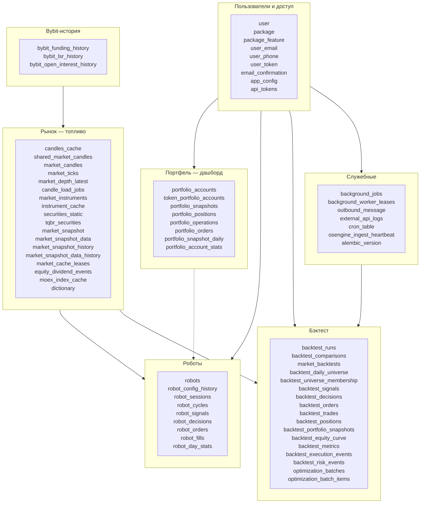
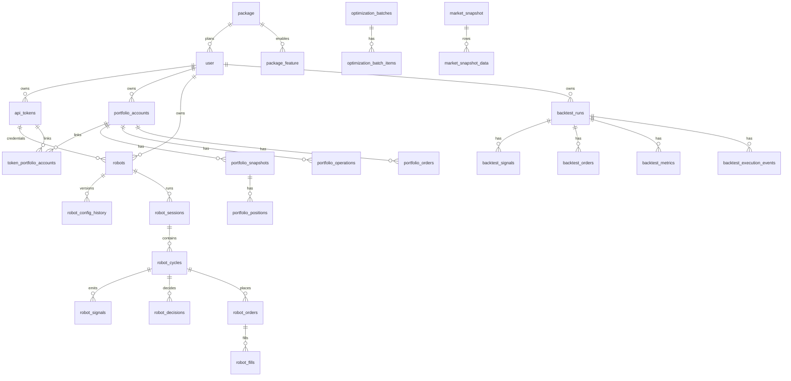

# Текущая база данных

Снимок **живой** локальной PostgreSQL `gin` на 2026-11-27. Это структура, а не выгрузка строк.

- Ревизия Alembic: `0097_ops_ticker_stats`
- Таблиц: **71** (`public`)
- Колонок: **892**
- Представлений: **0**
- Суммарный размер таблиц: **24.4 GB**

Число строк — оценка планировщика (`pg_class.reltuples`), не `COUNT(*)`. Размер — `pg_total_relation_size` (таблица и индексы).

Канон приложения — таблицы `public`. Legacy `robots` v1, `ganaly__*`, `backtest__*` и схема `backtest` сняты (миграции `0091`–`0095`). Audit роботов подробнее в [[func/trades_tables]].

## Общая карта базы

Ниже — **карта доменов**, не полный ER. В Reading Mode Obsidian отрисует Mermaid. Цель: понять, *где что лежит и зачем*, а детали колонок — в разделах ниже.

### Зачем нам эти контуры

| Контур | Зачем нужен | Главные таблицы |
|---|---|---|
| Пользователи и доступ | Аккаунты, пакеты, сессии входа, подтверждение почты | `user`, `package`, `user_token`, `email_confirmation` |
| Брокерские токены | Подключение T-Invest / Bybit без хранения ключей в коде | `api_tokens`, `token_portfolio_accounts` |
| Портфель | Дашборд: счета, снимки, операции, заявки + KPI marts | `portfolio_*`, `token_portfolio_accounts` |
| Роботы | Paper/live + audit сессия→цикл→ордер + дневные KPI | `robots`, `robot_*` |
| Бэктест | Прогоны стратегий, метрики, glass-box события | `backtest_runs`, `backtest_*`, `optimization_*` |
| Рынок и справочники | Свечи, снимки MOEX, кэши — топливо роботов и бэктеста | `candles_cache`, `shared_market_candles`, `market_*`, `dictionary` |
| Bybit-история | Funding / OI / LSR для крипто-стратегий | `bybit_*_history` |
| Служебные | Очередь воркеров, почта, cron, лизы | `background_jobs`, `outbound_message`, `cron_table` |

### Поток данных (с высоты)

Каждый контур ниже называет **все** свои таблицы. Стрелки — кто от кого зависит. Колонки — в карточках дальше по заметке.



### Ядро связей (канон)

Упрощённый ER: только сущности, через которые сшиты остальные таблицы. Полные FK — в разделе ниже и в карточках таблиц.



### Как читать «где что»

1. **Вход пользователя** — `user` + `package` + `user_token` / `email_confirmation`. Без этого нет мультитенантности.
2. **Доступ к брокеру** — `api_tokens` (секрет) и `token_portfolio_accounts` (какой счёт виден под токеном).
3. **Деньги на экране** — `portfolio_accounts` → snapshots / positions / operations / orders; KPI в `portfolio_account_stats` / `portfolio_snapshot_daily`. Это UI портфеля, не audit робота.
4. **Торговля** — `robots` и audit `sessions → cycles → orders/fills` (+ `robot_day_stats`). Торговый счёт — `config.core.accountId`, не флаг на связи токена.
5. **Идеи до live** — `backtest_runs` и дети; тяжёлые прогоны идут через `background_jobs`.
6. **Данные рынка** — самые тяжёлые таблицы (`market_snapshot_data_history`, `candles_cache`). Без них робот и бэктест слепы.

### Оглавление деталей

- [[#Пользователи, пакеты и токены]] — 9 табл.
- [[#Портфель и заявки]] — 8 табл.
- [[#Роботы]] — 9 табл.
- [[#Бэктест]] — 17 табл.
- [[#Рынок и справочники]] — 18 табл.
- [[#Bybit]] — 3 табл.
- [[#Служебные]] — 7 табл.

## Крупнейшие таблицы

| Таблица | Оценка строк | Размер |
|---|---:|---:|
| `public.market_snapshot_data_history` | 7 967 183 | 15.7 GB |
| `public.external_api_logs` | 4 118 397 | 3.9 GB |
| `public.candles_cache` | 4 036 395 | 1.3 GB |
| `public.robot_decisions` | 3 045 920 | 1.1 GB |
| `public.robot_cycles` | 2 988 870 | 861.5 MB |
| `public.market_candles` | 1 171 571 | 408.7 MB |
| `public.backtest_signals` | 1 401 386 | 406.9 MB |
| `public.market_snapshot_data` | 3 582 | 329.5 MB |
| `public.background_jobs` | 290 549 | 180.1 MB |
| `public.backtest_decisions` | 228 242 | 76.4 MB |
| `public.backtest_daily_universe` | 228 242 | 70.1 MB |
| `public.bybit_funding_history` | 213 943 | 43.3 MB |

## Внешние ключи (канон)

| Таблица | Ограничение |
|---|---|
| `api_tokens` | `FOREIGN KEY (user_id) REFERENCES "user"(id) ON DELETE CASCADE` |
| `backtest_decisions` | `FOREIGN KEY (run_id) REFERENCES backtest_runs(id) ON DELETE CASCADE` |
| `backtest_execution_events` | `FOREIGN KEY (run_id) REFERENCES backtest_runs(id) ON DELETE CASCADE` |
| `backtest_metrics` | `FOREIGN KEY (run_id) REFERENCES backtest_runs(id) ON DELETE CASCADE` |
| `backtest_orders` | `FOREIGN KEY (run_id) REFERENCES backtest_runs(id) ON DELETE CASCADE` |
| `backtest_portfolio_snapshots` | `FOREIGN KEY (run_id) REFERENCES backtest_runs(id) ON DELETE CASCADE` |
| `backtest_risk_events` | `FOREIGN KEY (run_id) REFERENCES backtest_runs(id) ON DELETE CASCADE` |
| `backtest_runs` | `FOREIGN KEY (user_id) REFERENCES "user"(id) ON DELETE SET NULL` |
| `backtest_signals` | `FOREIGN KEY (run_id) REFERENCES backtest_runs(id) ON DELETE CASCADE` |
| `backtest_universe_membership` | `FOREIGN KEY (run_id) REFERENCES backtest_runs(id) ON DELETE CASCADE` |
| `external_api_logs` | `FOREIGN KEY (user_id) REFERENCES "user"(id) ON DELETE SET NULL` |
| `market_snapshot_data` | `FOREIGN KEY (snapshot_id) REFERENCES market_snapshot(id) ON DELETE CASCADE` |
| `optimization_batch_items` | `FOREIGN KEY (batch_id) REFERENCES optimization_batches(id) ON DELETE CASCADE` |
| `outbound_message` | `FOREIGN KEY (user_id) REFERENCES "user"(id) ON DELETE SET NULL` |
| `outbound_message` | `FOREIGN KEY (email_id) REFERENCES user_email(id) ON DELETE SET NULL` |
| `outbound_message` | `FOREIGN KEY (phone_id) REFERENCES user_phone(id) ON DELETE SET NULL` |
| `package_feature` | `FOREIGN KEY (package_id) REFERENCES package(id) ON DELETE CASCADE` |
| `portfolio_account_stats` | `FOREIGN KEY (account_id) REFERENCES portfolio_accounts(id) ON DELETE CASCADE` |
| `portfolio_accounts` | `FOREIGN KEY (user_id) REFERENCES "user"(id) ON DELETE CASCADE` |
| `portfolio_operations` | `FOREIGN KEY (account_id) REFERENCES portfolio_accounts(id) ON DELETE CASCADE` |
| `portfolio_orders` | `FOREIGN KEY (account_id) REFERENCES portfolio_accounts(id) ON DELETE CASCADE` |
| `portfolio_positions` | `FOREIGN KEY (snapshot_id) REFERENCES portfolio_snapshots(id) ON DELETE CASCADE` |
| `portfolio_snapshot_daily` | `FOREIGN KEY (account_id) REFERENCES portfolio_accounts(id) ON DELETE CASCADE` |
| `portfolio_snapshots` | `FOREIGN KEY (account_id) REFERENCES portfolio_accounts(id) ON DELETE CASCADE` |
| `robot_config_history` | `FOREIGN KEY (robot_id) REFERENCES robots(id) ON DELETE CASCADE` |
| `robot_cycles` | `FOREIGN KEY (robot_id) REFERENCES robots(id) ON DELETE CASCADE` |
| `robot_cycles` | `FOREIGN KEY (session_id) REFERENCES robot_sessions(id) ON DELETE CASCADE` |
| `robot_day_stats` | `FOREIGN KEY (robot_id) REFERENCES robots(id) ON DELETE CASCADE` |
| `robot_decisions` | `FOREIGN KEY (cycle_id) REFERENCES robot_cycles(id) ON DELETE CASCADE` |
| `robot_decisions` | `FOREIGN KEY (robot_id) REFERENCES robots(id) ON DELETE CASCADE` |
| `robot_fills` | `FOREIGN KEY (order_id) REFERENCES robot_orders(id) ON DELETE CASCADE` |
| `robot_fills` | `FOREIGN KEY (robot_id) REFERENCES robots(id) ON DELETE CASCADE` |
| `robot_orders` | `FOREIGN KEY (cycle_id) REFERENCES robot_cycles(id) ON DELETE CASCADE` |
| `robot_orders` | `FOREIGN KEY (robot_id) REFERENCES robots(id) ON DELETE CASCADE` |
| `robot_sessions` | `FOREIGN KEY (robot_id) REFERENCES robots(id) ON DELETE CASCADE` |
| `robot_signals` | `FOREIGN KEY (cycle_id) REFERENCES robot_cycles(id) ON DELETE CASCADE` |
| `robot_signals` | `FOREIGN KEY (robot_id) REFERENCES robots(id) ON DELETE CASCADE` |
| `robots` | `FOREIGN KEY (token_id) REFERENCES api_tokens(id) ON DELETE SET NULL` |
| `robots` | `FOREIGN KEY (user_id) REFERENCES "user"(id) ON DELETE CASCADE` |
| `token_portfolio_accounts` | `FOREIGN KEY (portfolio_account_id) REFERENCES portfolio_accounts(id) ON DELETE CASCADE` |
| `token_portfolio_accounts` | `FOREIGN KEY (token_id) REFERENCES api_tokens(id) ON DELETE CASCADE` |
| `user` | `FOREIGN KEY (package_code) REFERENCES package(id)` |
| `user_email` | `FOREIGN KEY (user_id) REFERENCES "user"(id) ON DELETE CASCADE` |
| `user_phone` | `FOREIGN KEY (user_id) REFERENCES "user"(id) ON DELETE CASCADE` |
| `user_token` | `FOREIGN KEY (user_id) REFERENCES "user"(id) ON DELETE CASCADE` |

Всего FK в `public`: **45**.

## Пользователи, пакеты и токены

| Таблица | Колонок | Оценка строк | Размер |
|---|---:|---:|---:|
| `public.api_tokens` | 16 | 11 | 192.0 KB |
| `public.app_config` | 3 | 0 | 32.0 KB |
| `public.email_confirmation` | 10 | 3 | 80.0 KB |
| `public.package` | 7 | 1 | 40.0 KB |
| `public.package_feature` | 8 | 4 | 88.0 KB |
| `public.user` | 9 | 4 | 80.0 KB |
| `public.user_email` | 9 | 4 | 64.0 KB |
| `public.user_phone` | 9 | 1 | 56.0 KB |
| `public.user_token` | 15 | 801 | 784.0 KB |

### public.api_tokens

**Зачем:** Брокерский ключ пользователя (T-Invest / Bybit), секрет шифруется.

**Как используется:** Settings UI; роботы берут token_id для live.

Оценка строк 11, размер 192.0 KB.

| Колонка | Тип | NULL | По умолчанию |
|---|---|---|---|
| `id` | `bigint` | нет | nextval('api_tokens_id_seq'::regclass) |
| `user_id` | `bigint` | нет |  |
| `token` | `text` | нет |  |
| `token_type` | `integer` | нет |  |
| `name` | `character varying(100)` | да |  |
| `creation_date` | `timestamp with time zone` | нет | CURRENT_TIMESTAMP |
| `modification_date` | `timestamp with time zone` | да |  |
| `expires_at` | `timestamp with time zone` | да |  |
| `last_used_at` | `timestamp with time zone` | да |  |
| `extra_data` | `jsonb` | да |  |
| `status` | `integer` | нет | 1 |
| `last_error` | `text` | да |  |
| `last_error_at` | `timestamp with time zone` | да |  |
| `usercre` | `character varying(128)` | да |  |
| `usermod` | `character varying(128)` | да |  |
| `token_secret` | `text` | да |  |

**Первичный ключ:** `PRIMARY KEY (id)`

**Внешние ключи:**

- `FOREIGN KEY (user_id) REFERENCES "user"(id) ON DELETE CASCADE`

**Индексы:**

- `ix_api_tokens_token_type` — `btree (token_type)`
- `ix_api_tokens_user_id` — `btree (user_id)`

### public.app_config

**Зачем:** Глобальные key→value настройки приложения.

**Как используется:** TTL сессий и прочие runtime-флаги без релиза.

Оценка строк 0, размер 32.0 KB.

| Колонка | Тип | NULL | По умолчанию |
|---|---|---|---|
| `key` | `character varying(128)` | нет |  |
| `value` | `character varying(512)` | нет |  |
| `description` | `character varying(1024)` | да |  |

**Первичный ключ:** `PRIMARY KEY (key)`

### public.email_confirmation

**Зачем:** Одноразовые коды до/вместо сессии (register, reset).

**Как используется:** POST /api/auth и смежные confirm-flow.

Оценка строк 3, размер 80.0 KB.

| Колонка | Тип | NULL | По умолчанию |
|---|---|---|---|
| `id` | `bigint` | нет | nextval('email_confirmation_id_seq'::regclass) |
| `email` | `character varying(128)` | нет |  |
| `purpose` | `character varying(32)` | нет | 'register'::character varying |
| `code_hash` | `character varying(64)` | нет |  |
| `password_hash` | `character varying(255)` | нет |  |
| `attempts` | `integer` | нет | 0 |
| `expires_at` | `timestamp with time zone` | нет |  |
| `created_at` | `timestamp with time zone` | нет |  |
| `last_sent_at` | `timestamp with time zone` | нет |  |
| `login` | `character varying(128)` | да |  |

**Первичный ключ:** `PRIMARY KEY (id)`

**Уникальность:** `UNIQUE (email, purpose)`.

**Индексы:**

- `email_confirmation_email_purpose` — `UNIQUE btree (email, purpose)`

### public.package

**Зачем:** Тарифный план.

**Как используется:** FK с user.package_code; админка пакетов.

Оценка строк 1, размер 40.0 KB.

| Колонка | Тип | NULL | По умолчанию |
|---|---|---|---|
| `id` | `bigint` | нет | nextval('package_id_seq'::regclass) |
| `name` | `character varying(128)` | нет |  |
| `status` | `integer` | нет | 1 |
| `usercre` | `character varying(128)` | да |  |
| `creation_date` | `timestamp with time zone` | нет | CURRENT_TIMESTAMP |
| `usermod` | `character varying(128)` | да |  |
| `modification_date` | `timestamp with time zone` | да |  |

**Первичный ключ:** `PRIMARY KEY (id)`

**Индексы:**

- `ix_package_status` — `btree (status)`

### public.package_feature

**Зачем:** Флаги возможностей тарифа (вкладки/лимиты).

**Как используется:** Проверка доступа к фичам UI/API.

Оценка строк 4, размер 88.0 KB.

| Колонка | Тип | NULL | По умолчанию |
|---|---|---|---|
| `id` | `bigint` | нет | nextval('package_feature_id_seq'::regclass) |
| `package_id` | `bigint` | нет |  |
| `feature` | `character varying(64)` | нет |  |
| `status` | `integer` | нет | 0 |
| `usercre` | `character varying(128)` | да |  |
| `creation_date` | `timestamp with time zone` | нет | CURRENT_TIMESTAMP |
| `usermod` | `character varying(128)` | да |  |
| `modification_date` | `timestamp with time zone` | да |  |

**Первичный ключ:** `PRIMARY KEY (id)`

**Уникальность:** `UNIQUE (package_id, feature)`.

**Внешние ключи:**

- `FOREIGN KEY (package_id) REFERENCES package(id) ON DELETE CASCADE`

**Индексы:**

- `ix_package_feature_feature` — `btree (feature)`
- `ix_package_feature_package_id` — `btree (package_id)`
- `ix_package_feature_status` — `btree (status)`
- `uq_package_feature_package_feature` — `UNIQUE btree (package_id, feature)`

### public.user

**Зачем:** Tenant приложения: логин, пароль, тариф, status.

**Как используется:** Auth и все FK «чей это объект»; UI настроек.

Оценка строк 4, размер 80.0 KB.

| Колонка | Тип | NULL | По умолчанию |
|---|---|---|---|
| `id` | `bigint` | нет | nextval('user_id_seq'::regclass) |
| `login` | `character varying(128)` | нет |  |
| `password_hash` | `character varying(255)` | нет |  |
| `creation_date` | `timestamp with time zone` | нет | CURRENT_TIMESTAMP |
| `package_code` | `bigint` | нет | 1 |
| `usercre` | `character varying(128)` | да |  |
| `usermod` | `character varying(128)` | да |  |
| `modification_date` | `timestamp with time zone` | да |  |
| `status` | `integer` | нет | 1 |

**Первичный ключ:** `PRIMARY KEY (id)`

**Уникальность:** `UNIQUE (login)`.

**Внешние ключи:**

- `FOREIGN KEY (package_code) REFERENCES package(id)`

**Индексы:**

- `ix_user_package_code` — `btree (package_code)`
- `ix_user_status` — `btree (status)`
- `user_login_key` — `UNIQUE btree (login)`

### public.user_email

**Зачем:** Почты пользователя (текущая + история через status).

**Как используется:** Регистрация, сброс пароля, outbound_message.

Оценка строк 4, размер 64.0 KB.

| Колонка | Тип | NULL | По умолчанию |
|---|---|---|---|
| `id` | `bigint` | нет | nextval('user_email_id_seq'::regclass) |
| `user_id` | `bigint` | нет |  |
| `email` | `character varying(255)` | нет |  |
| `is_primary` | `boolean` | нет | true |
| `creation_date` | `timestamp with time zone` | нет | CURRENT_TIMESTAMP |
| `usercre` | `character varying(128)` | да |  |
| `usermod` | `character varying(128)` | да |  |
| `modification_date` | `timestamp with time zone` | да |  |
| `status` | `integer` | нет | 1 |

**Первичный ключ:** `PRIMARY KEY (id)`

**Внешние ключи:**

- `FOREIGN KEY (user_id) REFERENCES "user"(id) ON DELETE CASCADE`

**Индексы:**

- `ix_user_email_status` — `btree (status)`
- `uq_user_email_user_email_active` — `UNIQUE btree (user_id, email) WHERE (status = 1)`

### public.user_phone

**Зачем:** Телефоны пользователя (текущий + история через status).

**Как используется:** Профиль / будущие SMS; outbound_message.

Оценка строк 1, размер 56.0 KB.

| Колонка | Тип | NULL | По умолчанию |
|---|---|---|---|
| `id` | `bigint` | нет | nextval('user_phone_id_seq'::regclass) |
| `user_id` | `bigint` | нет |  |
| `phone` | `character varying(32)` | нет |  |
| `is_primary` | `boolean` | нет | true |
| `creation_date` | `timestamp with time zone` | нет | CURRENT_TIMESTAMP |
| `usercre` | `character varying(128)` | да |  |
| `usermod` | `character varying(128)` | да |  |
| `modification_date` | `timestamp with time zone` | да |  |
| `status` | `integer` | нет | 1 |

**Первичный ключ:** `PRIMARY KEY (id)`

**Внешние ключи:**

- `FOREIGN KEY (user_id) REFERENCES "user"(id) ON DELETE CASCADE`

**Индексы:**

- `ix_user_phone_status` — `btree (status)`
- `uq_user_phone_user_phone_active` — `UNIQUE btree (user_id, phone) WHERE (status = 1)`

### public.user_token

**Зачем:** Сессии входа (JWT/refresh, устройство, last_seen).

**Как используется:** Логин, logout, список сессий в настройках.

Оценка строк 801, размер 784.0 KB.

| Колонка | Тип | NULL | По умолчанию |
|---|---|---|---|
| `id` | `bigint` | нет | nextval('user_token_id_seq'::regclass) |
| `user_id` | `bigint` | нет |  |
| `token` | `text` | нет |  |
| `status` | `integer` | нет | 1 |
| `creation_date` | `timestamp with time zone` | нет | CURRENT_TIMESTAMP |
| `expires_at` | `timestamp with time zone` | нет |  |
| `invalidated_at` | `timestamp with time zone` | да |  |
| `ip` | `character varying(45)` | да |  |
| `user_agent` | `text` | да |  |
| `device_label` | `character varying(128)` | да |  |
| `geo_label` | `character varying(255)` | да |  |
| `last_seen_at` | `timestamp with time zone` | да |  |
| `modification_date` | `timestamp with time zone` | да |  |
| `usercre` | `character varying(128)` | да |  |
| `usermod` | `character varying(128)` | да |  |

**Первичный ключ:** `PRIMARY KEY (id)`

**Уникальность:** `UNIQUE (token)`.

**Внешние ключи:**

- `FOREIGN KEY (user_id) REFERENCES "user"(id) ON DELETE CASCADE`

**Индексы:**

- `ix_user_token_user_status` — `btree (user_id, status)`
- `user_token_token_key` — `UNIQUE btree (token)`

## Портфель и заявки

| Таблица | Колонок | Оценка строк | Размер |
|---|---:|---:|---:|
| `public.portfolio_account_stats` | 18 | 0 | 24.0 KB |
| `public.portfolio_accounts` | 15 | 10 | 104.0 KB |
| `public.portfolio_operations` | 23 | 17 166 | 31.7 MB |
| `public.portfolio_orders` | 18 | 103 | 144.0 KB |
| `public.portfolio_positions` | 23 | 75 658 | 19.9 MB |
| `public.portfolio_snapshot_daily` | 10 | 1 816 | 576.0 KB |
| `public.portfolio_snapshots` | 16 | 66 026 | 13.1 MB |
| `public.token_portfolio_accounts` | 8 | 15 | 104.0 KB |

### public.portfolio_account_stats

**Зачем:** Сводные KPI счёта (own_funds, win-rate, avg monthly ROI).

**Как используется:** Mart при синке; dashboard и analytics вместо тяжёлых агрегатов.

Оценка строк 0, размер 24.0 KB.

| Колонка | Тип | NULL | По умолчанию |
|---|---|---|---|
| `account_id` | `bigint` | нет |  |
| `total_amount` | `double precision` | да |  |
| `currency` | `character varying(16)` | да |  |
| `snapshot_id` | `bigint` | да |  |
| `snapshot_at` | `timestamp with time zone` | да |  |
| `day_over_day_delta` | `double precision` | да |  |
| `day_over_day_percent` | `double precision` | да |  |
| `own_funds` | `double precision` | да |  |
| `gain_abs` | `double precision` | да |  |
| `gain_percent` | `double precision` | да |  |
| `wins` | `integer` | да |  |
| `losses` | `integer` | да |  |
| `win_rate_percent` | `double precision` | да |  |
| `first_input_at` | `timestamp with time zone` | да |  |
| `avg_monthly_roi_percent` | `double precision` | да |  |
| `positions_count` | `integer` | да |  |
| `computed_at` | `timestamp with time zone` | нет | now() |
| `ops_sync_version` | `bigint` | нет | 0 |

**Первичный ключ:** `PRIMARY KEY (account_id)`

**Внешние ключи:**

- `FOREIGN KEY (account_id) REFERENCES portfolio_accounts(id) ON DELETE CASCADE`

### public.portfolio_accounts

**Зачем:** Справочник брокерских счетов пользователя.

**Как используется:** Дашборд, связка с токеном, корень snapshots/orders/ops.

Оценка строк 10, размер 104.0 KB.

| Колонка | Тип | NULL | По умолчанию |
|---|---|---|---|
| `id` | `bigint` | нет | nextval('portfolio_accounts_id_seq'::regclass) |
| `user_id` | `bigint` | нет |  |
| `account_id` | `character varying(50)` | нет |  |
| `account_type` | `character varying(50)` | нет |  |
| `account_name` | `character varying(255)` | да |  |
| `account_status` | `character varying(50)` | нет |  |
| `opened_date` | `timestamp with time zone` | да |  |
| `closed_date` | `timestamp with time zone` | да |  |
| `access_level` | `character varying(50)` | да |  |
| `is_active` | `integer` | нет | 1 |
| `last_sync_at` | `timestamp with time zone` | да |  |
| `created_at` | `timestamp with time zone` | нет | CURRENT_TIMESTAMP |
| `updated_at` | `timestamp with time zone` | да |  |
| `last_token_id` | `bigint` | да |  |
| `dashboard_hidden` | `integer` | нет | 0 |

**Первичный ключ:** `PRIMARY KEY (id)`

**Уникальность:** `UNIQUE (user_id, account_id)`.

**Внешние ключи:**

- `FOREIGN KEY (user_id) REFERENCES "user"(id) ON DELETE CASCADE`

**Индексы:**

- `ix_portfolio_accounts_last_token_id` — `btree (last_token_id)`
- `ix_portfolio_accounts_user_account` — `btree (user_id, account_id)`
- `uq_user_account` — `UNIQUE btree (user_id, account_id)`

### public.portfolio_operations

**Зачем:** Операции брокера по счёту (сделки, вводы, комиссии).

**Как используется:** Синк T-Invest/Bybit operations; аналитика / KPI.

Оценка строк 17 166, размер 31.7 MB.

| Колонка | Тип | NULL | По умолчанию |
|---|---|---|---|
| `id` | `bigint` | нет | nextval('portfolio_operations_id_seq'::regclass) |
| `account_id` | `bigint` | нет |  |
| `operation_id` | `character varying(120)` | нет |  |
| `parent_operation_id` | `character varying(50)` | да |  |
| `figi` | `character varying(20)` | да |  |
| `instrument_type` | `character varying(30)` | да |  |
| `instrument_uid` | `character varying(50)` | да |  |
| `position_uid` | `character varying(50)` | да |  |
| `operation_type` | `character varying(50)` | нет |  |
| `operation_date` | `timestamp with time zone` | нет |  |
| `quantity` | `numeric(20,4)` | нет |  |
| `quantity_rest` | `numeric(20,4)` | да |  |
| `price` | `numeric(20,4)` | нет |  |
| `price_currency` | `character varying(10)` | нет |  |
| `payment` | `numeric(20,4)` | нет |  |
| `payment_currency` | `character varying(10)` | нет |  |
| `commission` | `numeric(20,4)` | да |  |
| `commission_currency` | `character varying(10)` | да |  |
| `status` | `character varying(128)` | нет |  |
| `trades` | `json` | да |  |
| `extra_data` | `json` | да |  |
| `created_at` | `timestamp with time zone` | нет | CURRENT_TIMESTAMP |
| `ticker` | `character varying(50)` | да |  |

**Первичный ключ:** `PRIMARY KEY (id)`

**Уникальность:** `UNIQUE (operation_id)`.

**Внешние ключи:**

- `FOREIGN KEY (account_id) REFERENCES portfolio_accounts(id) ON DELETE CASCADE`

**Индексы:**

- `ix_portfolio_operations_account_date` — `btree (account_id, operation_date)`
- `ix_portfolio_operations_figi` — `btree (figi)`
- `ix_portfolio_operations_operation_id` — `btree (operation_id)`
- `ix_portfolio_operations_ticker` — `btree (ticker)`
- `portfolio_operations_operation_id_key` — `UNIQUE btree (operation_id)`

### public.portfolio_orders

**Зачем:** Журнал заявок по счёту (active + history), не audit робота.

**Как используется:** Пишет portfolio_updater + live trading_core; Bybit history есть, у T-Invest — в основном open/GetOrders.

Оценка строк 103, размер 144.0 KB.

| Колонка | Тип | NULL | По умолчанию |
|---|---|---|---|
| `id` | `bigint` | нет | nextval('portfolio_orders_id_seq'::regclass) |
| `account_id` | `bigint` | нет |  |
| `order_id` | `character varying(120)` | нет |  |
| `figi` | `character varying(32)` | да |  |
| `instrument_uid` | `character varying(50)` | да |  |
| `order_type` | `character varying(30)` | нет |  |
| `order_direction` | `character varying(20)` | нет |  |
| `order_date` | `timestamp with time zone` | нет |  |
| `lots_requested` | `numeric(20,4)` | нет |  |
| `lots_executed` | `numeric(20,4)` | да |  |
| `price` | `numeric(20,4)` | да |  |
| `execution_price` | `numeric(20,4)` | да |  |
| `status` | `character varying(30)` | нет |  |
| `commission` | `numeric(20,4)` | да |  |
| `commission_currency` | `character varying(10)` | да |  |
| `extra_data` | `json` | да |  |
| `created_at` | `timestamp with time zone` | нет | CURRENT_TIMESTAMP |
| `reason` | `character varying(64)` | да |  |

**Первичный ключ:** `PRIMARY KEY (id)`

**Внешние ключи:**

- `FOREIGN KEY (account_id) REFERENCES portfolio_accounts(id) ON DELETE CASCADE`

**Индексы:**

- `ix_portfolio_orders_account_date` — `btree (account_id, order_date)`
- `ix_portfolio_orders_account_status` — `btree (account_id, status)`
- `uq_portfolio_orders_account_order_id` — `UNIQUE btree (account_id, order_id)`

### public.portfolio_positions

**Зачем:** Позиции внутри одного snapshot.

**Как используется:** Дашборд позиций; источник ticker для ops.

Оценка строк 75 658, размер 19.9 MB.

| Колонка | Тип | NULL | По умолчанию |
|---|---|---|---|
| `id` | `bigint` | нет | nextval('portfolio_positions_id_seq'::regclass) |
| `snapshot_id` | `bigint` | нет |  |
| `figi` | `character varying(20)` | да |  |
| `instrument_uid` | `character varying(50)` | да |  |
| `position_uid` | `character varying(50)` | да |  |
| `ticker` | `character varying(50)` | да |  |
| `class_code` | `character varying(20)` | да |  |
| `instrument_type` | `character varying(30)` | нет |  |
| `quantity` | `numeric(20,4)` | нет |  |
| `quantity_lots` | `numeric(20,4)` | да |  |
| `average_position_price` | `numeric(20,4)` | да |  |
| `average_position_price_fifo` | `numeric(20,4)` | да |  |
| `current_price` | `numeric(20,4)` | да |  |
| `average_position_price_pt` | `numeric(20,4)` | да |  |
| `expected_yield` | `numeric(10,4)` | да |  |
| `expected_yield_fifo` | `numeric(10,4)` | да |  |
| `daily_yield` | `numeric(20,4)` | да |  |
| `var_margin` | `numeric(20,4)` | да |  |
| `current_nkd` | `numeric(20,4)` | да |  |
| `blocked` | `integer` | нет | 0 |
| `blocked_lots` | `numeric(20,4)` | да |  |
| `extra_data` | `json` | да |  |
| `created_at` | `timestamp with time zone` | нет | CURRENT_TIMESTAMP |

**Первичный ключ:** `PRIMARY KEY (id)`

**Внешние ключи:**

- `FOREIGN KEY (snapshot_id) REFERENCES portfolio_snapshots(id) ON DELETE CASCADE`

**Индексы:**

- `ix_portfolio_positions_figi` — `btree (figi)`
- `ix_portfolio_positions_snapshot` — `btree (snapshot_id)`
- `ix_portfolio_positions_ticker` — `btree (ticker)`

### public.portfolio_snapshot_daily

**Зачем:** Дневной mart по счёту (EOD equity, day_delta).

**Как используется:** Пишется при синке; дашборд/графики без тяжёлого DISTINCT ON.

Оценка строк 1 816, размер 576.0 KB.

| Колонка | Тип | NULL | По умолчанию |
|---|---|---|---|
| `id` | `bigint` | нет |  |
| `account_id` | `bigint` | нет |  |
| `snapshot_day` | `date` | нет |  |
| `snapshot_date` | `timestamp with time zone` | нет |  |
| `total_amount_portfolio` | `double precision` | да |  |
| `daily_yield` | `double precision` | да |  |
| `expected_yield` | `double precision` | да |  |
| `currency` | `character varying(16)` | да |  |
| `day_delta` | `double precision` | да |  |
| `own_funds_eod` | `double precision` | да |  |

**Первичный ключ:** `PRIMARY KEY (account_id, snapshot_day)`

**Внешние ключи:**

- `FOREIGN KEY (account_id) REFERENCES portfolio_accounts(id) ON DELETE CASCADE`

**Индексы:**

- `ix_portfolio_snapshot_daily_day` — `btree (snapshot_day)`

### public.portfolio_snapshots

**Зачем:** Снимки equity/PnL счёта во времени.

**Как используется:** Пишет portfolio_updater; читает дашборд/аналитика.

Оценка строк 66 026, размер 13.1 MB.

| Колонка | Тип | NULL | По умолчанию |
|---|---|---|---|
| `id` | `bigint` | нет | nextval('portfolio_snapshots_id_seq'::regclass) |
| `account_id` | `bigint` | нет |  |
| `snapshot_date` | `timestamp with time zone` | нет | CURRENT_TIMESTAMP |
| `total_amount_portfolio` | `numeric(20,4)` | нет |  |
| `total_amount_shares` | `numeric(20,4)` | да |  |
| `total_amount_bonds` | `numeric(20,4)` | да |  |
| `total_amount_etf` | `numeric(20,4)` | да |  |
| `total_amount_currencies` | `numeric(20,4)` | да |  |
| `total_amount_futures` | `numeric(20,4)` | да |  |
| `total_amount_options` | `numeric(20,4)` | да |  |
| `total_amount_sp` | `numeric(20,4)` | да |  |
| `expected_yield` | `numeric(10,4)` | да |  |
| `daily_yield` | `numeric(20,4)` | да |  |
| `daily_yield_relative` | `numeric(10,4)` | да |  |
| `currency` | `character varying(10)` | нет | 'RUB'::character varying |
| `created_at` | `timestamp with time zone` | нет | CURRENT_TIMESTAMP |

**Первичный ключ:** `PRIMARY KEY (id)`

**Внешние ключи:**

- `FOREIGN KEY (account_id) REFERENCES portfolio_accounts(id) ON DELETE CASCADE`

**Индексы:**

- `ix_portfolio_snapshots_account_date` — `btree (account_id, snapshot_date)`

### public.token_portfolio_accounts

**Зачем:** Какие брокерские счета видны под данным api_token.

**Как используется:** Синк портфеля и выбор счёта роботом (не is_trading).

Оценка строк 15, размер 104.0 KB.

| Колонка | Тип | NULL | По умолчанию |
|---|---|---|---|
| `token_id` | `bigint` | нет |  |
| `portfolio_account_id` | `bigint` | нет |  |
| `creation_date` | `timestamp with time zone` | нет | CURRENT_TIMESTAMP |
| `id` | `bigint` | нет | nextval('token_portfolio_accounts_id_seq'::regclass) |
| `status` | `integer` | нет | 1 |
| `usercre` | `character varying(128)` | да |  |
| `usermod` | `character varying(128)` | да |  |
| `modification_date` | `timestamp with time zone` | да |  |

**Первичный ключ:** `PRIMARY KEY (id)`

**Уникальность:** `UNIQUE (token_id, portfolio_account_id)`.

**Внешние ключи:**

- `FOREIGN KEY (portfolio_account_id) REFERENCES portfolio_accounts(id) ON DELETE CASCADE`
- `FOREIGN KEY (token_id) REFERENCES api_tokens(id) ON DELETE CASCADE`

**Индексы:**

- `ix_token_portfolio_accounts_account` — `btree (portfolio_account_id)`
- `ix_token_portfolio_accounts_status` — `btree (status)`
- `uq_token_portfolio_accounts_token_account` — `UNIQUE btree (token_id, portfolio_account_id)`

## Роботы

| Таблица | Колонок | Оценка строк | Размер |
|---|---:|---:|---:|
| `public.robot_config_history` | 6 | 31 | 120.0 KB |
| `public.robot_cycles` | 11 | 2 988 870 | 861.5 MB |
| `public.robot_day_stats` | 7 | 85 | 80.0 KB |
| `public.robot_decisions` | 10 | 3 045 920 | 1.1 GB |
| `public.robot_fills` | 11 | 2 492 | 824.0 KB |
| `public.robot_orders` | 14 | 6 120 | 2.8 MB |
| `public.robot_sessions` | 8 | 124 | 80.0 KB |
| `public.robot_signals` | 11 | 38 690 | 10.5 MB |
| `public.robots` | 16 | 10 | 136.0 KB |

### public.robot_config_history

**Зачем:** Неизменяемые версии конфига.

**Как используется:** Аудит изменений настроек робота.

Оценка строк 31, размер 120.0 KB.

| Колонка | Тип | NULL | По умолчанию |
|---|---|---|---|
| `id` | `uuid` | нет |  |
| `robot_id` | `bigint` | нет |  |
| `version` | `integer` | нет |  |
| `config` | `json` | нет |  |
| `created_by` | `bigint` | да |  |
| `creation_date` | `timestamp with time zone` | нет | CURRENT_TIMESTAMP |

**Первичный ключ:** `PRIMARY KEY (id)`

**Внешние ключи:**

- `FOREIGN KEY (robot_id) REFERENCES robots(id) ON DELETE CASCADE`

**Индексы:**

- `ix_robot_config_history_robot_id` — `btree (robot_id)`
- `ix_robot_config_history_robot_version` — `UNIQUE btree (robot_id, version)`

### public.robot_cycles

**Зачем:** Торговый цикл (poll/bar/tick) внутри сессии.

**Как используется:** Пишет engine; к нему вяжутся signals/decisions/orders.

Оценка строк 2 988 870, размер 861.5 MB.

| Колонка | Тип | NULL | По умолчанию |
|---|---|---|---|
| `id` | `uuid` | нет |  |
| `session_id` | `uuid` | нет |  |
| `robot_id` | `bigint` | нет |  |
| `cycle_number` | `integer` | нет |  |
| `triggered_by` | `character varying(32)` | нет | 'poll'::character varying |
| `started_at` | `timestamp with time zone` | нет |  |
| `finished_at` | `timestamp with time zone` | да |  |
| `status` | `character varying(16)` | нет | 'ok'::character varying |
| `skip_reason` | `character varying(64)` | да |  |
| `equity` | `numeric(20,4)` | да |  |
| `stats` | `jsonb` | нет | '{}'::jsonb |

**Первичный ключ:** `PRIMARY KEY (id)`

**Внешние ключи:**

- `FOREIGN KEY (robot_id) REFERENCES robots(id) ON DELETE CASCADE`
- `FOREIGN KEY (session_id) REFERENCES robot_sessions(id) ON DELETE CASCADE`

**Индексы:**

- `ix_robots_v2_cycles_robot_started` — `btree (robot_id, started_at)`
- `ix_robots_v2_cycles_session_id` — `btree (session_id)`

### public.robot_day_stats

**Зачем:** Дневной rollup W/L по роботу.

**Как используется:** Пишет audit после цикла; быстрые KPI без скана fills.

Оценка строк 85, размер 80.0 KB.

| Колонка | Тип | NULL | По умолчанию |
|---|---|---|---|
| `robot_id` | `bigint` | нет |  |
| `stats_day` | `date` | нет |  |
| `wins` | `integer` | нет | 0 |
| `losses` | `integer` | нет | 0 |
| `realized_pnl` | `double precision` | да |  |
| `fills_count` | `integer` | нет | 0 |
| `computed_at` | `timestamp with time zone` | нет | now() |

**Первичный ключ:** `PRIMARY KEY (robot_id, stats_day)`

**Внешние ключи:**

- `FOREIGN KEY (robot_id) REFERENCES robots(id) ON DELETE CASCADE`

**Индексы:**

- `ix_robot_day_stats_day` — `btree (stats_day)`

### public.robot_decisions

**Зачем:** Решение risk/sizing по сигналу.

**Как используется:** Монитор; почему ордер выставлен или нет.

Оценка строк 3 045 920, размер 1.1 GB.

| Колонка | Тип | NULL | По умолчанию |
|---|---|---|---|
| `id` | `uuid` | нет |  |
| `cycle_id` | `uuid` | нет |  |
| `robot_id` | `bigint` | нет |  |
| `stage` | `character varying(32)` | нет |  |
| `outcome` | `character varying(16)` | нет |  |
| `code` | `character varying(64)` | нет |  |
| `message` | `text` | да |  |
| `ticker` | `character varying(32)` | да |  |
| `context` | `jsonb` | нет | '{}'::jsonb |
| `created_at` | `timestamp with time zone` | нет |  |

**Первичный ключ:** `PRIMARY KEY (id)`

**Внешние ключи:**

- `FOREIGN KEY (cycle_id) REFERENCES robot_cycles(id) ON DELETE CASCADE`
- `FOREIGN KEY (robot_id) REFERENCES robots(id) ON DELETE CASCADE`

**Индексы:**

- `ix_robots_v2_decisions_cycle_id` — `btree (cycle_id)`
- `ix_robots_v2_decisions_robot_created` — `btree (robot_id, created_at)`

### public.robot_fills

**Зачем:** Исполнения ордеров робота.

**Как используется:** PnL цикла и reconcile.

Оценка строк 2 492, размер 824.0 KB.

| Колонка | Тип | NULL | По умолчанию |
|---|---|---|---|
| `id` | `uuid` | нет |  |
| `order_id` | `uuid` | нет |  |
| `robot_id` | `bigint` | нет |  |
| `ticker` | `character varying(32)` | нет |  |
| `side` | `character varying(8)` | нет |  |
| `quantity` | `numeric(20,4)` | нет |  |
| `price` | `numeric(20,6)` | нет |  |
| `pnl` | `numeric(20,6)` | да |  |
| `commission` | `numeric(20,6)` | да |  |
| `kind` | `character varying(32)` | нет |  |
| `filled_at` | `timestamp with time zone` | нет |  |

**Первичный ключ:** `PRIMARY KEY (id)`

**Внешние ключи:**

- `FOREIGN KEY (order_id) REFERENCES robot_orders(id) ON DELETE CASCADE`
- `FOREIGN KEY (robot_id) REFERENCES robots(id) ON DELETE CASCADE`

**Индексы:**

- `ix_robots_v2_fills_order_id` — `btree (order_id)`
- `ix_robots_v2_fills_robot_filled` — `btree (robot_id, filled_at)`

### public.robot_orders

**Зачем:** Ордера audit робота (не portfolio_orders).

**Как используется:** Live/paper execution trail.

Оценка строк 6 120, размер 2.8 MB.

| Колонка | Тип | NULL | По умолчанию |
|---|---|---|---|
| `id` | `uuid` | нет |  |
| `cycle_id` | `uuid` | нет |  |
| `robot_id` | `bigint` | нет |  |
| `ticker` | `character varying(32)` | нет |  |
| `side` | `character varying(8)` | нет |  |
| `kind` | `character varying(32)` | нет |  |
| `quantity` | `numeric(20,4)` | нет |  |
| `price` | `numeric(20,6)` | да |  |
| `status` | `character varying(32)` | нет |  |
| `mode` | `character varying(16)` | нет |  |
| `broker_order_id` | `character varying(128)` | да |  |
| `reject_reason` | `text` | да |  |
| `submitted_at` | `timestamp with time zone` | нет |  |
| `order_type` | `character varying(16)` | нет | 'MARKET'::character varying |

**Первичный ключ:** `PRIMARY KEY (id)`

**Внешние ключи:**

- `FOREIGN KEY (cycle_id) REFERENCES robot_cycles(id) ON DELETE CASCADE`
- `FOREIGN KEY (robot_id) REFERENCES robots(id) ON DELETE CASCADE`

**Индексы:**

- `ix_robots_v2_orders_broker_order_id` — `btree (broker_order_id)`
- `ix_robots_v2_orders_cycle_id` — `btree (cycle_id)`
- `ix_robots_v2_orders_robot_submitted` — `btree (robot_id, submitted_at)`

### public.robot_sessions

**Зачем:** Один Start→Stop запуска.

**Как используется:** Корень audit trail; mode/account_id/virtual_capital.

Оценка строк 124, размер 80.0 KB.

| Колонка | Тип | NULL | По умолчанию |
|---|---|---|---|
| `id` | `uuid` | нет |  |
| `robot_id` | `bigint` | нет |  |
| `mode` | `character varying(16)` | нет |  |
| `virtual_capital` | `numeric(20,4)` | да |  |
| `account_id` | `character varying(64)` | да |  |
| `started_at` | `timestamp with time zone` | нет |  |
| `ended_at` | `timestamp with time zone` | да |  |
| `stop_reason` | `character varying(64)` | да |  |

**Первичный ключ:** `PRIMARY KEY (id)`

**Внешние ключи:**

- `FOREIGN KEY (robot_id) REFERENCES robots(id) ON DELETE CASCADE`

**Индексы:**

- `ix_robots_v2_sessions_robot_started` — `btree (robot_id, started_at)`

### public.robot_signals

**Зачем:** Сырой сигнал стратегии в цикле.

**Как используется:** Монитор робота / glass-box.

Оценка строк 38 690, размер 10.5 MB.

| Колонка | Тип | NULL | По умолчанию |
|---|---|---|---|
| `id` | `uuid` | нет |  |
| `cycle_id` | `uuid` | нет |  |
| `robot_id` | `bigint` | нет |  |
| `ticker` | `character varying(32)` | нет |  |
| `side` | `character varying(8)` | нет |  |
| `kind` | `character varying(32)` | нет |  |
| `reason` | `text` | да |  |
| `price` | `numeric(20,6)` | да |  |
| `created_at` | `timestamp with time zone` | нет |  |
| `entry_price` | `numeric(20,6)` | да |  |
| `delta_pct` | `numeric(12,4)` | да |  |

**Первичный ключ:** `PRIMARY KEY (id)`

**Внешние ключи:**

- `FOREIGN KEY (cycle_id) REFERENCES robot_cycles(id) ON DELETE CASCADE`
- `FOREIGN KEY (robot_id) REFERENCES robots(id) ON DELETE CASCADE`

**Индексы:**

- `ix_robots_v2_signals_cycle_id` — `btree (cycle_id)`

### public.robots

**Зачем:** Торговый робот paper/live: конфиг JSON, status, type, token_id.

**Как используется:** CRUD роботов, старт/стоп сессии; торговый счёт в config.core.accountId.

Оценка строк 10, размер 136.0 KB.

| Колонка | Тип | NULL | По умолчанию |
|---|---|---|---|
| `id` | `bigint` | нет | nextval('robots_v2_id_seq'::regclass) |
| `name` | `character varying(50)` | нет |  |
| `user_id` | `bigint` | нет |  |
| `token_id` | `bigint` | да |  |
| `type` | `integer` | нет |  |
| `status` | `integer` | нет | 0 |
| `config_version` | `integer` | нет | 4 |
| `config` | `json` | нет | '{}'::json |
| `metadata` | `json` | нет | '{}'::json |
| `last_started` | `timestamp with time zone` | да |  |
| `last_error` | `text` | да |  |
| `last_error_at` | `timestamp with time zone` | да |  |
| `usercre` | `character varying(128)` | да |  |
| `creation_date` | `timestamp with time zone` | нет | CURRENT_TIMESTAMP |
| `usermod` | `character varying(128)` | да |  |
| `modification_date` | `timestamp with time zone` | да |  |

**Первичный ключ:** `PRIMARY KEY (id)`

**Внешние ключи:**

- `FOREIGN KEY (token_id) REFERENCES api_tokens(id) ON DELETE SET NULL`
- `FOREIGN KEY (user_id) REFERENCES "user"(id) ON DELETE CASCADE`

**Индексы:**

- `ix_robots_v2_status` — `btree (status)`
- `ix_robots_v2_token_id` — `btree (token_id)`
- `ix_robots_v2_type` — `btree (type)`
- `ix_robots_v2_user_id` — `btree (user_id)`

## Бэктест

| Таблица | Колонок | Оценка строк | Размер |
|---|---:|---:|---:|
| `public.backtest_comparisons` | 6 | 0 | 8.0 KB |
| `public.backtest_daily_universe` | 14 | 228 242 | 70.1 MB |
| `public.backtest_decisions` | 9 | 228 242 | 76.4 MB |
| `public.backtest_equity_curve` | 13 | 1 266 | 160.0 KB |
| `public.backtest_execution_events` | 15 | 238 | 216.0 KB |
| `public.backtest_metrics` | 10 | 40 | 1.1 MB |
| `public.backtest_orders` | 14 | 2 492 | 904.0 KB |
| `public.backtest_portfolio_snapshots` | 6 | 30 652 | 3.4 MB |
| `public.backtest_positions` | 10 | 0 | 0 B |
| `public.backtest_risk_events` | 8 | 0 | 32.0 KB |
| `public.backtest_runs` | 25 | 171 | 1.1 MB |
| `public.backtest_signals` | 8 | 1 401 386 | 406.9 MB |
| `public.backtest_trades` | 10 | 6 519 | 680.0 KB |
| `public.backtest_universe_membership` | 6 | 1 742 | 264.0 KB |
| `public.market_backtests` | 12 | 0 | 40.0 KB |
| `public.optimization_batch_items` | 8 | 0 | 32.0 KB |
| `public.optimization_batches` | 15 | 0 | 24.0 KB |

### public.backtest_comparisons

**Зачем:** Сравнение нескольких прогонов.

**Как используется:** UI сравнения результатов.

Оценка строк 0, размер 8.0 KB.

| Колонка | Тип | NULL | По умолчанию |
|---|---|---|---|
| `id` | `bigint` | да |  |
| `name` | `character varying(200)` | да |  |
| `base_run_id` | `bigint` | да |  |
| `compare_run_id` | `bigint` | да |  |
| `config_diff` | `jsonb` | да |  |
| `created_at` | `timestamp with time zone` | да |  |

### public.backtest_daily_universe

**Зачем:** Вселенная инструментов на день прогона.

**Как используется:** Симулятор фильтрует тикеры по дню.

Оценка строк 228 242, размер 70.1 MB.

| Колонка | Тип | NULL | По умолчанию |
|---|---|---|---|
| `id` | `bigint` | да |  |
| `backtest_run_id` | `bigint` | да |  |
| `trade_date` | `date` | да |  |
| `ticker` | `character varying(20)` | да |  |
| `source` | `character varying(30)` | да |  |
| `filter_result` | `character varying(20)` | да |  |
| `reject_reason` | `text` | да |  |
| `snapshot_id` | `bigint` | да |  |
| `price_at_filter` | `numeric(12,4)` | да |  |
| `volume_at_filter` | `bigint` | да |  |
| `atr_value` | `numeric(12,4)` | да |  |
| `gap_percent` | `numeric(6,3)` | да |  |
| `applied_filters` | `jsonb` | да |  |
| `created_at` | `timestamp with time zone` | да |  |

### public.backtest_decisions

**Зачем:** Решения прогона.

**Как используется:** Glass-box risk path.

Оценка строк 228 242, размер 76.4 MB.

| Колонка | Тип | NULL | По умолчанию |
|---|---|---|---|
| `id` | `bigint` | нет | nextval('backtest_decisions_id_seq'::regclass) |
| `run_id` | `bigint` | нет |  |
| `trade_date` | `date` | нет |  |
| `ticker` | `character varying(20)` | нет |  |
| `source` | `character varying(20)` | нет | 'PIPELINE'::character varying |
| `result` | `character varying(20)` | нет |  |
| `reason` | `text` | да |  |
| `payload` | `jsonb` | нет | '{}'::jsonb |
| `created_at` | `timestamp with time zone` | нет | now() |

**Первичный ключ:** `PRIMARY KEY (id)`

**Внешние ключи:**

- `FOREIGN KEY (run_id) REFERENCES backtest_runs(id) ON DELETE CASCADE`

**Индексы:**

- `idx_backtest_decisions_run_day` — `btree (run_id, trade_date)`
- `idx_backtest_decisions_run_ticker` — `btree (run_id, ticker)`

### public.backtest_equity_curve

**Зачем:** Точки equity curve.

**Как используется:** График капитала в UI.

Оценка строк 1 266, размер 160.0 KB.

| Колонка | Тип | NULL | По умолчанию |
|---|---|---|---|
| `id` | `bigint` | да |  |
| `backtest_run_id` | `bigint` | да |  |
| `trade_date` | `date` | да |  |
| `cash` | `numeric(14,2)` | да |  |
| `positions_value` | `numeric(14,2)` | да |  |
| `total_equity` | `numeric(14,2)` | да |  |
| `daily_pnl` | `numeric(12,4)` | да |  |
| `daily_return_percent` | `numeric(8,4)` | да |  |
| `commission_paid` | `numeric(12,4)` | да |  |
| `slippage_paid` | `numeric(12,4)` | да |  |
| `trades_count` | `integer` | да |  |
| `drawdown` | `numeric(8,4)` | да |  |
| `drawdown_percent` | `numeric(6,2)` | да |  |

### public.backtest_execution_events

**Зачем:** События исполнения (glass-box).

**Как используется:** Отладка fill/slippage модели.

Оценка строк 238, размер 216.0 KB.

| Колонка | Тип | NULL | По умолчанию |
|---|---|---|---|
| `id` | `bigint` | нет | nextval('backtest_execution_events_id_seq'::regclass) |
| `run_id` | `bigint` | нет |  |
| `event_time` | `timestamp with time zone` | нет |  |
| `intent_id` | `character varying(64)` | нет |  |
| `cycle_id` | `character varying(64)` | да |  |
| `ticker` | `character varying(32)` | нет |  |
| `side` | `character varying(10)` | да |  |
| `kind` | `character varying(32)` | да |  |
| `status` | `character varying(20)` | нет |  |
| `reason` | `character varying(64)` | да |  |
| `reject_reason` | `character varying(64)` | да |  |
| `quantity` | `numeric(20,4)` | да |  |
| `price` | `numeric(20,8)` | да |  |
| `trade_id` | `bigint` | да |  |
| `payload` | `jsonb` | нет | '{}'::jsonb |

**Первичный ключ:** `PRIMARY KEY (id)`

**Внешние ключи:**

- `FOREIGN KEY (run_id) REFERENCES backtest_runs(id) ON DELETE CASCADE`

**Индексы:**

- `ix_backtest_execution_events_run_cycle` — `btree (run_id, cycle_id)`
- `ix_backtest_execution_events_run_id` — `btree (run_id)`
- `ix_backtest_execution_events_run_intent` — `btree (run_id, intent_id)`

### public.backtest_metrics

**Зачем:** Итоговые метрики (Sharpe, DD, …).

**Как используется:** Карточка результата / сравнение.

Оценка строк 40, размер 1.1 MB.

| Колонка | Тип | NULL | По умолчанию |
|---|---|---|---|
| `id` | `bigint` | нет | nextval('backtest_metrics_id_seq'::regclass) |
| `run_id` | `bigint` | нет |  |
| `total_return_percent` | `numeric(12,6)` | да |  |
| `max_drawdown_percent` | `numeric(12,6)` | да |  |
| `sharpe_ratio` | `numeric(12,6)` | да |  |
| `trades_total` | `bigint` | нет | 0 |
| `win_rate_percent` | `numeric(12,6)` | да |  |
| `avg_pnl_per_trade` | `numeric(20,6)` | да |  |
| `final_equity` | `numeric(20,6)` | да |  |
| `payload` | `jsonb` | нет | '{}'::jsonb |

**Первичный ключ:** `PRIMARY KEY (id)`

**Внешние ключи:**

- `FOREIGN KEY (run_id) REFERENCES backtest_runs(id) ON DELETE CASCADE`

**Индексы:**

- `uq_backtest_metrics_run_id` — `UNIQUE btree (run_id)`

### public.backtest_orders

**Зачем:** Ордера симуляции.

**Как используется:** Отчёт и метрики исполнения.

Оценка строк 2 492, размер 904.0 KB.

| Колонка | Тип | NULL | По умолчанию |
|---|---|---|---|
| `id` | `bigint` | нет | nextval('backtest_orders_id_seq'::regclass) |
| `run_id` | `bigint` | нет |  |
| `signal_time` | `timestamp with time zone` | да |  |
| `figi` | `character varying(20)` | нет |  |
| `side` | `character varying(10)` | нет |  |
| `status` | `character varying(20)` | нет |  |
| `quantity` | `numeric(20,4)` | нет |  |
| `requested_price` | `numeric(20,6)` | да |  |
| `executed_price` | `numeric(20,6)` | да |  |
| `slippage_pct` | `numeric(10,6)` | нет | 0 |
| `commission` | `numeric(20,6)` | да |  |
| `tax` | `numeric(20,6)` | да |  |
| `pnl_net` | `numeric(20,6)` | да |  |
| `payload` | `jsonb` | нет | '{}'::jsonb |

**Первичный ключ:** `PRIMARY KEY (id)`

**Внешние ключи:**

- `FOREIGN KEY (run_id) REFERENCES backtest_runs(id) ON DELETE CASCADE`

**Индексы:**

- `ix_backtest_orders_run_id` — `btree (run_id)`

### public.backtest_portfolio_snapshots

**Зачем:** Снимки портфеля прогона.

**Как используется:** Кривая и аналитика run.

Оценка строк 30 652, размер 3.4 MB.

| Колонка | Тип | NULL | По умолчанию |
|---|---|---|---|
| `id` | `bigint` | нет | nextval('backtest_portfolio_snapshots_id_seq'::regclass) |
| `run_id` | `bigint` | нет |  |
| `snapshot_time` | `timestamp with time zone` | нет |  |
| `cash_balance` | `numeric(20,4)` | нет |  |
| `equity` | `numeric(20,4)` | нет |  |
| `positions_payload` | `jsonb` | нет | '[]'::jsonb |

**Первичный ключ:** `PRIMARY KEY (id)`

**Внешние ключи:**

- `FOREIGN KEY (run_id) REFERENCES backtest_runs(id) ON DELETE CASCADE`

**Индексы:**

- `ix_backtest_portfolio_run_id` — `btree (run_id)`

### public.backtest_positions

**Зачем:** Позиции по ходу прогона.

**Как используется:** Отчёты / equity path.

Оценка строк 0, размер 0 B.

| Колонка | Тип | NULL | По умолчанию |
|---|---|---|---|
| `id` | `bigint` | да |  |
| `backtest_run_id` | `bigint` | да |  |
| `trade_date` | `date` | да |  |
| `ticker` | `character varying(20)` | да |  |
| `quantity` | `integer` | да |  |
| `avg_entry_price` | `numeric(12,4)` | да |  |
| `current_price` | `numeric(12,4)` | да |  |
| `unrealized_pnl` | `numeric(12,4)` | да |  |
| `realized_pnl` | `numeric(12,4)` | да |  |
| `updated_at` | `timestamp with time zone` | да |  |

### public.backtest_risk_events

**Зачем:** Срабатывания risk-правил в прогоне.

**Как используется:** Почему сделка отклонена.

Оценка строк 0, размер 32.0 KB.

| Колонка | Тип | NULL | По умолчанию |
|---|---|---|---|
| `id` | `bigint` | нет | nextval('backtest_risk_events_id_seq'::regclass) |
| `run_id` | `bigint` | нет |  |
| `ts` | `timestamp with time zone` | нет | now() |
| `secid` | `character varying(24)` | да |  |
| `figi` | `character varying(64)` | да |  |
| `signal_id` | `character varying(64)` | да |  |
| `reason_code` | `character varying(64)` | нет |  |
| `payload` | `jsonb` | нет | '{}'::jsonb |

**Первичный ключ:** `PRIMARY KEY (id)`

**Внешние ключи:**

- `FOREIGN KEY (run_id) REFERENCES backtest_runs(id) ON DELETE CASCADE`

**Индексы:**

- `idx_backtest_risk_events_reason` — `btree (run_id, reason_code)`
- `idx_backtest_risk_events_run_ts` — `btree (run_id, ts)`

### public.backtest_runs

**Зачем:** Прогон бэктеста (параметры, статус, robot_id опционально).

**Как используется:** UI бэктеста + background_jobs heavy lane.

Оценка строк 171, размер 1.1 MB.

| Колонка | Тип | NULL | По умолчанию |
|---|---|---|---|
| `id` | `bigint` | нет | nextval('backtest_runs_id_seq'::regclass) |
| `robot_id` | `bigint` | да |  |
| `requested_from` | `timestamp with time zone` | нет |  |
| `requested_to` | `timestamp with time zone` | нет |  |
| `started_at` | `timestamp with time zone` | нет |  |
| `finished_at` | `timestamp with time zone` | да |  |
| `status` | `character varying(20)` | нет |  |
| `board` | `character varying(20)` | нет | 'TQBR'::character varying |
| `initial_capital` | `numeric(20,4)` | нет |  |
| `config_snapshot` | `jsonb` | нет | '{}'::jsonb |
| `execution_model` | `jsonb` | нет | '{}'::jsonb |
| `metrics_summary` | `jsonb` | да |  |
| `error_message` | `text` | да |  |
| `user_id` | `bigint` | да |  |
| `cancel_requested` | `boolean` | нет | false |
| `run_phase` | `character varying(40)` | да |  |
| `current_trade_date` | `date` | да |  |
| `trade_dates_total` | `integer` | да |  |
| `trade_dates_remaining` | `integer` | да |  |
| `partial_result` | `boolean` | нет | false |
| `progress_percent` | `numeric(5,2)` | да |  |
| `eta_seconds` | `integer` | да |  |
| `eta_confidence` | `character varying(10)` | да |  |
| `phase_units_done` | `integer` | да |  |
| `phase_units_total` | `integer` | да |  |

**Первичный ключ:** `PRIMARY KEY (id)`

**Внешние ключи:**

- `FOREIGN KEY (user_id) REFERENCES "user"(id) ON DELETE SET NULL`

**Индексы:**

- `ix_backtest_runs_robot_created` — `btree (robot_id, started_at DESC)`
- `ix_backtest_runs_robot_id_started` — `btree (robot_id, started_at DESC)`
- `ix_backtest_runs_user_started` — `btree (user_id, started_at)`
- `ix_backtest_runs_user_started_desc` — `btree (user_id, started_at DESC)`

### public.backtest_signals

**Зачем:** Сигналы прогона.

**Как используется:** Glass-box / отладка стратегии.

Оценка строк 1 401 386, размер 406.9 MB.

| Колонка | Тип | NULL | По умолчанию |
|---|---|---|---|
| `id` | `bigint` | нет | nextval('backtest_signals_id_seq'::regclass) |
| `run_id` | `bigint` | нет |  |
| `signal_time` | `timestamp with time zone` | да |  |
| `figi` | `character varying(20)` | нет |  |
| `signal_type` | `character varying(20)` | нет |  |
| `price` | `numeric(20,6)` | да |  |
| `was_executed` | `integer` | нет | 0 |
| `payload` | `jsonb` | нет | '{}'::jsonb |

**Первичный ключ:** `PRIMARY KEY (id)`

**Внешние ключи:**

- `FOREIGN KEY (run_id) REFERENCES backtest_runs(id) ON DELETE CASCADE`

**Индексы:**

- `ix_backtest_signals_run_id` — `btree (run_id)`

### public.backtest_trades

**Зачем:** Сделки симуляции.

**Как используется:** PnL и trade list в UI.

Оценка строк 6 519, размер 680.0 KB.

| Колонка | Тип | NULL | По умолчанию |
|---|---|---|---|
| `id` | `bigint` | да |  |
| `backtest_run_id` | `bigint` | да |  |
| `order_id` | `bigint` | да |  |
| `ticker` | `character varying(20)` | да |  |
| `direction` | `character varying(10)` | да |  |
| `quantity` | `integer` | да |  |
| `price` | `numeric(12,4)` | да |  |
| `commission` | `numeric(12,4)` | да |  |
| `trade_time` | `timestamp with time zone` | да |  |
| `created_at` | `timestamp with time zone` | да |  |

### public.backtest_universe_membership

**Зачем:** Состав universe конкретного run.

**Как используется:** Фиксация, на чём считали прогон.

Оценка строк 1 742, размер 264.0 KB.

| Колонка | Тип | NULL | По умолчанию |
|---|---|---|---|
| `run_id` | `bigint` | нет |  |
| `trade_date` | `date` | нет |  |
| `ticker` | `character varying(32)` | нет |  |
| `source` | `character varying(64)` | да |  |
| `filter_result` | `character varying(32)` | да |  |
| `reject_reason` | `text` | да |  |

**Первичный ключ:** `PRIMARY KEY (run_id, trade_date, ticker)`

**Внешние ключи:**

- `FOREIGN KEY (run_id) REFERENCES backtest_runs(id) ON DELETE CASCADE`

**Индексы:**

- `ix_backtest_universe_membership_run_date` — `btree (run_id, trade_date)`
- `pk_backtest_universe_membership` — `UNIQUE btree (run_id, trade_date, ticker)`

### public.market_backtests

**Зачем:** Очередь/мета market-level бэктестов.

**Как используется:** Пакетные прогоны по рынку.

Оценка строк 0, размер 40.0 KB.

| Колонка | Тип | NULL | По умолчанию |
|---|---|---|---|
| `id` | `bigint` | нет | nextval('market_backtests_id_seq'::regclass) |
| `user_id` | `integer` | нет |  |
| `name` | `character varying(255)` | да |  |
| `figi` | `character varying(32)` | нет |  |
| `candle_interval` | `character varying(64)` | нет |  |
| `strategy` | `character varying(64)` | нет |  |
| `from_date` | `timestamp with time zone` | нет |  |
| `to_date` | `timestamp with time zone` | нет |  |
| `initial_capital` | `numeric(20,4)` | нет |  |
| `request_payload` | `json` | нет |  |
| `result_payload` | `json` | нет |  |
| `created_at` | `timestamp with time zone` | нет | CURRENT_TIMESTAMP |

**Первичный ключ:** `PRIMARY KEY (id)`

**Индексы:**

- `ix_market_backtests_figi` — `btree (figi)`
- `ix_market_backtests_strategy` — `btree (strategy)`
- `ix_market_backtests_user_created` — `btree (user_id, created_at)`

### public.optimization_batch_items

**Зачем:** Один набор параметров в батче.

**Как используется:** Статус/связь item → run.

Оценка строк 0, размер 32.0 KB.

| Колонка | Тип | NULL | По умолчанию |
|---|---|---|---|
| `id` | `integer` | нет | nextval('optimization_batch_items_id_seq'::regclass) |
| `batch_id` | `integer` | нет |  |
| `candidate_index` | `integer` | нет |  |
| `run_id` | `integer` | да |  |
| `param_summary` | `jsonb` | нет | '{}'::jsonb |
| `status` | `character varying(20)` | нет | 'queued'::character varying |
| `score` | `double precision` | да |  |
| `created_at` | `timestamp with time zone` | нет | CURRENT_TIMESTAMP |

**Первичный ключ:** `PRIMARY KEY (id)`

**Внешние ключи:**

- `FOREIGN KEY (batch_id) REFERENCES optimization_batches(id) ON DELETE CASCADE`

**Индексы:**

- `ix_optimization_batch_items_batch` — `btree (batch_id, candidate_index)`
- `ix_optimization_batch_items_run` — `btree (run_id)`

### public.optimization_batches

**Зачем:** Батч перебора параметров.

**Как используется:** Оптимизатор → много backtest_runs.

Оценка строк 0, размер 24.0 KB.

| Колонка | Тип | NULL | По умолчанию |
|---|---|---|---|
| `id` | `integer` | нет | nextval('optimization_batches_id_seq'::regclass) |
| `robot_id` | `integer` | нет |  |
| `user_id` | `integer` | нет |  |
| `goal` | `character varying(32)` | нет |  |
| `mode` | `character varying(16)` | нет |  |
| `status` | `character varying(20)` | нет | 'queued'::character varying |
| `total_candidates` | `integer` | нет | 0 |
| `requested_from` | `timestamp with time zone` | нет |  |
| `requested_to` | `timestamp with time zone` | нет |  |
| `initial_capital` | `double precision` | нет |  |
| `overfitting_warnings` | `jsonb` | нет | '[]'::jsonb |
| `error_message` | `text` | да |  |
| `created_at` | `timestamp with time zone` | нет | CURRENT_TIMESTAMP |
| `started_at` | `timestamp with time zone` | да |  |
| `finished_at` | `timestamp with time zone` | да |  |

**Первичный ключ:** `PRIMARY KEY (id)`

**Индексы:**

- `ix_optimization_batches_robot_status` — `btree (robot_id, status)`

## Рынок и справочники

| Таблица | Колонок | Оценка строк | Размер |
|---|---:|---:|---:|
| `public.candle_load_jobs` | 20 | 0 | 64.0 KB |
| `public.candles_cache` | 13 | 4 036 395 | 1.3 GB |
| `public.dictionary` | 12 | 82 | 72.0 KB |
| `public.equity_dividend_events` | 11 | 1 436 | 1.4 MB |
| `public.instrument_cache` | 18 | 0 | 40.0 KB |
| `public.market_cache_leases` | 11 | 24 874 | 4.1 MB |
| `public.market_candles` | 10 | 1 171 571 | 408.7 MB |
| `public.market_depth_latest` | 7 | 0 | 16.0 KB |
| `public.market_instruments` | 7 | 195 | 72.0 KB |
| `public.market_snapshot` | 9 | 5 | 368.0 KB |
| `public.market_snapshot_data` | 59 | 3 582 | 329.5 MB |
| `public.market_snapshot_data_history` | 59 | 7 967 183 | 15.7 GB |
| `public.market_snapshot_history` | 9 | 18 292 | 2.2 MB |
| `public.market_ticks` | 10 | 0 | 24.0 KB |
| `public.moex_index_cache` | 5 | 0 | 32.0 KB |
| `public.securities_static` | 7 | 0 | 8.0 KB |
| `public.shared_market_candles` | 11 | 7 456 | 1.8 MB |
| `public.tqbr_securities` | 20 | 4 006 | 3.5 MB |

### public.candle_load_jobs

**Зачем:** Задачи догрузки истории свечей.

**Как используется:** Воркеры заполняют candles_cache.

Оценка строк 0, размер 64.0 KB.

| Колонка | Тип | NULL | По умолчанию |
|---|---|---|---|
| `id` | `uuid` | нет | gen_random_uuid() |
| `user_id` | `bigint` | да |  |
| `status` | `character varying(20)` | нет | 'queued'::character varying |
| `board` | `character varying(16)` | нет | 'TQBR'::character varying |
| `interval` | `character varying(32)` | нет |  |
| `from_ts` | `timestamp with time zone` | нет |  |
| `to_ts` | `timestamp with time zone` | нет |  |
| `tickers` | `_text[]` | нет |  |
| `tickers_total` | `integer` | нет | 0 |
| `tickers_done` | `integer` | нет | 0 |
| `bars_written` | `bigint` | нет | '0'::bigint |
| `progress_percent` | `numeric(6,2)` | нет | '0'::numeric |
| `message` | `text` | да |  |
| `eta_seconds` | `integer` | да |  |
| `error` | `text` | да |  |
| `idempotency_key` | `character varying(128)` | да |  |
| `created_at` | `timestamp with time zone` | нет | CURRENT_TIMESTAMP |
| `updated_at` | `timestamp with time zone` | нет | CURRENT_TIMESTAMP |
| `started_at` | `timestamp with time zone` | да |  |
| `finished_at` | `timestamp with time zone` | да |  |

**Первичный ключ:** `PRIMARY KEY (id)`

**Уникальность:** `UNIQUE (idempotency_key)`.

**Индексы:**

- `ix_candle_load_jobs_status_created` — `btree (status, created_at)`
- `uq_candle_load_jobs_idempotency` — `UNIQUE btree (idempotency_key)`

### public.candles_cache

**Зачем:** Кэш OHLCV для роботов и бэктеста.

**Как используется:** Чтение стратегиями; наполнение load jobs / брокером.

Оценка строк 4 036 395, размер 1.3 GB.

| Колонка | Тип | NULL | По умолчанию |
|---|---|---|---|
| `id` | `bigint` | нет | nextval('candles_cache_id_seq'::regclass) |
| `ticker` | `character varying(20)` | нет |  |
| `interval` | `character varying(10)` | нет |  |
| `candle_time` | `timestamp with time zone` | нет |  |
| `open` | `numeric(12,4)` | да |  |
| `high` | `numeric(12,4)` | да |  |
| `low` | `numeric(12,4)` | да |  |
| `close` | `numeric(12,4)` | да |  |
| `volume` | `bigint` | да |  |
| `updated_at` | `timestamp with time zone` | да | now() |
| `market` | `character varying(16)` | нет |  |
| `instrument_id` | `character varying(64)` | нет |  |
| `source` | `character varying(32)` | нет |  |

**Первичный ключ:** `PRIMARY KEY (id)`

**Индексы:**

- `idx_candles_market_instrument_interval_time` — `btree (market, instrument_id, "interval", candle_time)`
- `uq_candles_cache_market_instrument_interval_time` — `UNIQUE btree (market, instrument_id, "interval", candle_time)`

### public.dictionary

**Зачем:** Справочник UI-значений (status и др.).

**Как используется:** Подписи enum в фронте/API.

Оценка строк 82, размер 72.0 KB.

| Колонка | Тип | NULL | По умолчанию |
|---|---|---|---|
| `id` | `bigint` | нет | nextval('dictionary_id_seq'::regclass) |
| `table_name` | `character varying(100)` | нет |  |
| `column_name` | `character varying(100)` | нет |  |
| `name` | `character varying(255)` | нет |  |
| `description` | `character varying(500)` | да |  |
| `num_value` | `integer` | да |  |
| `string_value` | `character varying(255)` | да |  |
| `hide_from_ui` | `integer` | нет | 0 |
| `usercre` | `character varying(128)` | да |  |
| `creation_date` | `timestamp with time zone` | нет | CURRENT_TIMESTAMP |
| `usermod` | `character varying(128)` | да |  |
| `modification_date` | `timestamp with time zone` | да |  |

**Первичный ключ:** `PRIMARY KEY (id)`

**Индексы:**

- `ix_dictionary_num_value` — `btree (num_value)`
- `ix_dictionary_table_column` — `btree (table_name, column_name)`

### public.equity_dividend_events

**Зачем:** Дивидендные события.

**Как используется:** Корректировки/календарь в аналитике.

Оценка строк 1 436, размер 1.4 MB.

| Колонка | Тип | NULL | По умолчанию |
|---|---|---|---|
| `id` | `bigint` | нет | nextval('equity_dividend_events_id_seq'::regclass) |
| `source` | `character varying(32)` | нет |  |
| `external_corp_action_id` | `character varying(160)` | нет |  |
| `secid` | `character varying(24)` | нет |  |
| `ticker` | `character varying(24)` | нет |  |
| `ex_date` | `date` | нет |  |
| `amount_per_share` | `numeric(20,9)` | да |  |
| `currency` | `character varying(12)` | да |  |
| `source_updated_at` | `timestamp with time zone` | да |  |
| `raw_payload` | `jsonb` | нет | '{}'::jsonb |
| `created_at` | `timestamp with time zone` | нет | CURRENT_TIMESTAMP |

**Первичный ключ:** `PRIMARY KEY (id)`

**Уникальность:** `UNIQUE (source, external_corp_action_id)`.

**Индексы:**

- `ix_equity_dividend_ex_date` — `btree (ex_date)`
- `ix_equity_dividend_secid` — `btree (secid)`
- `ix_equity_dividend_ticker_ex` — `btree (ticker, ex_date)`
- `uq_equity_dividend_events_source_ext` — `UNIQUE btree (source, external_corp_action_id)`

### public.instrument_cache

**Зачем:** Кэш карточек инструментов.

**Как используется:** Быстрый lookup без похода в брокера.

Оценка строк 0, размер 40.0 KB.

| Колонка | Тип | NULL | По умолчанию |
|---|---|---|---|
| `id` | `bigint` | нет | nextval('instrument_cache_id_seq'::regclass) |
| `figi` | `character varying(20)` | нет |  |
| `ticker` | `character varying(50)` | да |  |
| `isin` | `character varying(20)` | да |  |
| `instrument_uid` | `character varying(50)` | да |  |
| `position_uid` | `character varying(50)` | да |  |
| `name` | `character varying(255)` | да |  |
| `instrument_type` | `character varying(30)` | нет |  |
| `currency` | `character varying(10)` | да |  |
| `lot` | `integer` | да |  |
| `nominal` | `numeric(20,4)` | да |  |
| `nominal_currency` | `character varying(10)` | да |  |
| `maturity_date` | `timestamp with time zone` | да |  |
| `sector` | `character varying(100)` | да |  |
| `extra_data` | `json` | да |  |
| `created_at` | `timestamp with time zone` | нет | CURRENT_TIMESTAMP |
| `updated_at` | `timestamp with time zone` | да |  |
| `last_used_at` | `timestamp with time zone` | да |  |

**Первичный ключ:** `PRIMARY KEY (id)`

**Уникальность:** `UNIQUE (figi)`.

**Индексы:**

- `instrument_cache_figi_key` — `UNIQUE btree (figi)`
- `ix_instrument_cache_figi` — `btree (figi)`
- `ix_instrument_cache_ticker` — `btree (ticker)`

### public.market_cache_leases

**Зачем:** Лизы на куски рыночного кэша.

**Как используется:** Чтобы воркеры не дублировали загрузку.

Оценка строк 24 874, размер 4.1 MB.

| Колонка | Тип | NULL | По умолчанию |
|---|---|---|---|
| `id` | `bigint` | нет | nextval('market_cache_leases_id_seq'::regclass) |
| `run_id` | `bigint` | нет |  |
| `market` | `character varying(16)` | нет |  |
| `instrument_id` | `character varying(64)` | нет |  |
| `interval` | `character varying(16)` | нет |  |
| `from_date` | `date` | нет |  |
| `to_date` | `date` | нет |  |
| `status` | `character varying(16)` | нет | 'active'::character varying |
| `expires_at` | `timestamp with time zone` | да |  |
| `created_at` | `timestamp with time zone` | нет | CURRENT_TIMESTAMP |
| `updated_at` | `timestamp with time zone` | нет | CURRENT_TIMESTAMP |

**Первичный ключ:** `PRIMARY KEY (id)`

**Индексы:**

- `ix_market_cache_leases_gc` — `btree (market, status, expires_at)`
- `ix_market_cache_leases_live` — `btree (market, instrument_id, "interval", status)`
- `ix_market_cache_leases_run_id` — `btree (run_id)`

### public.market_candles

**Зачем:** Свечи market-контура.

**Как используется:** Снапшоты/исследования рынка.

Оценка строк 1 171 571, размер 408.7 MB.

| Колонка | Тип | NULL | По умолчанию |
|---|---|---|---|
| `id` | `bigint` | нет | nextval('market_candles_id_seq'::regclass) |
| `figi` | `character varying(32)` | нет |  |
| `candle_interval` | `character varying(64)` | нет |  |
| `candle_time` | `timestamp with time zone` | нет |  |
| `open` | `numeric(20,9)` | нет |  |
| `high` | `numeric(20,9)` | нет |  |
| `low` | `numeric(20,9)` | нет |  |
| `close` | `numeric(20,9)` | нет |  |
| `volume` | `bigint` | да |  |
| `created_at` | `timestamp with time zone` | нет | CURRENT_TIMESTAMP |

**Первичный ключ:** `PRIMARY KEY (id)`

**Уникальность:** `UNIQUE (figi, candle_interval, candle_time)`.

**Индексы:**

- `ix_market_candles_figi_interval_time` — `btree (figi, candle_interval, candle_time)`
- `uq_market_candles_figi_int_time` — `UNIQUE btree (figi, candle_interval, candle_time)`

### public.market_depth_latest

**Зачем:** Последний стакан.

**Как используется:** UI/стратегии, которым нужен depth.

Оценка строк 0, размер 16.0 KB.

| Колонка | Тип | NULL | По умолчанию |
|---|---|---|---|
| `market` | `character varying(16)` | нет |  |
| `instrument_id` | `character varying(64)` | нет |  |
| `ticker` | `character varying(32)` | нет |  |
| `bids` | `jsonb` | нет | '[]'::jsonb |
| `asks` | `jsonb` | нет | '[]'::jsonb |
| `exchange_time` | `timestamp with time zone` | да |  |
| `updated_at` | `timestamp with time zone` | нет | CURRENT_TIMESTAMP |

**Первичный ключ:** `PRIMARY KEY (market, instrument_id)`

**Индексы:**

- `pk_market_depth_latest` — `UNIQUE btree (market, instrument_id)`

### public.market_instruments

**Зачем:** Справочник инструментов (ticker↔figi).

**Как используется:** Резолв символов в ордерах и синке.

Оценка строк 195, размер 72.0 KB.

| Колонка | Тип | NULL | По умолчанию |
|---|---|---|---|
| `id` | `bigint` | нет | nextval('market_instruments_id_seq'::regclass) |
| `figi` | `character varying(32)` | нет |  |
| `ticker` | `character varying(64)` | да |  |
| `name` | `text` | да |  |
| `instrument_type` | `character varying(32)` | да |  |
| `created_at` | `timestamp with time zone` | нет | CURRENT_TIMESTAMP |
| `updated_at` | `timestamp with time zone` | да |  |

**Первичный ключ:** `PRIMARY KEY (id)`

**Уникальность:** `UNIQUE (figi)`.

**Индексы:**

- `ix_market_instruments_ticker` — `btree (ticker)`
- `uq_market_instruments_figi` — `UNIQUE btree (figi)`

### public.market_snapshot

**Зачем:** Заголовок снимка рынка.

**Как используется:** Корень market_snapshot_data*.

Оценка строк 5, размер 368.0 KB.

| Колонка | Тип | NULL | По умолчанию |
|---|---|---|---|
| `id` | `bigint` | нет | nextval('market_snapshot_id_seq'::regclass) |
| `snapshot_time` | `timestamp with time zone` | нет |  |
| `board` | `character varying(20)` | нет |  |
| `status` | `character varying(20)` | да |  |
| `error_message` | `text` | да |  |
| `is_manual` | `boolean` | да | false |
| `ttl_minutes` | `integer` | да | 5 |
| `moex_timestamp` | `timestamp with time zone` | да |  |
| `created_at` | `timestamp with time zone` | да | now() |

**Первичный ключ:** `PRIMARY KEY (id)`

### public.market_snapshot_data

**Зачем:** Строки текущего снимка (тяжелые).

**Как используется:** Скрининг / universe на «сейчас».

Оценка строк 3 582, размер 329.5 MB.

| Колонка | Тип | NULL | По умолчанию |
|---|---|---|---|
| `id` | `bigint` | нет | nextval('market_snapshot_data_id_seq'::regclass) |
| `snapshot_id` | `bigint` | нет |  |
| `ticker` | `character varying(20)` | нет |  |
| `last_price` | `numeric(12,4)` | да |  |
| `open_price` | `numeric(12,4)` | да |  |
| `prev_price` | `numeric(12,4)` | да |  |
| `volume_today` | `bigint` | да |  |
| `value_today` | `bigint` | да |  |
| `volume_lots` | `bigint` | да |  |
| `bid` | `numeric(12,4)` | да |  |
| `ask` | `numeric(12,4)` | да |  |
| `spread` | `numeric(12,4)` | да |  |
| `security_status` | `character varying(10)` | да |  |
| `trading_status` | `character varying(20)` | да |  |
| `num_trades` | `bigint` | да |  |
| `min_step` | `numeric(12,6)` | да |  |
| `issue_size` | `numeric(20,4)` | да |  |
| `board_id` | `character varying(12)` | да |  |
| `short_name` | `character varying(255)` | да |  |
| `sec_name` | `character varying(255)` | да |  |
| `isin` | `character varying(20)` | да |  |
| `sec_type` | `character varying(3)` | да |  |
| `list_level` | `integer` | да |  |
| `face_value` | `numeric(20,6)` | да |  |
| `board_name` | `character varying(381)` | да |  |
| `decimals` | `integer` | да |  |
| `remarks` | `character varying(255)` | да |  |
| `market_code` | `character varying(12)` | да |  |
| `instr_id` | `character varying(12)` | да |  |
| `sector_id` | `character varying(12)` | да |  |
| `face_unit` | `character varying(12)` | да |  |
| `prev_date` | `date` | да |  |
| `lat_name` | `character varying(255)` | да |  |
| `reg_number` | `character varying(90)` | да |  |
| `currency_id` | `character varying(12)` | да |  |
| `settle_date` | `date` | да |  |
| `lot_size` | `integer` | да |  |
| `low_price` | `numeric(12,4)` | да |  |
| `high_price` | `numeric(12,4)` | да |  |
| `close_price` | `numeric(12,4)` | да |  |
| `prev_wa_price` | `numeric(12,4)` | да |  |
| `prev_legal_close_price` | `numeric(12,4)` | да |  |
| `value` | `numeric(20,4)` | да |  |
| `value_usd` | `numeric(20,4)` | да |  |
| `wa_price` | `numeric(12,4)` | да |  |
| `last_change` | `numeric(12,4)` | да |  |
| `last_change_prcnt` | `numeric(12,4)` | да |  |
| `market_price_today` | `numeric(12,4)` | да |  |
| `market_price` | `numeric(12,4)` | да |  |
| `last_to_prev_price` | `numeric(12,4)` | да |  |
| `market_update_time` | `character varying(20)` | да |  |
| `val_today_rur` | `bigint` | да |  |
| `trading_session` | `character varying(3)` | да |  |
| `seq_num` | `bigint` | да |  |
| `sys_time` | `timestamp with time zone` | да |  |
| `issue_capitalization` | `numeric(20,4)` | да |  |
| `trend_issue_capitalization` | `numeric(20,4)` | да |  |
| `securities_payload` | `jsonb` | да |  |
| `marketdata_payload` | `jsonb` | да |  |

**Первичный ключ:** `PRIMARY KEY (id)`

**Внешние ключи:**

- `FOREIGN KEY (snapshot_id) REFERENCES market_snapshot(id) ON DELETE CASCADE`

**Индексы:**

- `idx_snapshot_data_ticker_time` — `btree (ticker, snapshot_id)`
- `uq_market_snapshot_data_snapshot_ticker` — `UNIQUE btree (snapshot_id, ticker)`

### public.market_snapshot_data_history

**Зачем:** Строки истории снимков (самая тяжёлая).

**Как используется:** Ретро-скрининг и исследования.

Оценка строк 7 967 183, размер 15.7 GB.

| Колонка | Тип | NULL | По умолчанию |
|---|---|---|---|
| `id` | `bigint` | нет |  |
| `snapshot_id` | `bigint` | нет |  |
| `ticker` | `character varying(20)` | нет |  |
| `last_price` | `numeric(12,4)` | да |  |
| `open_price` | `numeric(12,4)` | да |  |
| `prev_price` | `numeric(12,4)` | да |  |
| `volume_today` | `bigint` | да |  |
| `value_today` | `bigint` | да |  |
| `volume_lots` | `bigint` | да |  |
| `bid` | `numeric(12,4)` | да |  |
| `ask` | `numeric(12,4)` | да |  |
| `spread` | `numeric(12,4)` | да |  |
| `security_status` | `character varying(10)` | да |  |
| `trading_status` | `character varying(20)` | да |  |
| `num_trades` | `bigint` | да |  |
| `min_step` | `numeric(12,6)` | да |  |
| `issue_size` | `numeric(20,4)` | да |  |
| `board_id` | `character varying(12)` | да |  |
| `short_name` | `character varying(255)` | да |  |
| `sec_name` | `character varying(255)` | да |  |
| `isin` | `character varying(20)` | да |  |
| `sec_type` | `character varying(3)` | да |  |
| `list_level` | `integer` | да |  |
| `face_value` | `numeric(20,6)` | да |  |
| `board_name` | `character varying(381)` | да |  |
| `decimals` | `integer` | да |  |
| `remarks` | `character varying(255)` | да |  |
| `market_code` | `character varying(12)` | да |  |
| `instr_id` | `character varying(12)` | да |  |
| `sector_id` | `character varying(12)` | да |  |
| `face_unit` | `character varying(12)` | да |  |
| `prev_date` | `date` | да |  |
| `lat_name` | `character varying(255)` | да |  |
| `reg_number` | `character varying(90)` | да |  |
| `currency_id` | `character varying(12)` | да |  |
| `settle_date` | `date` | да |  |
| `lot_size` | `integer` | да |  |
| `low_price` | `numeric(12,4)` | да |  |
| `high_price` | `numeric(12,4)` | да |  |
| `close_price` | `numeric(12,4)` | да |  |
| `prev_wa_price` | `numeric(12,4)` | да |  |
| `prev_legal_close_price` | `numeric(12,4)` | да |  |
| `value` | `numeric(20,4)` | да |  |
| `value_usd` | `numeric(20,4)` | да |  |
| `wa_price` | `numeric(12,4)` | да |  |
| `last_change` | `numeric(12,4)` | да |  |
| `last_change_prcnt` | `numeric(12,4)` | да |  |
| `market_price_today` | `numeric(12,4)` | да |  |
| `market_price` | `numeric(12,4)` | да |  |
| `last_to_prev_price` | `numeric(12,4)` | да |  |
| `market_update_time` | `character varying(20)` | да |  |
| `val_today_rur` | `bigint` | да |  |
| `trading_session` | `character varying(3)` | да |  |
| `seq_num` | `bigint` | да |  |
| `sys_time` | `timestamp with time zone` | да |  |
| `issue_capitalization` | `numeric(20,4)` | да |  |
| `trend_issue_capitalization` | `numeric(20,4)` | да |  |
| `securities_payload` | `jsonb` | да |  |
| `marketdata_payload` | `jsonb` | да |  |

**Первичный ключ:** `PRIMARY KEY (id)`

**Индексы:**

- `idx_market_snapshot_data_history_snapshot_ticker` — `btree (snapshot_id, ticker)`

### public.market_snapshot_history

**Зачем:** Заголовки исторических снимков.

**Как используется:** Архив market_snapshot.

Оценка строк 18 292, размер 2.2 MB.

| Колонка | Тип | NULL | По умолчанию |
|---|---|---|---|
| `id` | `bigint` | нет |  |
| `snapshot_time` | `timestamp with time zone` | нет |  |
| `board` | `character varying(20)` | нет |  |
| `status` | `character varying(20)` | да |  |
| `error_message` | `text` | да |  |
| `is_manual` | `boolean` | да | false |
| `ttl_minutes` | `integer` | да | 5 |
| `moex_timestamp` | `timestamp with time zone` | да |  |
| `created_at` | `timestamp with time zone` | да | now() |

**Первичный ключ:** `PRIMARY KEY (id)`

### public.market_ticks

**Зачем:** Тиковые данные.

**Как используется:** Тонкий поток цен (если включён ingest).

Оценка строк 0, размер 24.0 KB.

| Колонка | Тип | NULL | По умолчанию |
|---|---|---|---|
| `id` | `bigint` | нет | nextval('market_ticks_id_seq'::regclass) |
| `market` | `character varying(16)` | нет |  |
| `instrument_id` | `character varying(64)` | нет |  |
| `ticker` | `character varying(32)` | нет |  |
| `exchange_time` | `timestamp with time zone` | нет |  |
| `price` | `numeric(20,8)` | нет |  |
| `quantity` | `numeric(20,8)` | нет |  |
| `side` | `character varying(8)` | да |  |
| `trade_id` | `character varying(64)` | нет | ''::character varying |
| `ingested_at` | `timestamp with time zone` | нет | CURRENT_TIMESTAMP |

**Первичный ключ:** `PRIMARY KEY (id)`

**Индексы:**

- `ix_market_ticks_lookup` — `btree (market, instrument_id, exchange_time)`
- `uq_market_ticks_dedup` — `UNIQUE btree (market, instrument_id, exchange_time, trade_id, price, quantity)`

### public.moex_index_cache

**Зачем:** Кэш индексов MOEX.

**Как используется:** Бенчмарки и фильтры.

Оценка строк 0, размер 32.0 KB.

| Колонка | Тип | NULL | По умолчанию |
|---|---|---|---|
| `id` | `bigint` | нет | nextval('moex_index_cache_id_seq'::regclass) |
| `index_code` | `character varying(32)` | нет |  |
| `as_of_date` | `date` | нет |  |
| `tickers` | `json` | нет |  |
| `fetched_at` | `timestamp with time zone` | нет | CURRENT_TIMESTAMP |

**Первичный ключ:** `PRIMARY KEY (id)`

**Уникальность:** `UNIQUE (index_code, as_of_date)`.

**Индексы:**

- `ix_moex_index_cache_code_date` — `btree (index_code, as_of_date)`
- `uq_moex_index_cache_code_date` — `UNIQUE btree (index_code, as_of_date)`

### public.securities_static

**Зачем:** Статика бумаг.

**Как используется:** Справочник/фильтры вселенной.

Оценка строк 0, размер 8.0 KB.

| Колонка | Тип | NULL | По умолчанию |
|---|---|---|---|
| `ticker` | `character varying(20)` | нет |  |
| `shortname` | `character varying(100)` | да |  |
| `lot_size` | `integer` | да |  |
| `min_step` | `numeric(10,6)` | да |  |
| `isin` | `character varying(20)` | да |  |
| `status` | `character varying(10)` | да |  |
| `updated_at` | `timestamp with time zone` | да |  |

**Первичный ключ:** `PRIMARY KEY (ticker)`

### public.shared_market_candles

**Зачем:** Общие свечи между контурами.

**Как используется:** Дедуп загрузки рынка.

Оценка строк 7 456, размер 1.8 MB.

| Колонка | Тип | NULL | По умолчанию |
|---|---|---|---|
| `ticker` | `character varying(20)` | нет |  |
| `board` | `character varying(16)` | нет | 'TQBR'::character varying |
| `interval` | `character varying(32)` | нет |  |
| `bucket_start` | `timestamp with time zone` | нет |  |
| `open` | `numeric(20,9)` | нет |  |
| `high` | `numeric(20,9)` | нет |  |
| `low` | `numeric(20,9)` | нет |  |
| `close` | `numeric(20,9)` | нет |  |
| `volume` | `bigint` | да |  |
| `source` | `character varying(32)` | нет | 'MOEX_ISS'::character varying |
| `updated_at` | `timestamp with time zone` | нет | CURRENT_TIMESTAMP |

**Первичный ключ:** `PRIMARY KEY (ticker, board, interval, bucket_start)`

**Индексы:**

- `ix_shared_market_candles_range` — `btree (ticker, board, "interval", bucket_start)`
- `pk_shared_market_candles` — `UNIQUE btree (ticker, board, "interval", bucket_start)`

### public.tqbr_securities

**Зачем:** TQBR-листинг MOEX.

**Как используется:** Universe и справочники акций.

Оценка строк 4 006, размер 3.5 MB.

| Колонка | Тип | NULL | По умолчанию |
|---|---|---|---|
| `secid` | `character varying(32)` | нет |  |
| `shortname` | `text` | да |  |
| `isin` | `character varying(32)` | да |  |
| `updated_at` | `timestamp with time zone` | нет | CURRENT_TIMESTAMP |
| `name` | `text` | да |  |
| `regnumber` | `character varying(64)` | да |  |
| `instrument_type` | `character varying(32)` | да |  |
| `instrument_group` | `character varying(32)` | да |  |
| `engine` | `character varying(16)` | да |  |
| `market` | `character varying(16)` | да |  |
| `primary_board` | `character varying(16)` | да |  |
| `is_traded` | `boolean` | нет | true |
| `currency` | `character varying(12)` | да |  |
| `face_value` | `numeric(20,6)` | да |  |
| `maturity_date` | `date` | да |  |
| `lot_size` | `integer` | да |  |
| `issuer` | `text` | да |  |
| `list_level` | `integer` | да |  |
| `is_active` | `boolean` | нет | true |
| `extra_data` | `jsonb` | нет | '{}'::jsonb |

**Первичный ключ:** `PRIMARY KEY (secid)`

**Индексы:**

- `ix_tqbr_securities_instrument_group` — `btree (instrument_group)`
- `ix_tqbr_securities_is_active` — `btree (is_active)`
- `ix_tqbr_securities_isin` — `btree (isin)`
- `ix_tqbr_securities_market` — `btree (market)`
- `ix_tqbr_securities_primary_board` — `btree (primary_board)`
- `ix_tqbr_securities_secid` — `btree (secid)`

## Bybit

| Таблица | Колонок | Оценка строк | Размер |
|---|---:|---:|---:|
| `public.bybit_funding_history` | 6 | 213 943 | 43.3 MB |
| `public.bybit_lsr_history` | 7 | 11 725 | 2.5 MB |
| `public.bybit_open_interest_history` | 6 | 11 725 | 2.4 MB |

### public.bybit_funding_history

**Зачем:** История funding Bybit.

**Как используется:** Крипто-стратегии и бэктест.

Оценка строк 213 943, размер 43.3 MB.

| Колонка | Тип | NULL | По умолчанию |
|---|---|---|---|
| `id` | `bigint` | нет | nextval('bybit_funding_history_id_seq'::regclass) |
| `symbol` | `character varying(32)` | нет |  |
| `funding_time` | `timestamp with time zone` | нет |  |
| `funding_rate` | `numeric(12,8)` | нет |  |
| `instrument_category` | `character varying(16)` | нет | 'linear'::character varying |
| `created_at` | `timestamp with time zone` | да | now() |

**Первичный ключ:** `PRIMARY KEY (id)`

**Индексы:**

- `idx_bybit_funding_history_symbol_time` — `btree (symbol, funding_time)`
- `uq_bybit_funding_history_symbol_time_category` — `UNIQUE btree (symbol, funding_time, instrument_category)`

### public.bybit_lsr_history

**Зачем:** Long/short ratio Bybit.

**Как используется:** Сигналы/фильтры крипто.

Оценка строк 11 725, размер 2.5 MB.

| Колонка | Тип | NULL | По умолчанию |
|---|---|---|---|
| `id` | `bigint` | нет | nextval('bybit_lsr_history_id_seq'::regclass) |
| `symbol` | `character varying(32)` | нет |  |
| `snapshot_time` | `timestamp with time zone` | нет |  |
| `long_ratio` | `numeric(12,8)` | нет |  |
| `short_ratio` | `numeric(12,8)` | нет |  |
| `instrument_category` | `character varying(16)` | нет | 'linear'::character varying |
| `created_at` | `timestamp with time zone` | да | now() |

**Первичный ключ:** `PRIMARY KEY (id)`

**Индексы:**

- `idx_bybit_lsr_history_symbol_time` — `btree (symbol, snapshot_time)`
- `uq_bybit_lsr_history_symbol_time_category` — `UNIQUE btree (symbol, snapshot_time, instrument_category)`

### public.bybit_open_interest_history

**Зачем:** Open interest Bybit.

**Как используется:** Сигналы/фильтры крипто.

Оценка строк 11 725, размер 2.4 MB.

| Колонка | Тип | NULL | По умолчанию |
|---|---|---|---|
| `id` | `bigint` | нет | nextval('bybit_open_interest_history_id_seq'::regclass) |
| `symbol` | `character varying(32)` | нет |  |
| `snapshot_time` | `timestamp with time zone` | нет |  |
| `open_interest_usd` | `numeric(20,4)` | нет |  |
| `instrument_category` | `character varying(16)` | нет | 'linear'::character varying |
| `created_at` | `timestamp with time zone` | да | now() |

**Первичный ключ:** `PRIMARY KEY (id)`

**Индексы:**

- `idx_bybit_oi_history_symbol_time` — `btree (symbol, snapshot_time)`
- `uq_bybit_oi_history_symbol_time_category` — `UNIQUE btree (symbol, snapshot_time, instrument_category)`

## Служебные

| Таблица | Колонок | Оценка строк | Размер |
|---|---:|---:|---:|
| `public.alembic_version` | 1 | 0 | 24.0 KB |
| `public.background_jobs` | 15 | 290 549 | 180.1 MB |
| `public.background_worker_leases` | 8 | 2 | 72.0 KB |
| `public.cron_table` | 8 | 1 | 104.0 KB |
| `public.external_api_logs` | 16 | 4 118 397 | 3.9 GB |
| `public.osengine_ingest_heartbeat` | 6 | 0 | 16.0 KB |
| `public.outbound_message` | 21 | 119 | 136.0 KB |

### public.alembic_version

**Зачем:** Текущая ревизия схемы.

**Как используется:** Alembic upgrade/downgrade.

Оценка строк 0, размер 24.0 KB.

| Колонка | Тип | NULL | По умолчанию |
|---|---|---|---|
| `version_num` | `character varying(32)` | нет |  |

**Первичный ключ:** `PRIMARY KEY (version_num)`

**Индексы:**

- `alembic_version_pkc` — `UNIQUE btree (version_num)`

### public.background_jobs

**Зачем:** Очередь фоновых compute-задач.

**Как используется:** Бэктест/оптимизация на heavy/portfolio workers.

Оценка строк 290 549, размер 180.1 MB.

| Колонка | Тип | NULL | По умолчанию |
|---|---|---|---|
| `id` | `uuid` | нет | gen_random_uuid() |
| `lane` | `character varying(32)` | нет |  |
| `job_type` | `character varying(64)` | нет |  |
| `status` | `character varying(20)` | нет | 'queued'::character varying |
| `priority` | `integer` | нет | 0 |
| `payload` | `jsonb` | нет | '{}'::jsonb |
| `idempotency_key` | `character varying(160)` | да |  |
| `message` | `text` | да |  |
| `error` | `text` | да |  |
| `attempts` | `integer` | нет | 0 |
| `run_after` | `timestamp with time zone` | да |  |
| `created_at` | `timestamp with time zone` | нет | CURRENT_TIMESTAMP |
| `updated_at` | `timestamp with time zone` | нет | CURRENT_TIMESTAMP |
| `started_at` | `timestamp with time zone` | да |  |
| `finished_at` | `timestamp with time zone` | да |  |

**Первичный ключ:** `PRIMARY KEY (id)`

**Индексы:**

- `ix_background_jobs_idempotency_active` — `btree (idempotency_key) WHERE ((status)::text = ANY ((ARRAY['queued'::character varying, 'running'::character varying])::text[]))`
- `ix_background_jobs_lane_status_priority` — `btree (lane, status, priority, created_at)`

### public.background_worker_leases

**Зачем:** Лизы lane-воркеров (кто держит heavy/portfolio).

**Как используется:** Антидубль воркеров на одной БД.

Оценка строк 2, размер 72.0 KB.

| Колонка | Тип | NULL | По умолчанию |
|---|---|---|---|
| `lane` | `character varying(32)` | нет |  |
| `worker_id` | `uuid` | нет |  |
| `hostname` | `character varying(255)` | да |  |
| `pid` | `integer` | да |  |
| `status` | `character varying(20)` | нет | 'running'::character varying |
| `started_at` | `timestamp with time zone` | нет | CURRENT_TIMESTAMP |
| `heartbeat_at` | `timestamp with time zone` | нет | CURRENT_TIMESTAMP |
| `updated_at` | `timestamp with time zone` | нет | CURRENT_TIMESTAMP |

**Первичный ключ:** `PRIMARY KEY (lane)`

**Индексы:**

- `ix_bg_worker_leases_status_hb` — `btree (status, heartbeat_at)`

### public.cron_table

**Зачем:** Расписание периодических задач.

**Как используется:** Хостовый/app cron.

Оценка строк 1, размер 104.0 KB.

| Колонка | Тип | NULL | По умолчанию |
|---|---|---|---|
| `id` | `bigint` | нет | nextval('cron_table_id_seq'::regclass) |
| `robot_name` | `character varying(64)` | нет |  |
| `fixed_delay` | `integer` | нет |  |
| `last_run` | `timestamp with time zone` | да |  |
| `next_run` | `timestamp with time zone` | да |  |
| `is_active` | `boolean` | нет | true |
| `created_at` | `timestamp with time zone` | нет | CURRENT_TIMESTAMP |
| `updated_at` | `timestamp with time zone` | нет | CURRENT_TIMESTAMP |

**Первичный ключ:** `PRIMARY KEY (id)`

**Уникальность:** `UNIQUE (robot_name)`.

**Индексы:**

- `ix_cron_table_is_active` — `btree (is_active)`
- `ix_cron_table_next_run` — `btree (next_run)`
- `uq_cron_table_robot_name` — `UNIQUE btree (robot_name)`

### public.external_api_logs

**Зачем:** Логи вызовов внешних API (брокер и др.).

**Как используется:** Отладка rate-limit/ошибок; очень объёмная.

Оценка строк 4 118 397, размер 3.9 GB.

| Колонка | Тип | NULL | По умолчанию |
|---|---|---|---|
| `id` | `bigint` | нет | nextval('external_api_logs_id_seq'::regclass) |
| `user_id` | `bigint` | да |  |
| `token_id` | `bigint` | да |  |
| `broker` | `character varying(32)` | нет | 'tinvest'::character varying |
| `context_type` | `character varying(64)` | да |  |
| `context_ref` | `character varying(128)` | да |  |
| `endpoint` | `character varying(500)` | нет |  |
| `request_data` | `jsonb` | да |  |
| `response_status` | `integer` | да |  |
| `response_data` | `jsonb` | да |  |
| `started_at` | `timestamp with time zone` | нет |  |
| `finished_at` | `timestamp with time zone` | да |  |
| `duration_ms` | `integer` | да |  |
| `success` | `integer` | нет | 1 |
| `error_message` | `text` | да |  |
| `created_at` | `timestamp with time zone` | нет | CURRENT_TIMESTAMP |

**Первичный ключ:** `PRIMARY KEY (id)`

**Внешние ключи:**

- `FOREIGN KEY (user_id) REFERENCES "user"(id) ON DELETE SET NULL`

**Индексы:**

- `ix_external_api_logs_broker` — `btree (broker)`
- `ix_external_api_logs_endpoint` — `btree (endpoint)`
- `ix_external_api_logs_success` — `btree (success)`
- `ix_external_api_logs_user_created` — `btree (user_id, created_at)`

### public.osengine_ingest_heartbeat

**Зачем:** Heartbeat OSEngine ingest.

**Как используется:** Мониторинг внешнего загрузчика рынка.

Оценка строк 0, размер 16.0 KB.

| Колонка | Тип | NULL | По умолчанию |
|---|---|---|---|
| `stream` | `character varying(32)` | нет |  |
| `last_at` | `timestamp with time zone` | да |  |
| `subscribed_instruments` | `integer` | нет | 0 |
| `rows_total` | `bigint` | нет | '0'::bigint |
| `detail` | `text` | да |  |
| `updated_at` | `timestamp with time zone` | нет | CURRENT_TIMESTAMP |

**Первичный ключ:** `PRIMARY KEY (stream)`

### public.outbound_message

**Зачем:** Очередь писем (SMTP).

**Как используется:** Коды логина/регистрации, уведомления.

Оценка строк 119, размер 136.0 KB.

| Колонка | Тип | NULL | По умолчанию |
|---|---|---|---|
| `id` | `bigint` | нет | nextval('outbound_mail_id_seq'::regclass) |
| `user_id` | `bigint` | да |  |
| `subject` | `character varying(255)` | да |  |
| `body` | `text` | нет |  |
| `purpose` | `character varying(32)` | нет |  |
| `status` | `character varying(16)` | нет | 'pending'::character varying |
| `attempts` | `integer` | нет | 0 |
| `error_code` | `character varying(64)` | да |  |
| `error_message` | `text` | да |  |
| `created_at` | `timestamp with time zone` | нет |  |
| `updated_at` | `timestamp with time zone` | нет |  |
| `sent_at` | `timestamp with time zone` | да |  |
| `next_attempt_at` | `timestamp with time zone` | да |  |
| `channel` | `character varying(16)` | нет |  |
| `email_id` | `bigint` | да |  |
| `phone_id` | `bigint` | да |  |
| `created_source` | `character varying(16)` | нет |  |
| `created_by` | `character varying(255)` | нет |  |
| `updated_source` | `character varying(16)` | нет |  |
| `updated_by` | `character varying(255)` | нет |  |
| `to_email` | `character varying(255)` | да |  |

**Первичный ключ:** `PRIMARY KEY (id)`

**Внешние ключи:**

- `FOREIGN KEY (user_id) REFERENCES "user"(id) ON DELETE SET NULL`
- `FOREIGN KEY (email_id) REFERENCES user_email(id) ON DELETE SET NULL`
- `FOREIGN KEY (phone_id) REFERENCES user_phone(id) ON DELETE SET NULL`

**Индексы:**

- `outbound_message_pending_idx` — `btree (next_attempt_at NULLS FIRST, id) WHERE ((status)::text = 'pending'::text)`

## Как снять заново

```bash
PYTHONPATH=backend .venv/Scripts/python.exe docs/db/_regen_current_db_md.py
```

Заметка собрана запросами к `pg_class` / `information_schema` / `pg_indexes` локальной БД из `.env` (`DB_NAME=gin`). Данные строк, токены и пароли в заметку не входят.
